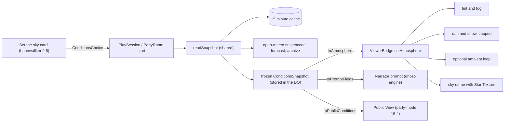

# Design Document

## Overview

The real world comes in as a small, frozen record and goes out as looks, sound and a few words. Everything that can be a pure function is one and lives in `shared/src/conditions/` so it can be property-tested without a network, a GPU or a clock: place rounding, time of day, weather mapping, the moon, Memory Day checks, the EXIF date reader, the star maths, the star texture, and the policy that reads and freezes a Snapshot. The only code that talks to an outside host is one small module, `api/src/conditions/open-meteo.ts`.

Decisions:
- **Read once, freeze, never refresh.** A game reads one Snapshot at its start and keeps it. Nothing re-reads weather mid-game, so every player sees the same sky and the cost is at most one weather call per game.
- **The game never waits for the weather and never fails because of it.** A 3 second timeout, a failure or `CONDITIONS_ENABLED=false` gives the Default (clear sky, host clock) with no error screen.
- **The real world never changes a rule.** No rules module (`shared/src/ghost/engine.ts`, the Party Mode reducers) imports `shared/src/conditions/`. Only three projections leave the module: `toAtmosphere` (Viewer), `toPromptFields` (Narrator) and `toPublicConditions` (Public View).
- **Open-Meteo is not paid, but it is an outside host.** It takes no SpendTicket, yet every call goes through the one module with a 3 second timeout, a cache and no user text in logs. It lives in `api/src/conditions/`, not in `guarded/`, and no other module may call an outside weather host.
- **Small on purpose.** Weather, time and moon only. News and crime at a place are left out (see "Left out on purpose").
- **Cheapest first.** The sky dome (tasks 6 and 4.4) is the first of the extras to build; ambient loops (4.3) are optional and last.

## Architecture



## Components and interfaces

### `shared/src/conditions/` (pure; clock and rng injected)
`types.ts` (types and zod schemas), `place.ts` (`normalizePlace`, `normalizeMatches`), `time.ts` (`localHour`, `timeOfDay`, `REP_HOUR`), `weather.ts` (`weatherClassFromCode`, `tempBand`, `windBand`), `look.ts` (`atmosphereLook`, `particleBudget`, `ambientLoopFor`, `ambientGain`), `moon.ts` (`moonPhase`, `moonAge`), `memory-day.ts` (`validateMemoryDay`, `instantFor`), `exif.ts` (`readCaptureDate`), `snapshot.ts` (`readSnapshot`, `defaultSnapshot`, `freezeSnapshot`, `cacheKey`, `isFresh`, `toAtmosphere`, `toPromptFields`, `toPublicConditions`), `star-list.ts` (`STAR_LIST`), `stars.ts` (`starsAbove`, `moonSky`), `sky-texture.ts` (`skyVisibility`, `rasterizeSky`), `real-world-terms.ts` (`mentionsRealWorld`), `star-lines.ts` (`pickStarLine`), `telemetry.ts` (counter whitelist).

```ts
type ConditionsChoice = { place?: PlaceInput; memoryDay?: MemoryDay; hostHour: number /* 0..23 integer */ };
type WeatherRequest =
  | { kind: 'forecast'; lat: number; lon: number }
  | { kind: 'archive'; lat: number; lon: number; date: string; hour: number };
type RawWeather = { code: number | null; tempC: number | null; windKmh: number | null; tz: string | null };
type ConditionsCache = { get(key: string): Promise<RawWeather | null>; put(key: string, v: RawWeather, ttlSeconds: number): Promise<void> };
type ReadDeps = {
  now: () => number;                                   // injected clock
  enabled: boolean;                                    // CONDITIONS_ENABLED
  fetchWeather: (r: WeatherRequest) => Promise<RawWeather>;
  cache: ConditionsCache;
  sleep: (ms: number) => Promise<void>;                // injected timer for the 3 second limit
};
readSnapshot(choice: ConditionsChoice, deps: ReadDeps): Promise<ConditionsSnapshot>;   // never rejects
```

`readSnapshot` steps: (1) if not enabled, or no Place, return the Default (no call); (2) validate the Memory Day, if any (bad value: ignore it and read live; the card already refused it); (3) build one `WeatherRequest` (forecast, or archive when a Memory Day is set); (4) look in the cache by `cacheKey`, else race `fetchWeather` against `sleep(3000)`; (5) map the answer with `weatherClassFromCode`, `tempBand`, `windBand`; (6) compute Time of Day, moon and, at dusk and night, the stars; (7) deep-freeze and return. Any rejection, timeout, null code or malformed answer at step 4 or 5 gives the Default weather (clear, mild, calm) while keeping everything computed without the service.

### `api/src/conditions/` (thin)
- `open-meteo.ts`: the only module that calls an outside weather host. `geocode(name)`, `forecast(lat, lon)`, `archive(lat, lon, date, hour)`. Each call: `AbortSignal.timeout(3000)`, parameters built from validated numbers and (for geocoding only) one trimmed, URL-encoded name of at most 60 characters, answers parsed with zod down to the fields we use, everything else dropped. Logs carry counters only.
- `cache.ts`: `ConditionsCache` over the Workers Cache API or KV (Spike conditions 1.1 chooses), TTL 15 minutes.
- `snapshot-store.ts`: used by `PlaySession` and `PartyRoom`: read once at start, store under one key, return the stored value on every later read, drop it with the session or room.
- Variables: `CONDITIONS_ENABLED` (default `true`) and `WEATHER_BASE_URL` (unset means the public Open-Meteo hosts; set means one base URL for all three paths, used by tests with a fake and by a self-hosted or paid endpoint).

### Routes
| Route | Purpose | Req |
|---|---|---|
| `POST /api/conditions/search` `{q}` | city search, at most five `{label, lat, lon, tz}` with lat and lon already rounded | 1.1, 1.3 |

A POST so the query text never sits in a URL or an access log. Origin and session-cookie checks apply; a rate limit by session and hashed address applies (assumption: one search a second and 30 an hour per session, to be tuned after Spike conditions 1.1 reports the real upstream limits). With `CONDITIONS_ENABLED=false` it returns `conditions_disabled`. There is no route that returns weather: the Snapshot is read inside `PlaySession` and `PartyRoom` at start and arrives in their views.

### Viewer (`web/src/viewer/atmosphere/`)
`setAtmosphere(a: Atmosphere | null)` on the ViewerBridge (world-viewer criterion 3.6, added by that spec; this spec exports the `Atmosphere` type from `shared/src/conditions/types.ts`). It is idempotent: the same Atmosphere does no work. It drives four small parts: the grade overlay uniforms (tint and haze), a capped precipitation layer, the optional ambient loop and the sky dome. `null` restores the normal look.

### Narrator (`shared/src/ghost/prompt.ts`, `validate.ts`, `scripted.ts`)
`buildNarrationPrompt` takes an optional `sky?: PromptFields = { weather: WeatherClass; timeBucket: TimeOfDay; moon: MoonPhase }` from `toPromptFields(snapshot)`. It adds one fixed sentence built from those three enum values, never from free text: "Outside it is {weather} and {timeBucket}; the moon is {moon}. You may mention one of these in a few words; never state any other fact about the real world." `validateGhostReply` calls `mentionsRealWorld` (a word-stem list for news, crime, death and real events, with fixtures) and replaces a matching reply by a scripted line. Scripted weather lines (per Weather Class and time bucket) and star lines are written to the same list and tested against it.

### Party Mode (`party-mode` Requirement 15.4)
At start the Master chooses a city search, the table's location, or off (which sends a `ConditionsChoice` with no Place). `PartyRoom` calls `readSnapshot` once, stores it, shows the Atmosphere on the Host, and adds only `toPublicConditions(snapshot)` (weather, time of day, moon) to the Public View. Coordinates, label and Memory Day stay in the room and are deleted with it. The hour strike (15.1 to 15.3) uses the host's clock, not the Snapshot. A rematch is a new game and reads again; within 15 minutes the cache answers it.

## Data models

```ts
type TimeOfDay = 'dawn' | 'day' | 'dusk' | 'night';
type WeatherClass = 'clear' | 'cloud' | 'fog' | 'rain' | 'storm' | 'snow';
type TempBand = 'freezing' | 'cold' | 'mild' | 'warm' | 'hot';
type WindBand = 'calm' | 'breezy' | 'windy';
type MoonPhase = 'new moon' | 'waxing crescent' | 'first quarter' | 'waxing gibbous'
               | 'full moon' | 'waning gibbous' | 'last quarter' | 'waning crescent';   // exactly eight
type Place = { lat: number; lon: number; tz: string | null; label: string };   // lat, lon rounded to 2 decimals; tz null when unknown
type PlaceInput = { lat: number; lon: number; tz?: string | null; label?: string };   // from the client, before rounding; `normalizePlace` makes a Place
type MemoryDay = { date: string /* YYYY-MM-DD */; timeOfDay: TimeOfDay };
type SkyStar = { id: number /* index into STAR_LIST */; az: number; alt: number; mag: number };
type MoonSky = { az: number; alt: number; lit: number /* 0..1 */ };
type ConditionsSnapshot = Readonly<{
  place?: Place; timeOfDay: TimeOfDay; weather: WeatherClass; tempBand: TempBand; windBand: WindBand;
  moon: MoonPhase; memoryDay?: MemoryDay; stars?: readonly SkyStar[]; moonSky?: MoonSky;
  source: 'live' | 'memory' | 'default';
}>;                                                     // deep-frozen
type Atmosphere = Pick<ConditionsSnapshot, 'timeOfDay' | 'weather' | 'tempBand' | 'windBand' | 'moon' | 'stars' | 'moonSky'>;
type PublicConditions = Pick<ConditionsSnapshot, 'timeOfDay' | 'weather' | 'moon'>;
type PromptFields = { weather: WeatherClass; timeBucket: TimeOfDay; moon: MoonPhase };   // undefined when source is 'default'
```

Rules in the data model:
- **Place.** `lat` and `lon` are finite, within [-90, 90] and [-180, 180], and equal `Math.round(x * 100) / 100`. `label` is the chosen match's name (control characters stripped, at most 80 characters) or the fixed word "Here" for the table's location. There is no address, accuracy, altitude, heading, speed or fix time. `tz` is an IANA name from the geocoding match, or from the forecast answer (`timezone=auto`) for a table location, or `null`.
- **Time of Day.** Local hour 5 to 7 is dawn, 8 to 17 is day, 18 to 20 is dusk, 21 to 4 is night. `localHour(nowMs, tz)` uses `Intl.DateTimeFormat` with the zone; with `tz` null or invalid the caller passes the host's hour. A Memory Day carries its own Time of Day; its middle hour for the sky is `REP_HOUR` (dawn 6, day 12, dusk 19, night 23).
- **Weather Class** from the WMO `weather_code`: 0 and 1 clear; 2 and 3 cloud; 45 and 48 fog; 51 to 67 and 80 to 82 rain; 71 to 77, 85 and 86 snow; 95, 96 and 99 storm; any other value, NaN or null clear. Total by construction. (The code table is from the public Open-Meteo documentation as remembered; Spike conditions 1.1 checks it against a recorded answer.)
- **Bands.** Temperature in degrees Celsius: below 0 freezing, below 10 cold, below 20 mild, below 28 warm, otherwise hot; null is mild. Wind in km/h: below 12 calm, below 29 breezy, otherwise windy; null is calm. Both are my starting thresholds, kept as constants.
- **Default.** `defaultSnapshot(now, hostHour)`: no Place, Time of Day from `hostHour`, clear, mild, calm, Moon Phase from the date, no stars, `source: 'default'`.
- **Moon Phase.** Julian date from the UTC instant; age = ((jd - 2451550.1) mod 29.530588853) in days; phase = floor(age / 29.530588853 * 8 + 0.5) mod 8, mapped to the eight names in order. Accurate to about a day, fine for naming a phase.
- **Memory Day.** `validateMemoryDay(date, timeOfDay, today)` accepts a real calendar date from 1940-01-01 to yesterday (host date minus one day) and rejects anything else. `instantFor(memoryDay, lon)` is the date at `REP_HOUR` in local solar time at the longitude (UTC hour = local hour minus lon / 15), so the sky matches the chosen Time of Day without a time zone database.
- **Atmosphere look.** `atmosphereLook(weather, timeOfDay)` returns `{ tint: [r, g, b], tintStrength, haze, brightness }` from a table: the class sets a base tint, strength and haze (clear none; cloud a light grey; fog a strong pale haze; rain a cool blue-grey; storm a dark slate; snow a pale cool white), the time of day blends a warm dawn, amber dusk or blue night tint and sets a brightness. `tintStrength` and `haze` lie in [0, 1]; `brightness` never goes below 0.6, so a night in a storm still leaves the world walkable. Clear at day is the identity, so a game with conditions off looks as it did before. A storm adds darker tint only: no flashes of its own; any brightening goes through the viewer's flicker limiter (world-viewer criterion 3.2), which is off under reduced motion.
- **Particles.** `particleBudget(weather, { quality, reducedMotion })` is 0 for clear, cloud and fog; for rain, storm and snow it is the smallest of the default cap 1200, the low-quality cap 400 (quality level 1 or lower) and the reduced-motion cap 120 (which also slows the fall to a quarter speed). These caps are my starting values.
- **Ambient loops.** Up to 12 files, `web/public/sounds/ambient/<weather>-<day|night>.m4a` (six classes by two; dawn and day use "day", dusk and night use "night"). `ambientGain(setting, ducked)` is never above 0.3 (30 percent). Played only after a user gesture, muted by the viewer's mute control, lowered while the chat is open. A file that is missing or fails to decode is skipped silently. Every file is credited in `docs/sounds/CREDITS.md`.

## The Open-Meteo calls

All three go through `open-meteo.ts`, each with a 3 second timeout. Parameters below are from the public documentation as remembered and are **unverified until Spike conditions 1.1**.

| Call | Endpoint (relative) | Asks for |
|---|---|---|
| Geocoding | `/v1/search?name=<q>&count=5&language=en&format=json` | name, admin area, country, latitude, longitude, timezone (the rest dropped) |
| Forecast | `/v1/forecast?latitude=&longitude=&current=weather_code,temperature_2m,wind_speed_10m&timezone=auto` | the current code, temperature (Celsius), wind (km/h) and the zone name |
| Archive | `/v1/archive?latitude=&longitude=&start_date=<d>&end_date=<d>&hourly=weather_code,temperature_2m,wind_speed_10m&timezone=auto` | the hourly values; we take the hour nearest `REP_HOUR` |

Default hosts when `WEATHER_BASE_URL` is unset: `api.open-meteo.com` (forecast), `archive-api.open-meteo.com` (archive), `geocoding-api.open-meteo.com` (geocoding). Unverified and to check in the spike: whether archive answers hourly weather codes back to 1940, how far behind "yesterday" the archive runs (a null answer for a recent date is treated as a failure and gives the Default weather while the date still drives the moon and stars), whether sunrise and sunset could replace the fixed hour table, and the shape of a paid plan's host and key.

## Fallback rules and caching

| Situation | Result |
|---|---|
| `CONDITIONS_ENABLED=false` | Default Snapshot, no outside call, search returns `conditions_disabled` |
| No Place set | Default Snapshot (host hour, clear), no outside call |
| Call fails, times out after 3 seconds, or answers null or malformed | Default weather (clear, mild, calm); time of day from the Place's zone when known, else the host's hour; moon and stars still computed |
| Memory Day with no Place | Default weather; moon and Time of Day from the Memory Day; no stars |
| Memory Day archive has no data | Default weather, same as a failure |
| Same rounded Place within 15 minutes | Answered from the cache, no outside call |

Cache key: `forecast:<lat>:<lon>` or `archive:<lat>:<lon>:<date>:<hour>` using the rounded values, no session id, TTL 15 minutes. At most one weather call per game; the city search is a separate geocoding call, before the game. Counters only: reads, cache hits, timeouts, errors, defaults, geocode calls, geocode errors.

## Privacy

- Only a position rounded to two decimals (about a kilometre) is ever kept, in the room or session, and it is deleted with it. Coordinates never reach a log, a prompt, the Public View or another player's screen.
- The server never derives a place from the request (`request.cf` latitude, longitude and city are not read; a test greps for them). The browser shares its position only after the explicit tap; the browser also rounds before sending, and the server rounds again and ignores every other field.
- The city query goes to Open-Meteo's geocoding endpoint from the Worker, not from the visitor's browser, so Open-Meteo sees our server and not the visitor. It is sent by POST to us, never logged, never cached by text, and never used in any other call.
- The label is shown only on the visitor's own card and never enters a prompt or the Public View.
- The photo's capture time is read in the browser from the bytes before the photo is re-encoded, and only the date and a Time of Day leave the reader; minutes, seconds, location and every other field are dropped, and the canvas re-encode removes the rest.
- No analytics. The Open-Meteo free tier asks for attribution and is for non-commercial use only; the credit line is added to the app credits, and a paid plan is needed if the game is ever sold (Spike conditions 1.1 records the terms and the paid host).

## Stars and the sky texture

- **List.** `STAR_LIST` holds at most 300 stars: right ascension and declination (J2000, degrees), apparent magnitude (about 3.5 or brighter) and a proper name where one exists. It is built once from a public-domain catalogue and committed; the file header records the source and licence. (Licence compatibility is unconfirmed: avoid share-alike catalogues. Checked in task 6.1.)
- **Maths (low precision, a look and not astronomy).** Days since J2000 from the instant; Greenwich sidereal time = 280.46061837 + 360.98564736629 * d degrees; local sidereal time adds the longitude; hour angle = local sidereal time minus right ascension; altitude and azimuth from the standard formulas. Precession, proper motion, refraction and parallax are ignored (an error of well under a degree for dates since 1940; the moon's parallax adds up to about a degree). The moon uses a mean longitude plus its main correction term and a latitude term, then the same conversion. Checked in task 6.2 against a few known sky positions (for example Polaris near an altitude equal to the latitude).
- **Instant.** Live game: the real UTC instant. Memory Day: `instantFor`, a local solar time at `REP_HOUR` (an hour or two off the legal clock; fine for a look).
- **When.** Only at dusk and night with a Place set. `starsAbove` keeps stars with altitude above 0; the Snapshot stores them as `stars`, with `moonSky`.
- **Texture.** `rasterizeSky(stars, moonSky, weather, timeOfDay, size)` returns RGBA bytes for an equirectangular image (azimuth across, altitude down) of at most 1024 by 512 pixels (512 by 256 at low quality). Each star is a small soft dot (radius 1 to 3 pixels by magnitude); the moon is a disc with its lit fraction shaded. It is a pure function, called once per Atmosphere in `setAtmosphere` and never in the frame loop, then wrapped in a `DataTexture` on a sky dome mesh drawn behind the world.
- **Dimming.** `skyVisibility(weather, timeOfDay)` is a time factor (night 1, dusk 0.5, dawn and day 0) times a weather factor (clear 1, cloud 0.35, fog, rain, storm and snow 0). Zero visibility draws nothing and the dome is not added. The factors are my starting values.
- **Honest limit.** The dome sits behind the splat, so it shows only where the world leaves sky; an indoor world shows little or none. Whether Marble worlds leave visible sky is unverified (checked with a real outdoor and a real indoor world under Spike conditions 1.1 and world-viewer Spike 2.1).
- **Naming a star.** `pickStarLine(stars, rng, alreadyNamed)` chooses, with the seeded rng, one named star above 20 degrees altitude and returns a fixed scripted line with its name, or nothing if the sky is hidden or a star was already named. The "named already" flag lives in the narration record beside the session, not in game state, so it cannot change a rule.

## Left out on purpose

News and crime at a place. A real place can be someone's home, and a ghost reciting a real crime would hurt the people connected to it. So a Snapshot may hold only weather, time and moon (criterion 2.2), the scripted lines and model replies may not mention news, crime, death or real events (criterion 5.2), and `ghost-safety.md` rejects any reply that does. Also not built: any location from the network address, tides, air quality, an anniversary line, Hue lights, and any "what happened on this day" text for a Memory Day. A Memory Day changes only the moon, the stars and the recorded weather.

## Unverified assumptions (each retired by Spike conditions 1.1 unless noted)

1. Open-Meteo answers from a Cloudflare Worker, with p95 well under 3 seconds, and the exact shapes, parameters and weather-code table above.
2. Archive coverage (1940 onward), hourly weather codes, and the newest date with data.
3. Free-tier limits and what happens to many Workers sharing egress addresses; the attribution wording; non-commercial use only; the paid plan's host and key. A global daily counter for outside calls is not specced; add one to SpendGuard as a free meter if the spike shows the limit is tight.
4. Whether the Workers Cache API works on our host or KV is needed for the 15 minute cache.
5. Whether sunrise and sunset are returned and could replace the fixed hour table.
6. Sensors: `navigator.geolocation` prompts and denial on a real iPhone, a real Android phone and a TV browser; and whether a photo picked on iOS Safari or Android Chrome still carries `DateTimeOriginal` (some pickers strip metadata or convert HEIC).
7. Model: whether Scout mentions the sky naturally without inventing real-world facts (one weather case per persona is added to ghost-engine Spike 4.1).
8. Viewer: whether Spark honours scene fog (otherwise the grade overlay's haze is used alone) and whether worlds leave visible sky for the dome (world-viewer Spike 2.1).

## Error handling

New stable codes in `shared/src/errors.ts`: `conditions_disabled` (search while off), `bad_place` (a Place Input that fails validation), `bad_memory_day` (date outside 1940 to yesterday or not a real date), `geocode_unavailable` (the search call failed or timed out; the card says so and offers the table's location or skipping). A weather failure is never an error to the player: it becomes the Default and a counter. `readSnapshot` never rejects, and a corrupt stored Snapshot is replaced by the Default. A photo with no usable timestamp gives no suggestion and no message.

## Testing strategy

- Property tests on every pure module (below), seeded, at least 100 runs, in `shared/src/conditions/`.
- Contract tests parse recorded Open-Meteo answers from `shared/fixtures/weather/` (recorded in the spike, scrubbed to test places).
- A fake `fetchWeather` returns good, slow (over 3000 ms on the fake clock), failing and malformed answers; a fake cache counts calls.
- API tests run `open-meteo.ts` against a fake server through `WEATHER_BASE_URL`; no test calls the real service.
- Source-level checks: no rules module imports `shared/src/conditions/`; nothing under `api/src/conditions/` reads `request.cf` or logs a query; no module outside `open-meteo.ts` names an Open-Meteo host.
- Red-team fixtures (at least 20 news, crime, death and real-event strings, including hostile place labels) run through `validateGhostReply`, `buildNarrationPrompt` and the scripted library.
- Known-value unit tests for the moon (a new moon near 2024-04-08, a full moon near 2024-04-23; to be confirmed against an almanac when written) and a few star positions.
- Viewer: jsdom or fake-renderer tests that `rasterizeSky` runs once per `setAtmosphere` and zero times over a thousand frames, and that a missing ambient file is silent.

## Correctness Properties

### Property 1: A Place keeps only a position rounded to two decimals
*For any* raw geocoding answer (any number of results, any extra fields) or browser position (any extra fields such as accuracy, altitude or timestamp, including NaN, infinities and out-of-range values), `normalizeMatches` returns at most five Places and `normalizePlace` returns either a rejection or a Place whose only properties are `lat`, `lon`, `tz` and `label`, with `lat` and `lon` equal to the input rounded to two decimals and inside their ranges, and no unrounded coordinate appears anywhere in its serialisation.
**Validates: Requirements 1.1, 1.3**

### Property 2: Every hour maps to exactly one time of day
*For any* instant and valid time zone, `timeOfDay(localHour(now, tz))` is exactly one of dawn, day, dusk or night, hours 5 to 7 give dawn, 8 to 17 day, 18 to 20 dusk and 21 to 4 night, and with no Place the result depends only on the host's hour and the weather is clear.
**Validates: Requirements 1.4**

### Property 3: Weather class and band mapping is total
*For any* integer, NaN or null weather code, temperature and wind speed, the mapping returns exactly one of the six Weather Classes, one Temperature Band and one Wind Band; and for every class and time of day the look values lie in range with `brightness` at least 0.6, and `particleBudget` is 0 for clear, cloud and fog and never exceeds 1200, 400 at low quality or 120 under reduced motion for rain, storm and snow.
**Validates: Requirements 2.3, 4.2, 4.3**

### Property 4: One frozen snapshot per game, one call, cached 15 minutes
*For any* sequence of game starts, Places and fake-clock times, each game makes at most one weather call, a repeat for the same rounded Place and request within 15 minutes makes none, a call 15 minutes or more later is allowed, and the Snapshot returned for a game is deeply frozen and is the same object on every later read.
**Validates: Requirements 2.1, 2.5**

### Property 5: A timeout or failure falls back to the default
*For any* failure of `fetchWeather` (rejection, an answer later than 3000 ms on the fake clock, a null code, a malformed answer), with `CONDITIONS_ENABLED` off, or with no Place, `readSnapshot` resolves with a valid Snapshot whose weather is clear with mild and calm bands, makes no outside call when disabled or when no Place is set, and never rejects.
**Validates: Requirements 2.4**

### Property 6: Memory Day stays in range and uses recorded weather
*For any* date string, Time of Day and host date, `validateMemoryDay` accepts exactly the real calendar dates from 1940-01-01 up to yesterday and rejects every other string, and an accepted Memory Day with a Place always produces an archive request for that date and never a forecast request, with the same fallback to the Default on failure.
**Validates: Requirements 3.1, 3.2**

### Property 7: The real world never changes a rule
*For any* Snapshot, any Memory Day and any setting of conditions on or off, driving the game with the same sequence of actions, positions and times gives identical game state, scores, clocks and outcomes, and no rules module imports the conditions module.
**Validates: Requirements 2.2, 4.1, 5.1**

### Property 8: Moon phase is one of eight and cycles in order
*For any* instant, `moonPhase` returns exactly one of the eight names, the same instant gives the same name, and stepping through one mean month of 29.530588853 days visits all eight phases in order and repeats.
**Validates: Requirements 2.6**

### Property 9: Photo timestamp reading keeps only the capture date
*For any* byte sequence, including JPEG-like data whose EXIF holds GPS, make, model, serial number, other dates (DateTime, DateTimeDigitized, GPS date stamp) and truncated or corrupt segments, `readCaptureDate` never throws and returns either nothing or an object with only a date and a Time of Day taken from `DateTimeOriginal`, and a date outside 1940 to yesterday gives nothing.
**Validates: Requirements 3.3**

### Property 10: Star texture bounds and dimming
*For any* Place, instant, weather and time of day, `starsAbove` returns at most 300 stars all with altitude above 0, `rasterizeSky` returns a buffer of width times height times 4 bytes with width at most 1024 and height at most 512, nothing is drawn at dawn or day, brightness under cloud never exceeds brightness under clear, and in fog, rain, storm and snow the texture is empty.
**Validates: Requirements 6.1, 6.2, 6.3**

### Property 11: Scripted lines and the narrator prompt carry no news, crime, death or real events
*For any* Snapshot (including hostile place labels, coordinates and dates), the narrator prompt contains only the three enum values for weather, time bucket and moon and none of the label, coordinates or date, and is identical to a prompt with no sky fields when the source is the Default; every scripted line, weather line and star line passes `mentionsRealWorld`; any model reply that fails it is replaced by a scripted line; and across any sequence of turns at most one star is named.
**Validates: Requirements 5.1, 5.2, 5.3**
