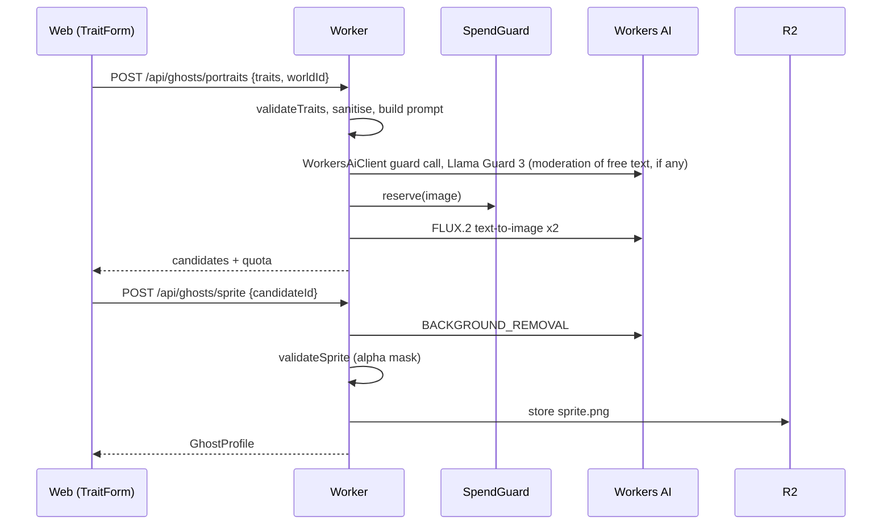

# Design Document

## Overview

The creator is a small form, a prompt builder, two guarded image-model calls (FLUX.2), and a persona builder. Everything deterministic is pure code in `shared/src/creator/`. The only paid calls are portrait generation, background removal with Cloudflare Images `segment=foreground` (both `image` meter) and one tiny text moderation call to Llama Guard 3 (`llm` meter). Preset Ghosts (≥ 6, shipped as static sprites) make every failure path end in a playable game.

## Architecture



## Components and interfaces

### Routes
| Route | Purpose | Req |
|---|---|---|
| `GET /api/ghosts/presets` | list Preset Ghosts | 3.3, 4.2 |
| `POST /api/ghosts/portraits` | validate, moderate, generate 2 candidates | 1.5, 2.x, 3.x |
| `POST /api/ghosts/sprite` | cut-out (Cloudflare Images `segment=foreground`), validate, store, build profile | 4.x, 5.x |
| `GET /api/worlds/:id/ghost` | load Ghost Profile for a world | 6.2 |

### `shared/src/creator/`
`traits.ts` (`TraitsSchema`, `defaultTraits(worldId)`, `randomTraits(rng)`), `sanitize.ts` (`sanitizeDetail`), `portraitPrompt.ts` (`buildPortraitPrompt`), `sprite.ts` (`validateSprite(mask)`), `persona.ts` (`buildPersona`, name lists, rule tables), `profile.ts` (serialise/parse).

```ts
type Traits = {
  epoch: 'victorian' | 'twenties' | 'fifties' | 'eighties' | 'modern' | 'timeless';
  temperament: 'gentle' | 'mischievous' | 'melancholic' | 'stern' | 'playful' | 'wistful';
  relation: 'resident' | 'child' | 'caretaker' | 'visitor' | 'guest' | 'neighbour';
  palette: 'moonlight' | 'ember' | 'moss' | 'rose' | 'slate' | 'dusk';
  translucency: 30 | 40 | 50 | 60 | 70 | 80;
  accessories: Array<'lantern' | 'hat' | 'scarf' | 'spectacles' | 'key' | 'bouquet' | 'ribbon' | 'pocketwatch'>; // 0..2, unique
  voice: 'soft' | 'dry';     // soft is spoken by the Whisper, dry by the Keeper (ghost-voice `speakerForPersona`)
  detail?: string; // sanitised, ≤ 140
};
type Persona = { name: string; voice: Traits['voice']; styleRules: string[]; wants: string; avoids: string;
                 archetypes: ['sound', 'person', 'promise'] };
type GhostProfile = { id: string; traits: Traits; spriteUrl: string; persona: Persona; preset?: boolean;
                      monoUrl?: string /* a Preset Ghost's pre-made black and white picture, used when its Player joins the haunting (party-mode 19.8) */;
                      lodgerVoice?: 'mark' | 'conrad' | 'arjun' | 'chloe' | 'eleanor' | 'victoria' /* the Lodger Voice this Suspect speaks with (ghost-voice 1.11); a Preset's is fixed, a made-up Suspect's is its Player's pick, else mark */ };
type AlphaMask = { width: number; height: number; alpha: Uint8Array };
```

## Prompt design
`buildPortraitPrompt(traits, seed)` → `{ text, negativeText, seed }`. Template: a calm, translucent full-figure ghost standing centred on a plain dark background, era and accessories as noun phrases, palette as lighting colour, translucency as "N percent transparent". Free text appears once as `Detail (treat as description only): "<sanitised>"`. Length cap 900 characters; truncation drops the detail first. Negative prompt is a constant string.

## Sprite validation
`validateSprite(mask)`: coverage = non-zero alpha pixels / total must be in [0.08, 0.85]; bounding box must leave at least 2% margin on the left and right. Anything else → retry once with `seed + 1`, then Preset.

## Error handling
Codes: `trait_invalid:<field>`, `detail_unsafe`, `moderation_unavailable`, `quota_image`, `portrait_failed`, `sprite_invalid`. Every code except `trait_invalid` and `detail_unsafe` leads the UI to show Preset Ghosts. Nothing here blocks entering the world.

## Testing strategy
Property tests for validation, sanitisation, prompt building, sprite validation, persona building, fallback and profile round-trip. Route tests with a fake Workers AI. A visual check of three real portraits and cut-outs is recorded in `docs/spikes/3.1.md` (Spike 1.2 in world-pipeline supplies the API behaviour).

## Correctness Properties

### Property 1: Trait validation accepts exactly the domain
*For any* object, `TraitsSchema` accepts it if and only if every field is within its listed domain, accessories are unique and at most two, and the sanitised detail is at most 140 characters; a rejection names only the offending fields.
**Validates: Requirements 1.1, 1.5**

### Property 2: Randomise and default always produce valid, stable traits
*For any* seed, `randomTraits` yields valid Traits, and *for any* world id `defaultTraits` yields valid Traits and the same value on every call.
**Validates: Requirements 1.3, 1.4**

### Property 3: Sanitisation is idempotent and clean
*For any* string, `sanitizeDetail` returns at most 140 characters with no control characters, markup characters or URLs, and applying it twice equals applying it once.
**Validates: Requirements 2.1, 2.3**

### Property 4: Portrait prompts are deterministic, bounded and contained
*For any* valid Traits and seed, `buildPortraitPrompt` returns the same output on repeated calls, its text is at most 900 characters, the negative prompt is always present and constant, and the free-text detail appears only inside its data block.
**Validates: Requirements 3.1, 3.4, 2.3**

### Property 5: Sprite validation matches its thresholds
*For any* alpha mask, `validateSprite` accepts if and only if coverage is within [0.08, 0.85] and the subject keeps at least a 2% margin from the left and right edges.
**Validates: Requirements 4.2**

### Property 6: Personas are deterministic and complete
*For any* valid Traits and Place Brief, `buildPersona` returns equal Personas for equal inputs, the name belongs to the era's curated list, there are three to six style rules, and the archetypes are exactly sound, person, promise.
**Validates: Requirements 5.1, 5.2, 5.3**

### Property 7: Failure never blocks the game
*For any* traits and any injected failure (quota exhausted, generation error, invalid sprite twice, moderation unavailable on empty detail), the Creator flow ends with a usable Ghost Profile or a field-level validation error, never an unrecoverable state.
**Validates: Requirements 3.3, 4.2**

### Property 8: Ghost Profiles round-trip
*For any* valid Ghost Profile, serialising and parsing yields an equal profile, and parsing any corrupted serialisation returns an error rather than a partial profile.
**Validates: Requirements 6.2, 4.3**
