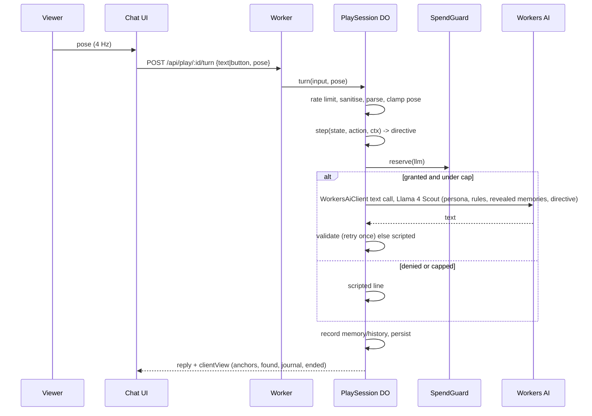

# Design Document

## Overview

**The engine decides, the model narrates.** All game state lives in a pure reducer, `step`, in `shared/src/ghost/`. A `PlaySession` Durable Object persists that state and runs one turn at a time. A `Narrator` turns the reducer's `Directive` into text, using a Workers AI text model when budget allows and persona-flavoured scripted lines otherwise. Because state never depends on narration, the game is testable without a model and completable without one.

Decisions:
- **Hidden seeds are generic.** A seed is an archetype (sound, person, promise) plus a short generic hook. The model grounds the memory in the Place Brief only at reveal time. Nothing secret exists that could be extracted early.
- **Anchors are placed on the client** (it has the collider BVH for floor snapping) with a seeded, pure algorithm, then **validated on the server**; invalid placements fall back to a ring layout.
- **Hints are geometric words**, produced by pure functions, never by the model.
- **Budget switch is per turn.** Each turn asks `SpendGuard` for an `llm` unit; denial or a per-session cap means Scripted Mode for that turn.

## Architecture



## Components and interfaces

### Routes
| Route | Purpose | Req |
|---|---|---|
| `POST /api/play/start` `{worldId, anchors?}` | create Session; validate or replace anchors | 1.1–1.5 |
| `POST /api/play/:id/turn` `{button?|text?, pose}` | one turn → `{reply, view}` | 2.x–6.x |
| `GET /api/play/:id` | restore view after reload | 1.4, 8.1 |
| `POST /api/play/:id/reset` | "Haunt again" | 8.3 |

### `shared/src/ghost/`
`parse.ts` (`parseAction`), `rate.ts` (`acceptTurn`), `anchors.ts` (`placeAnchors`, `validateAnchors`, `ringAnchors`), `engine.ts` (`step`), `pose.ts` (`sanitizePose`), `hints.ts` (`relativeBearing`, `distanceBand`, `autoHintDue`), `prompt.ts` (`buildNarrationPrompt` with an optional `sky?: PromptFields` (weather class, time bucket and moon name) from the `conditions` spec, `clientView` carrying `atmosphere`), `validate.ts` (`validateGhostReply`, banned phrases), `scripted.ts` (`pickLine`), `budget.ts` (`narrationMode`), `session.ts` (serialise/parse, expiry), `telemetry.ts` (`event` whitelist).

```ts
type Vec3 = [number, number, number];
type AnchorId = 'a1' | 'a2' | 'a3';
type Archetype = 'sound' | 'person' | 'promise';
type Anchor = { id: AnchorId; pos: Vec3; radius: number };           // radius default 2.5 m
type Seed = { anchorId: AnchorId; archetype: Archetype; hook: string };  // never sent to client
type Memory = { anchorId: AnchorId; archetype: Archetype; text: string };
type Action = { kind: 'look' | 'listen' | 'touch' | 'ask' | 'say' | 'hint'; text?: string };
type Directive =
  | { kind: 'reveal'; anchorId: AnchorId }
  | { kind: 'echo'; anchorId: AnchorId }
  | { kind: 'tease'; band: 'far' | 'nearer' | 'very close' }
  | { kind: 'hint'; bearing: Bearing; band: 'far' | 'nearer' | 'very close' }
  | { kind: 'ambient' } | { kind: 'ending' } | { kind: 'refuse' };
type Progress = { turn: number; found: AnchorId[]; ended: boolean; idleTurns: number };
type GameState = Progress & { memories: Memory[]; history: { role: 'visitor' | 'ghost'; text: string }[]; llmTurns: number;
                              lastTurnAt: number; lastProgressAt: number; seedState: number };
```

### Anchor placement
`placeAnchors(sampler, spawn, bounds, walkRadius, seed)`: seeded rejection sampling in polar coordinates around the spawn, `sampler(x, z) → y | null` snaps to the floor (BVH raycast on the client; constant floor in disc mode). Accept a candidate if inside the walk radius and bounds, ≥ 3 m from spawn and ≥ 4 m from accepted anchors; up to 200 attempts per anchor, otherwise `ringAnchors`. `ringAnchors` puts three anchors 120° apart on a ring of radius clamp(0.6 × walkRadius, 3, 8). Precondition: walk radius ≥ 5 m (manifest ingest sets a minimum; smaller worlds use authored anchors). `validateAnchors` re-checks bounds, spawn distance and spacing on the server.

### Hints
`relativeBearing(player, yaw, target)`: forward = (−sin yaw, 0, −cos yaw); signed angle to the target in the XZ plane, eight 45° sectors centred on ahead, ahead-right, right, behind-right, behind, behind-left, left, ahead-left. `distanceBand(d)`: ≤ 6 m "very close", ≤ 15 m "nearer", else "far". `autoHintDue(state, now)`: `idleTurns ≥ 8` or `now − lastProgressAt ≥ 90 s`.

### Narration
`buildNarrationPrompt(persona, brief, revealed, directive, visitorText, history, sky?)` returns system and messages; `sky` is the `conditions` spec's `PromptFields` (weather class, time bucket, moon name) and is absent for a default snapshot, so a game with conditions off prompts exactly as before. `engine.ts` never imports `shared/src/conditions/`: the real world changes words, never a state. The system text = persona + fixed rules from `steering/ghost-safety.md` + revealed memories + directive. Visitor text goes in `<player>…</player>`. Params: temperature 0.8, max tokens 220, timeout 6 s, one retry. `validateGhostReply` rejects empty, > 600 chars, URLs, markup/control characters, banned phrases. `pickLine(kind, persona, rng)` picks from ≥ 5 variants per kind and voice.

### Budget
`narrationMode({ llmTurns, sessionCap, ticketGranted, kill }) → 'model' | 'scripted'`. A model call happens only when mode is `model`.

## Error handling
Codes: `rate_limited`, `session_expired`, `bad_anchors` (handled by ring fallback), `narration_failed` (handled by scripted line). Turns never fail because narration failed; they return a scripted line. Expired sessions return `session_expired` and the client offers "Haunt again".

## Testing strategy
- Property tests on every pure module; a model-based test drives `step` with random action/position sequences against a simple oracle.
- Red-team fixtures (≥ 20 jailbreak and markup strings) run through `parseAction`, `buildNarrationPrompt` and `validateGhostReply` as unit tests.
- Narrator tests use a fake Workers AI that returns good, bad, slow and failing outputs.
- One manual live-model session per persona type, recorded in `docs/spikes/4.1.md`.

## Correctness Properties

### Property 1: Anchor placement and validation
*For any* generated room, seed and spawn satisfying the preconditions, `placeAnchors` returns three anchors that pass `validateAnchors` (inside bounds and walk radius, ≥ 3 m from spawn, ≥ 4 m apart, on the sampled floor), identical for identical inputs; and `validateAnchors` rejects any set violating one of those rules.
**Validates: Requirements 1.2, 1.5**

### Property 2: Action parsing is total and deterministic
*For any* string, `parseAction` returns exactly one Action kind, the same kind for the same string, with text truncated to 200 characters and stripped of control characters; button inputs map to their own kind.
**Validates: Requirements 2.1, 2.3**

### Property 3: Turn rate limiting
*For any* non-decreasing sequence of timestamps, the turns accepted by `acceptTurn` are at least 1.5 seconds apart and a turn arriving 1.5 seconds or more after the last accepted one is accepted.
**Validates: Requirements 2.2**

### Property 4: Reveal rule and monotone progress
*For any* state, anchors, position and Action, a memory is revealed on this turn if and only if the position is within an unfound anchor's radius and the Action is engaging; `found` never loses an element; a turn away from all unfound anchors changes neither `found` nor `memories`; engaging a found anchor yields `echo` and no change.
**Validates: Requirements 3.1, 3.2, 3.3**

### Property 5: Ending is reached exactly at three and is absorbing
*For any* reachable state, `ended` is true if and only if three memories are found, and once ended every later turn yields only `ambient` or `ending` and leaves `found` unchanged.
**Validates: Requirements 3.4**

### Property 6: Pose sanitising
*For any* reported pose including NaN, infinities and far-out values, `sanitizePose` returns a finite position inside the bounds, or the previous valid position when the input is non-finite.
**Validates: Requirements 3.5**

### Property 7: Hints are geometric words only
*For any* player position, yaw and target, `relativeBearing` returns one of eight labels, rotating the yaw by 45° shifts the label one step around the circle, the distance band is non-decreasing in distance, and the narrated hint text contains no digits and no memory content.
**Validates: Requirements 4.1, 4.3**

### Property 8: Automatic hints trigger on idleness
*For any* state, `autoHintDue` is true if and only if there have been at least eight consecutive turns without progress or at least 90 seconds since the last progress.
**Validates: Requirements 4.2**

### Property 9: No leakage of unrevealed memories
*For any* reachable state where seeds contain unique random tokens, neither `buildNarrationPrompt` nor `clientView` contains the token of any seed whose memory has not been revealed, and the client view never contains seeds at all.
**Validates: Requirements 1.1, 5.2**

### Property 10: Replies are always safe and non-empty
*For any* model output string (including empty, very long, URL, markup and banned phrases), the final reply after validation, retry and scripted fallback is non-empty, at most 600 characters, and free of URLs, markup, control characters and banned phrases; and every Directive kind has at least five scripted variants.
**Validates: Requirements 5.3, 5.4**

### Property 11: State transitions are independent of narration
*For any* sequence of Actions and positions, the resulting sequence of `Progress` values is identical whether narration succeeds, fails, times out, or runs in Scripted Mode, and `narrationMode` returns `scripted` whenever the cap is reached, the ticket is denied, or the kill switch is on.
**Validates: Requirements 6.1, 6.2, 6.3**

### Property 12: The game is always completable
*For any* anchor layout and any reachable state, walking to each unfound anchor and performing one engaging Action there ends the game within at most three such steps, in both model and Scripted Mode.
**Validates: Requirements 7.1**

### Property 13: Sessions round-trip and expire
*For any* Session state, serialising then parsing yields an equal state (found memories and the last eight turns preserved), corrupted input is rejected, and a Session older than 24 hours is reported expired.
**Validates: Requirements 1.4, 8.1, 8.2**

### Property 14: Telemetry carries no content
*For any* play-through with random visitor strings, every emitted telemetry event uses only whitelisted counter names and error codes and contains none of the visitor's input, prompt or reply text.
**Validates: Requirements 9.1**

## Shared look (design system, 2026-11-15)

The screens of this spec are built from `design/elements.css`, with the values of `design/tokens.json`; every element is shown, with its markup, on `design/catalogue.html` (run `pnpm voice-demo` and open `/design/`). The play-through in `tools/voice-demo` is the reference screen. Rules: `.kiro/steering/design-system.md`.

| Part of this spec | Elements |
|---|---|
| Chat panel | `ui-sheet ui-sheet-head ui-sheet-title ui-log ui-log-row ui-log-who ui-field` |
| Quick buttons | `ui-choices ui-button--quiet` |
| The ghost's reply | `ui-dialogue ui-speech ui-nameplate ui-portrait` |
| Journal | `ui-panel ui-log` |

A screen's own style says only where things go. A piece that is missing is added to the elements and the catalogue first. The chat is not built yet, so it is built from the elements the first time.
