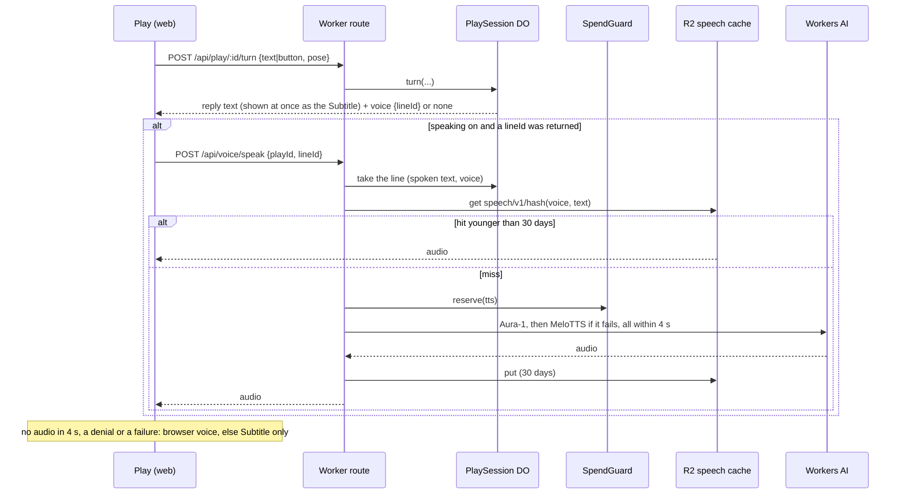
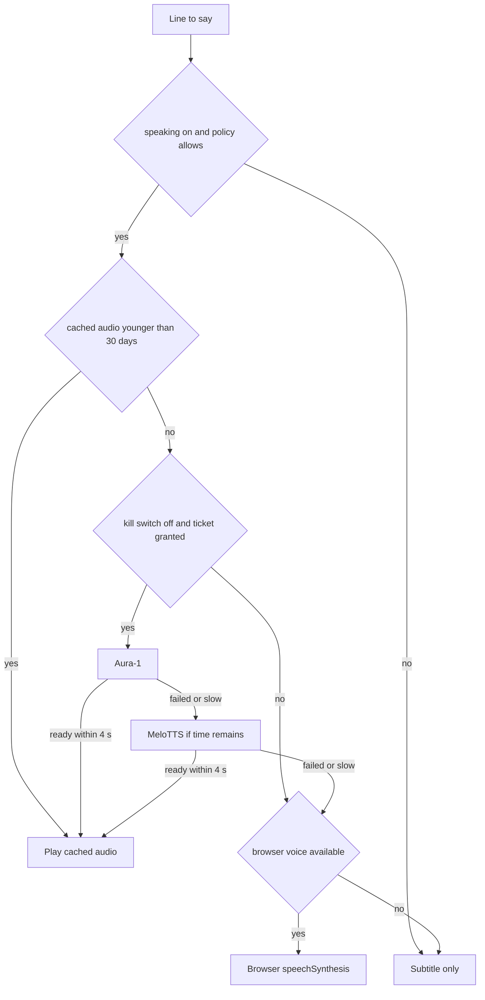
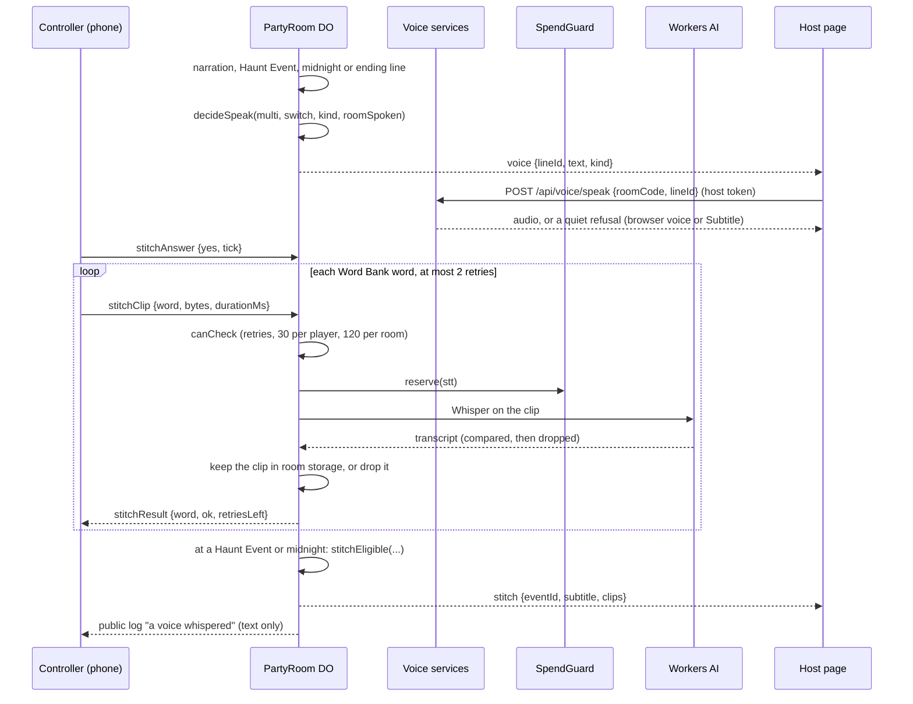
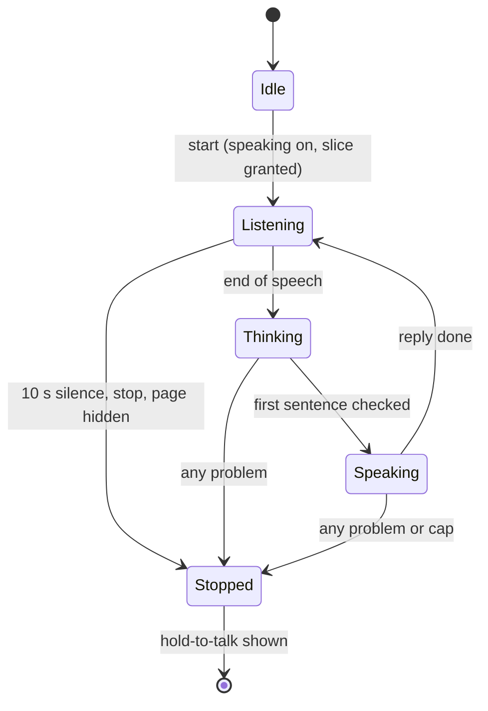

# Design Document

## Overview

**The engine decides, the model narrates, the voice only reads aloud what the engine already approved.** The ghost engine produces every line and validates it with `validateGhostReply`. This spec adds a layer that turns an approved line into audio, turns a held-button recording into the same text a visitor could have typed, and, in Party Mode, plays a rare whisper cut from a player's own recorded words. Nothing here changes a game state, a rule or a Directive, so the game is testable without audio and finishable without it.

Decisions:
- **Text first, always.** The Subtitle is shown when the line arrives, not when the audio does. Speech is an extra that can fail at any step; the last step of the Fallback Chain is the Subtitle alone, and no voice failure ever reaches an error screen.
- **Reuse, do not fork.** `validateGhostReply`, `parseAction`, `acceptTurn`, the telemetry whitelist, `SpendGuard`, `SpendTicket` and the one `WorkersAiClient` are the ghost engine's and the world pipeline's. This spec adds two guarded wrappers (`speak`, `transcribe`) to that client and one rule for what text may be spoken.
- **The server speaks only text it produced.** The browser sends a `lineId`, never text. The server looks the line up in the `PlaySession` or `PartyRoom` that produced and validated it. So the speech route cannot be used as a free text-to-speech service or to say unmoderated words.
- **A transcript is typed text.** The listen route returns text and nothing else. The Web app submits that text through the same turn route a typed line uses, so there is no second path to keep safe.
- **Audio is transient unless it is a Stitch Clip.** A listening recording is held in memory for one call and dropped. Live audio is never stored. Stitch Clips live only in the `PartyRoom`'s own storage and nowhere else.
- **Stitch is deliberately small.** Twelve fixed words, a few fixed Templates, a yes from each player for themselves, rare, kept only in the room, and a stitched line can contain nothing but those words.
- **Live mode is a stretch.** It is a small state machine around the same speaking and listening services, plus a transport that Spike 1.3 must choose. It is first in the cut order, Stitch is second, and either can be cut with nothing else changing.
- **This spec supersedes the TTS lines of `tech.md`.** `@cf/inworld/tts-2`, `GHOST_TTS_VOICE`, `HOST_TTS_VOICE` and `TTS_*` (and `PARTY_TTS_ROOM_CAP`) are replaced by Aura-1 with MeloTTS as the fallback and the `VOICE_*` variables below. The browser's `speechSynthesis` stays as a free fallback.

## Architecture

Speaking in Single player. The turn response carries the text at once; audio is a second, separate request.



The Fallback Chain. The Subtitle is shown on every branch.



Speaking and Stitch in Multiplayer. Phones never play ghost speech; they get the same text in the public log as before.



Live mode (stretch).



## Components and interfaces

### Routes
| Route | Purpose | Req |
|---|---|---|
| `POST /api/voice/speak` `{playId \| roomCode, lineId}` | audio for a line the server holds; a refusal is `503 voice_unavailable` and the client falls back quietly | 1.1 to 1.5, 4.1, 4.2 |
| `POST /api/voice/listen` (audio body, content type from an allow-list) | `{transcript}`; the audio is dropped before the response | 3.1 to 3.3, 4.1, 4.2 |
| `POST /api/voice/live/slice` | reserve the next 10-second slice on the `live` Meter (stretch) | 6.2 |
| `GET /api/quota` (existing) | gains `tts`, `stt` and `live` remaining and the flags `voice`, `stitch`, `live`, so the UI can hide a control instead of failing | 4.2, 4.3 |

Stitch has no HTTP route. Its messages travel on the seat's own WebSocket to the `PartyRoom`, so a Clip never reaches a route handler, R2, KV or a log. The names below are proposed here and written into party-mode Requirement 18 by its owner: Controller to Room `stitchAnswer {yes, tick}` and `stitchClip {word, bytes, durationMs}`; Room to Controller `stitchResult {word, ok, retriesLeft}`; Room to Host `voice {lineId, text, kind}` and `stitch {eventId, subtitle, clips}`; Master to Room `settings {stitch}` and the existing `speech {action}`. Every route checks the origin and the session cookie (or the host or seat token) like every state-changing route, and logs counters only.

### `shared/src/voice/`
`limits.ts` (every number in this spec as a named constant; the 200-character cap and 1.5-second turn gap are imported from `shared/src/ghost/`), `config.ts` (`parseVoiceConfig(env)`: zod, defaults, caps may be lowered but the room line cap never above 20), `voices.ts` (the allow-list and `voiceFor`), `speakable.ts` (`splitSentences`, `toVoiceLine`), `fallback.ts` (`resolveSpeech`), `cache.ts` (`canonicalSpeechKey`, `speechCacheKey`, `cacheFresh`), `policy.ts` (`decideSpeak`, `canSwitchSpeaking`), `listen.ts` (`listeningAllowed`, `clipVerdict`, `withTransientClip`), `transcript.ts` (`prepareTurnInput`), `gate.ts` (`withTicket`), `telemetry.ts` (the counter whitelist), and the generators `*.arb.ts`. Stitch and live logic sit in `stitch/` and `live.ts` so that cutting them removes whole files.

```ts
type VoiceId = `aura-1:${string}` | 'melotts:en';
type PersonaVoice = 'soft' | 'dry' | 'formal' | 'childlike';       // from ghost-creator Persona
type LineKind = 'narration' | 'haunt_event' | 'midnight' | 'ending';
type VoiceLine = { id: string; kind: LineKind; text: string; spoken: string; voice: VoiceId; createdAt: number };
  // text: the whole validated line (the Subtitle). spoken: leading whole sentences, at most 240 characters; '' means subtitle only.

voiceFor(persona: PersonaVoice): VoiceId;                          // always from the allow-list, always English
splitSentences(text: string): string[];
toVoiceLine(i: { id: string; text: string; kind: LineKind; voice: VoiceId; now: number }): VoiceLine | null;
  // null when validateGhostReply rejects the text. Calls the engine's validator as the Narrator does; no second banned-phrase list.
```

**Speaking policy** (a pure function; the web calls it for Single player, `PartyRoom` calls it for Multiplayer):

```ts
type Mode = 'single' | 'multi';
type SpeakInput = { mode: Mode; switch: boolean | null; kind: LineKind; roomSpoken: number };   // switch null = never touched
type SpeakDecision = { speak: true } | { speak: false; reason: 'off' | 'room_cap' | 'late_line' };
decideSpeak(i: SpeakInput): SpeakDecision;
canSwitchSpeaking(mode: Mode, actor: 'visitor' | 'master' | 'player'): boolean;   // single: visitor; multi: master
```
`on = switch ?? (mode === 'single')`. Off gives `off`. Single player has no room limit. In Multiplayer, `roomSpoken >= 20` gives `room_cap`, and `roomSpoken >= 15` with a kind outside `haunt_event`, `midnight`, `ending` gives `late_line`. `roomSpoken` counts lines the Room sent to the Host with `speak: true` and a non-empty `spoken`, so the 15th ordinary line leaves five spoken lines for the three Haunt Events (levels 3, 6 and 9), the midnight line and the ending. A stitched line is a played Clip set, costs no speech call and does not count toward the 20.

**Fallback Chain** (pure; the server runs the first three steps, the Web app the last two):

```ts
type Step = 'cache' | 'aura' | 'melo' | 'browser' | 'subtitle';
type Outcome = 'ok' | 'miss' | 'error' | 'slow' | 'denied';
type SpeechResult = { via: Step; subtitle: true; elapsedMs: number; paidCalls: number };   // no error member exists
resolveSpeech(ctx: { kill: boolean; ticket: boolean; browserVoice: boolean },
              attempt: (s: 'cache' | 'aura' | 'melo' | 'browser') => { outcome: Outcome; ms: number }): SpeechResult;
```
Order is cache, Aura-1, MeloTTS, browser, subtitle. The paid steps are skipped when `kill` is on or no ticket was granted; one ticket covers the Aura-1 attempt and, if it fails, the MeloTTS attempt, because the unit is one spoken line. Audio counts only if the whole clip is ready within 4000 ms of the request; a step that would start after 4000 ms is skipped. Aura-1 returns whole audio (streaming is unverified), so "ready" means fully arrived and playback never stalls. If Spike 1.1 shows that streaming works, "ready" could mean first audio, and Requirement 1.3 would change only with the owner's approval.

**Speech cache.** `canonicalSpeechKey(voice, text)` is `JSON.stringify([voice, normalise(text)])`, where `normalise` is NFC plus collapsed and trimmed whitespace, so it is injective. `speechCacheKey` is `speech/v1/` plus the SHA-256 hex of that string, with the digest function injected so `shared/` stays pure (Node's and Workers' `crypto.subtle` are passed in). The R2 object body is the audio; custom metadata holds `storedAt` and `voice` and never the text. `cacheFresh(storedAt, now)` is `now - storedAt < 30 days`. An R2 lifecycle rule deletes objects at 30 days, and the read path also checks `cacheFresh`, so a lifecycle delay never serves old audio. Lookup order is the line's own voice key, then the MeloTTS key. The cache is shared across sessions, but a hit is only ever returned for a line the server itself just validated, never fetched by key from the client.

**Listening.**
```ts
listeningAllowed(mode: Mode): boolean;                                   // single only
clipVerdict(i: { durationMs: number; bytes: number }): { ok: true } | { ok: false; code: 'clip_too_long' };
withTransientClip<T>(bytes: Uint8Array, use: (b: Uint8Array) => Promise<T>): Promise<T>;
  // runs use(), then in finally fills the buffer with zeros and drops the reference, once, on success, throw or timeout
```
The browser caps the recording at 8000 ms. The server cannot trust that, so it also refuses a body over a byte ceiling chosen from Spike 1.1 so that 8 seconds of any supported browser codec always fits and about 16 seconds never does. The ceiling is a proxy for length, not a measurement.

**Transcript path.** `prepareTurnInput(raw, source)` returns exactly what the typed path returns for the same string (200-character truncation, control stripping, `parseAction`, the `acceptTurn` decision); `source` is accepted for the UI and ignored by every rule. The listen route returns `{transcript}` and the Web app submits it with the same `POST /api/play/:id/turn {text}` call as a typed line. A contract test asserts that the turn route has no branch on a voice flag.

**Budget gate.**
```ts
withTicket<T>(ports: { reserve(meter): Promise<Ticket | null>; commit(t): Promise<void>; release(t): Promise<void>; kill(): boolean },
              meter: 'tts' | 'stt' | 'live', call: (t: Ticket) => Promise<T>)
  : Promise<{ ok: true; value: T } | { ok: false; reason: 'killed' | 'denied' | 'failed' }>;
```
The ports are injected, so the gate has no I/O of its own and is property-tested with a fake `SpendGuard`. No call without a granted ticket, one call per ticket, commit on success, release on failure. The guarded wrappers in `api/src/guarded/workersai/` type their ticket by meter: `speak(ticket: Ticket<'tts' | 'live'>, ...)` and `transcribe(ticket: Ticket<'stt' | 'live'>, ...)`.

### `shared/src/voice/stitch/`
`wordbank.ts` (`WORD_BANK`, `validateWordBank`), `templates.ts` (`TEMPLATES`, `validateTemplates`, `eligibleTemplates`), `compose.ts` (`composeStitch`), `check.ts` (`heardWord`, `canCheck`, `recordCheck`), `consent.ts` (`STITCH_QUESTION`, `consentReduce`, `consentEffective`), `play.ts` (`stitchEligible`, `stitchPublicEvent`, `stitchReveal`), `purge.ts` (`purgeClips`, `nextPurgeAt`).

**Word Bank and Templates.** The default Word Bank is the twelve words listen, behind, you, here, wait, closer, cold, tonight, again, candle, stairs, sleep. `validateWordBank` refuses more than 12 words, duplicates, and any word that is not lowercase letters. A Template is a fixed ordered list of two to four Word Bank words, and its subtitle is those words joined by spaces. Starter Templates, whose wording the owner reviews because it is a safety surface: `listen behind you`, `wait here`, `here again tonight`, `cold tonight`, `sleep here`, `wait closer`, `stairs behind you`, `listen again`, `candle cold`, `you closer`. `validateTemplates` fails the build if a Template uses a word outside the bank, if any bank word is in no Template, or if a Template's subtitle is rejected by `validateGhostReply`. A line has no free slot: nothing a player or a model writes can enter a Template.

```ts
type StitchTemplate = { id: string; words: readonly string[]; subtitle: string };
composeStitch(seat: number, tpl: StitchTemplate, clips: StitchClip[]): { clips: StitchClip[]; subtitle: string } | null;
  // exactly the seat's accepted clip for each template word, in order; null if any is missing
```

**Word Check.** `heardWord(transcript, asked)` lowercases the transcript and removes everything except letters and apostrophes inside words; it is true only when what remains is exactly the asked word. A transcript with two words, or none, or the wrong one, rejects the Clip. The check proves that Whisper heard the word; it cannot prove that nothing else was in the 2 seconds (a cough, music or a very quiet second word), which is why the Clip is also capped at 2 seconds and why the whole feature stays optional and room-only. `canCheck(state, seat, word)` is false when the seat has used 30 checks, the room has used 120, the pair has had three attempts (the first and two retries), the word was already accepted, or the seat has no effective consent. `recordCheck` runs only after the `stt` ticket is granted, so a denied ticket uses no check. With twelve words and three attempts a seat could want 36 checks, so the 30 cap can end a player's recording early, and with six players the room cap of 120 (20 each on average) binds first; both are the owner's numbers and both leave the game untouched, because a player with fewer words just has fewer Templates.

**Consent.**
```ts
type StitchConsent = { seat: number; yes: boolean; ageOrGuardianTick: boolean };   // nothing else: no age, no name, no date
type ConsentEvent =
  | { t: 'master_switch'; actorIsMaster: boolean; on: boolean }
  | { t: 'answer'; actorSeat: number; seat: number; isBot: boolean; yes: boolean; tick: boolean }
  | { t: 'leave'; seat: number };
consentReduce(state, e): { state: ConsentState; deleteClipsFor: number[] | 'all' };
consentEffective(c: StitchConsent): boolean;   // yes && ageOrGuardianTick
```
The state starts `{ enabled: false, consents: [] }`. Only the Master's token can switch Stitch on or off; turning it off clears every consent and deletes every Clip. An answer counts only when Stitch is on, `actorSeat === seat` and the seat is not a Bot, so the Master's token cannot answer for another seat. Consent is effective only when both the answer and the tick are yes; the Yes button on the phone stays disabled until the tick is on. A player who changes yes to no, or leaves, has that seat's Clips deleted at once. `STITCH_QUESTION` is a constant: it says in plain words that the Clips are deleted when the game ends, that the line is played aloud on the shared screen and revealed at the end, that a parent or guardian should say yes for a child, and carries the tick label "I am 16 or older, or a parent or guardian is saying yes for me". A unit test pins all of those phrases.

**Rarity.**
```ts
stitchEligible(c: { kind: 'haunt_event' | 'midnight' | 'other'; gameElapsedMs: number; accusationActive: boolean;
                    roundStitches: number; gameStitches: number; lastSeat: number | null;
                    seats: { seat: number; consent: StitchConsent | null; clips: StitchClip[] }[]; enabled: boolean },
                  rng: () => number): { ok: true; seat: number; template: StitchTemplate } | { ok: false; reason: string };
```
Eligible only for a Haunt Event or midnight, at least 60 seconds after the game began, outside an Accusation, with `roundStitches < 1` and `gameStitches < 2`, from a seat with effective consent and clips for every word of at least one Template, and not `lastSeat`. The seeded `rng` picks the seat and then the Template. `stitchPublicEvent` is `{ kind: 'stitch', text: 'a voice whispered' }` and carries no seat, nickname or template. `stitchReveal(played)` is built only for the ending payload. Playing a stitch updates only the Stitch counters; it does not touch the Haunt, the clock, Resolve, a Hand or the Solution. The room adds the stitched line's Subtitle to the Host's polite live region, and the phones see only the log text.

**Storage and deletion.** Accepted Clips are stored in the `PartyRoom`'s own storage under `clip:<seat>:<word>` with `recordedAt`; a rejected Clip is dropped right after its Word Check by `withTransientClip`. `purgeClips(clips, ctx, now)` keeps a Clip only while the game is not over, its seat is present with effective consent, Stitch is on, and `now - recordedAt` is under 6 hours. `nextPurgeAt(clips)` is the earliest `recordedAt + 6 h`, used to set the Durable Object alarm. Leaving, withdrawing, the Master turning Stitch off, game end and the room's own deletion all call the same purge. Clips are never copied to R2, KV, a log, a model prompt or any route.

### `shared/src/voice/live.ts` (stretch)
```ts
type LiveStop = 'silence' | 'stop' | 'hidden' | 'session_cap' | 'day_cap' | 'denied' | 'kill' | 'transport' | 'mic' | 'unsupported';
type LiveState = { phase: 'idle' | 'listening' | 'thinking' | 'speaking' | 'stopped'; stop?: LiveStop; since: number; lastVoiceAt: number | null; usedMs: number; sliceEndsAt: number };
liveReduce(state: LiveState, e: LiveEvent, now: number): { state: LiveState; effects: LiveEffect[] };
```
Events: `start`, `voice` (the visitor is speaking), `tick`, `utterance_end`, `reply_sentence`, `reply_done`, `stop`, `hidden`, `slice_granted`, `slice_denied`, `transport_error`, `mic_error`. Effects: `open_mic`, `close_mic`, `reserve_slice`, `speak_sentence`, `show_hold_to_talk`. There is no effect that stores audio. The microphone indicator is on exactly while the phase is `listening`. Silence is `now - max(since, lastVoiceAt)` while listening, and listening ends at 10 seconds of it, on `stop`, or on `hidden`. Live time is bought in 10-second slices, each with its own `live` SpendTicket just before it starts, so a denial ends the mode at a slice boundary: the session cap of 5 minutes is 30 slices and the day cap of 30 minutes is 180 slices. Inside Live Mode the slice ticket pays for the transcription, the narration and the speech of that slice, so the `tts` and `stt` session caps do not end a conversation after 20 utterances. Live Mode needs speaking to be on; with it off the Live control is disabled with a line that says why.

Replies are checked per sentence. The narrator may stream tokens in Live Mode to start speaking sooner, so each completed sentence goes through `toVoiceLine` (the engine's `validateGhostReply`, at most 240 characters) before it is spoken. A sentence that fails is not spoken, the rest of the reply is replaced by one scripted line in the persona's voice, and Live Mode continues. The assembled reply is then validated again as a whole and becomes the Subtitle exactly as in text mode. The transport (WebRTC, a WebSocket, or Cloudflare Realtime) and the end-of-speech detection are unverified and chosen by Spike 1.3; the reducer is transport-independent.

### `api/src/voice/` and the guarded wrappers
- `api/src/guarded/workersai/speak.ts`: Aura-1 through `env.AI.run(VOICE_TTS_MODEL_ID, ...)`, then MeloTTS (`VOICE_TTS_FALLBACK_MODEL_ID`) with the same ticket if it fails, under a deadline that aborts the upstream call at 4 seconds from the request.
- `api/src/guarded/workersai/transcribe.ts`: Whisper (`VOICE_STT_MODEL_ID`) with `language: 'en'`, the clip passed straight in and never written anywhere.
- `api/src/voice/speak.ts`: the route's service: lookup the line, cache, `withTicket('tts')`, `speak`, cache put, `resolveSpeech` bookkeeping, counters.
- `api/src/voice/listen.ts`: the route's service: origin and cookie, `clipVerdict`, a clip rate limit of one per 1.5 seconds per Session, `withTicket('stt')`, `withTransientClip(transcribe)`, `{transcript}`.
- `api/src/voice/stitch.ts`: the Word Check service the `PartyRoom` calls: `canCheck`, `withTicket('stt')`, `withTransientClip(transcribe)`, `heardWord`, `recordCheck`, and the store or drop.
- `api/src/voice/lines.ts`: how `PlaySession` and `PartyRoom` hold recent `VoiceLine`s (the last 8, valid 10 minutes, unguessable ids) so the speech route can find them.

### Web in Play and on the Host
These controls are built under the web shell spec `.kiro/specs/haunwallker` (Play tasks 6.1 and 6.2), inside the Chat and HUD, with no change to its reducer.
- **Speak toggle**: a button with `aria-pressed`, a 48 CSS pixel target and a text label ("Ghost voice: on"). In Single player it starts on and its state is kept in `sessionStorage`, not the cookie. In Multiplayer the Master's switch is the room's `settings.speech`, replacing the browser-voice-only path of party-mode Requirement 7.
- **Subtitle**: the line's full text appears in the Chat transcript's polite live region (ghost-engine 6.1, world-viewer 6.4) as soon as it arrives, marked while its audio plays. It is the same text, not a second announcement.
- **Audio player**: one `AudioContext` created on the first gesture (the content notice acknowledgement on Play, the unlock tap on the Host). A 4 second timer runs from the request; at 4 seconds, or on any refusal or an autoplay block, it uses `speechSynthesis` if a voice exists, otherwise the Subtitle alone. A quiet "voice off" mark appears; there is no error screen. Late audio is dropped.
- **Talk Button and recorder**: hold with the pointer or hold Space or Enter on the focused button. `MediaRecorder` records at most 8 seconds. The microphone indicator is a persistent badge with a dot and the words "Microphone on", visible for as long as the stream is open (with no pulsing under reduced motion), and the stream tracks are stopped the instant recording ends. A denied permission or no `MediaRecorder` hides the button and leaves typing. A transcript is shown as the visitor's own line, then sent through the typed turn route. An empty or failed transcription shows one quiet line ("Didn't catch that. Try again or type.").
- **Live controls** (stretch): a Live button, the indicator and a stop button that are visible whenever the microphone is open, and automatic return to the Talk Button on any stop.
- **Stitch recorder and player** (reusable helpers; the screens belong to party-mode): `recorder.ts` records one word of at most 2 seconds; `stitch-player.ts` decodes the clips and schedules them back to back with Web Audio on the Host.

### Budget meters and variables
`SpendGuard` gains three meters: `tts` (one unit per paid speech call), `stt` (one per Whisper call, for listening and for Word Checks) and `live` (one per 10-second slice). A cache hit makes no Workers AI call, so it reserves no ticket and does not count toward the 40; the cap is on paid speech calls, which equals spoken lines whenever the cache misses. A room is a `SpendGuard` scope with its own cap table, so the per-room `stt` cap is 120 Word Checks, not the Single-player 20 heard clips.

| Variable | Default | Notes |
|---|---|---|
| `VOICE_ENABLED` | `true` | `false` stops all speech, listening, Stitch and Live Mode; Subtitles and typing remain |
| `VOICE_TTS_MODEL_ID` | `@cf/deepgram/aura-1` | unverified, Spike 1.1 |
| `VOICE_TTS_FALLBACK_MODEL_ID` | `@cf/myshell-ai/melotts` | unverified, Spike 1.1 |
| `VOICE_STT_MODEL_ID` | `@cf/openai/whisper-large-v3-turbo` | unverified, Spike 1.1 |
| `VOICE_TTS_SESSION_CAP` | `40` | spoken lines per Single-player session |
| `VOICE_TTS_DAY_CAP` | `1500` | not in the amendment; the old `TTS_DAY_CAP` default, for the owner to confirm |
| `VOICE_STT_SESSION_CAP` | `20` | heard clips per Single-player session |
| `VOICE_STT_DAY_CAP` | `750` | not in the amendment; half of the speech cap, for the owner to confirm |
| `VOICE_ROOM_LINE_CAP` | `20` | spoken lines per room; may be lowered, never raised above 20 |
| `VOICE_STITCH_ENABLED` | `true` | `false` removes Stitch everywhere (cut order, step 2) |
| `VOICE_STITCH_PLAYER_CHECKS` | `30` | Word Checks per player |
| `VOICE_STITCH_ROOM_CHECKS` | `120` | Word Checks per room |
| `VOICE_LIVE_ENABLED` | `false` | on only after Spike 1.3 and group 6 (cut order, step 1) |
| `VOICE_LIVE_SESSION_SECONDS` | `300` | 5 minutes a session |
| `VOICE_LIVE_DAY_SECONDS` | `1800` | 30 minutes a day, read as the `live` Meter's global day cap |

The rules that are not caps (240 characters, 4 seconds, 30 days, the 15th line, 8 seconds, 12 words, 2 seconds, two retries, 60 seconds, one a Round and two a game, 6 hours, 10 seconds of silence, the 10-second slice) are named constants in `limits.ts`, changed only with the requirements.

### Privacy and the EU-child question
- **Single player.** The microphone opens only while the Talk Button is held (or Live Mode listens, with its indicator and stop button). The browser's own permission prompt is the visitor's consent. The recording is sent to Workers AI Whisper, held in memory for that one call, then zeroed and dropped; nothing is written to R2, KV, Durable Object storage or a log. The transcript is returned to the visitor and from then on is typed text, so the Session keeps it among the last 8 turns for up to 24 hours like any typed line.
- **Multiplayer.** Phones record only for Stitch, only for a player who said yes, one word at a time. Accepted Clips stay in the room's own storage and are sent to nothing except the Host's WebSocket for playback. The Word Check sends a Clip to Whisper once; the transcript is compared and discarded, and only pass or fail and a counter are kept.
- **Logs and telemetry** carry ids, counters and error codes only: speech requests, cache hits, fallbacks by step, listen calls, Clips checked, accepted and rejected, stitches played, live slices and stop reasons. Never audio, a transcript, a prompt, a word, a nickname or a line of text. The only log text for Stitch is "a voice whispered", which is also what the public log shows.
- **Cached ghost speech** is keyed by voice and text, not by world, and lives at most 30 days. "Delete my place" does not remove it, which is an honest limit; it holds only the ghost's own validated lines and never a visitor's voice.
- **The EU-child question.** A recording of a voice is personal data, and a child's recording is the sensitive case. In the EU the age below which a child's own consent is not enough for an online service is 16 unless a member state lowers it (to as low as 13), which is why the tick says 16. **Nothing checks age.** The tick is a statement by whoever taps it: a child can tick it, and nothing checks that a parent or guardian is present or is who they say. It is stored only as a yes or no; no age, date of birth or guardian name is asked, stored or checked, which keeps the data small but also means the tick is a prompt to stop and think, not verification. Other places have other rules (for example COPPA for under-13s in the US). This project is not legal advice, and the owner should take advice before putting Stitch in front of the public.
- **What the design does to limit harm.** Stitch is off by default, needs the Master and then each player for themselves, the Master cannot say yes for anyone, the question says in plain words what happens to the Clips, Clips are deleted on leaving, on withdrawing, when the game ends or after 6 hours, they go to no model but the Word Check, and logs hold no content. The safe public launch setting is `VOICE_STITCH_ENABLED=false`, which costs the rest of the game nothing.

### Unverified facts
Facts about the models come from search excerpts that were mostly not opened in full. None of these may be built on until its spike says so.

| Fact | Status | Spike |
|---|---|---|
| Aura-1 is available on Workers AI as `@cf/deepgram/aura-1` (a partner model), which speaker names it offers, its output format, price in neurons, and latency for a 240-character line | unverified | ghost-voice 1.1 |
| MeloTTS is available as `@cf/myshell-ai/melotts`, sounds acceptable in English, and its latency and output format | unverified | ghost-voice 1.1 |
| Whisper large-v3-turbo on Workers AI accepts the audio formats browsers record (webm with opus, mp4 with aac), its clip length and size limits, latency and price | unverified | ghost-voice 1.1 |
| The data-retention terms for audio sent to Whisper and for text sent to Aura-1 | unverified | ghost-voice 1.1 |
| Speech is ready within 4 seconds often enough that the browser fallback is the exception, not the rule | unmeasured; 4 seconds is the owner's rule, not a measurement | ghost-voice 1.1 |
| How often Whisper rejects a clean one-second word from a phone microphone (this sets how often a player must retry) | unverified | ghost-voice 1.2 |
| How joined clips sound with Web Audio scheduling, and whether iOS Safari recordings (mp4) and Android recordings (webm) join without clicks or gaps | unverified | ghost-voice 1.2 |
| A live voice transport on Cloudflare (WebRTC, a WebSocket or Realtime) and end-of-speech detection | unverified | ghost-voice 1.3 |
| The delay in Live Mode: the guess of 2 to 3 seconds from the end of a sentence to the first spoken word is an estimate, not a result | estimate | ghost-voice 1.3 |
| The legal position on children's voice recordings | not legal advice | the owner |

When a spike resolves a fact, record it in `docs/spikes/ghost-voice-<n>.md` and update this table and the unverified list in `tech.md`.

## Data models

```ts
// speaking
type VoiceId = `aura-1:${string}` | 'melotts:en';
type LineKind = 'narration' | 'haunt_event' | 'midnight' | 'ending';
type VoiceLine = { id: string; kind: LineKind; text: string; spoken: string; voice: VoiceId; createdAt: number };
type SpeakDecision = { speak: true } | { speak: false; reason: 'off' | 'room_cap' | 'late_line' };
type SpeechCacheEntry = { key: string; voice: VoiceId; storedAt: number; contentType: string; bytes: number };  // R2 metadata; body = audio
type VoiceConfig = { enabled: boolean; ttsModel: string; ttsFallbackModel: string; sttModel: string;
                     ttsSessionCap: number; ttsDayCap: number; sttSessionCap: number; sttDayCap: number; roomLineCap: number;
                     stitchEnabled: boolean; stitchPlayerChecks: number; stitchRoomChecks: number;
                     liveEnabled: boolean; liveSessionSeconds: number; liveDaySeconds: number };

// Stitch (all of this lives in the PartyRoom)
type WordBank = readonly string[];                                    // at most 12
type StitchTemplate = { id: string; words: readonly string[]; subtitle: string };
type StitchConsent = { seat: number; yes: boolean; ageOrGuardianTick: boolean };
type StitchClip = { seat: number; word: string; bytes: Uint8Array; durationMs: number; recordedAt: number; contentType: string };
type StitchState = {
  enabled: boolean;                                                   // off by default
  consents: StitchConsent[];
  checks: { room: number; perSeat: Record<number, number>; attempts: Record<string, number>; accepted: string[] };   // keys "seat:word"
  played: { round: number; game: number; lastSeat: number | null; list: { eventId: string; seat: number; templateId: string; at: number }[] };
};                                                                    // serialised without clip bytes; clips are separate storage keys
type StitchPublicEvent = { kind: 'stitch'; text: 'a voice whispered' };   // no seat, no template
```

Persistence. A Single-player `VoiceLine` lives in the `PlaySession` for 10 minutes (the last 8) and goes with the Session. A room's voice counters (`spoken`) and `StitchState` live in `PartyRoom` state and go with the room; Clip bytes live under their own keys and also go at game end or 6 hours, whichever is first. The speech cache is R2 objects, 30 days.

## Error handling
Codes added to `shared/src/errors.ts` (stable strings): `voice_unavailable`, `clip_too_long`, `clip_not_heard`, `stitch_not_on`, `stitch_no_consent`, `stitch_check_limit`, `live_unavailable`. Existing codes `rate_limited`, `bad_origin`, `bad_token` and `session_expired` are reused. None of the voice codes is mapped to an error screen: the Web app turns each into the quiet fallback in the table.

| Failure | Behaviour |
|---|---|
| Aura-1 error or slow | MeloTTS if time remains, then the browser voice, then the Subtitle alone |
| Ticket denied, a cap, `VOICE_ENABLED=false` or the kill switch | no call; browser voice (free) or the Subtitle alone; the speak control stays but says why in one line |
| No audio within 4 seconds | late audio is dropped; browser voice or the Subtitle alone |
| Autoplay blocked or no audio device | the Subtitle alone |
| Microphone denied, absent or `MediaRecorder` missing | Talk Button hidden, typing works; Live Mode unavailable |
| Recording over 8 seconds or over the byte ceiling | `clip_too_long`; the Web app asks the visitor to hold for less |
| Whisper fails or returns nothing | the ticket is released, the audio is dropped, "Didn't catch that. Try again or type." |
| A Stitch check is denied or a limit is reached | `stitch_check_limit` or `voice_unavailable`; the phone says recording is not available now; the game is untouched and that player simply has fewer Templates |
| A word is not heard after the first try and two retries | the word is closed for that player; their other words still count |
| Live Mode: transport, microphone, ticket, cap, silence or hidden page | stop, close the microphone, show the Talk Button; no error screen |

Turns, the Hunt and the Haunt never wait on audio. A speech request that fails has no effect on the next turn.

## Testing strategy
- Property tests (fast-check, `propParams` from `shared/src/app/prop-config.ts`, seeded, at least 100 runs) for every pure module, with generators in `voice.arb.ts` (strings with sentence ends, long runs, URLs, markup and banned phrases), `stitch.arb.ts` (banks, clips, consent and check sequences, game histories) and `live.arb.ts` (timestamped event sequences). Each test carries the `// Feature: ghost-voice, Property N` and `// Validates:` comments.
- Fakes, never the network: a fake Workers AI (`speak` and `transcribe` returning good, slow, empty and failing results and counting calls), a fake R2 with an injected clock, a fake `SpendGuard` (grant, deny, kill), an in-memory Durable Object storage for the `PartyRoom`, and a fake `MediaRecorder` and `speechSynthesis` for the Web.
- Contract tests: the listen handler writes no audio to any storage and logs no transcript; the speak route refuses a request with text in it and any `lineId` it did not issue; the turn route has no voice branch; a log line contains only whitelisted counters; no code outside `api/src/guarded/` calls `env.AI.run` for speech or transcription.
- Unit tests: `STITCH_QUESTION` contains the deletion statement, the parent-or-guardian statement and the exact tick label; the starter Templates validate; a scripted line exists for the Live Mode replacement.
- Model-based test: random command sequences against the `PartyRoom` voice and Stitch state versus the pure functions.
- Manual: the three spikes, a real iPhone and Android recording, a keyboard-only run of Talk Button and the speak toggle, a screen-reader pass that checks a spoken line is announced once, and a contrast check of the indicator.

## Correctness Properties

### Property 1: Spoken lines are short, safe and validated
*For any* string (including empty, very long, URLs, markup, control characters, banned phrases and long runs with no sentence end), `toVoiceLine` yields no line when `validateGhostReply` rejects it, and otherwise a line whose `spoken` text is empty or a whole-sentence prefix of the normalised text of at most 240 characters that `validateGhostReply` accepts; and `voiceFor` returns only a voice from the fixed English allow-list for every persona voice, with no field in any synthesis request that could carry a reference voice.
**Validates: Requirements 1.1, 1.5**

### Property 2: The fallback chain always ends in a subtitle
*For any* outcomes and durations of the cache, Aura-1, MeloTTS and browser steps, any kill switch value, any ticket result and any browser-voice availability, `resolveSpeech` ends in cache, Aura-1, MeloTTS, the browser voice or the subtitle and never in an error, reports the Subtitle as shown in every case, makes no paid call when the kill switch is on or no ticket was granted, never uses audio that was ready after 4000 ms, and with every meter at zero the engine's `Progress` sequence for any sequence of actions equals the one with working voice.
**Validates: Requirements 1.2, 1.3, 4.2, 4.3**

### Property 3: The audio cache key depends on voice and text and expires after 30 days
*For any* voice and text, the cache key is the same every time, the same for texts that differ only in surrounding or repeated whitespace, different when the voice differs or the text differs in any other way, and contains no readable part of the text; and *for any* stored time and current time, `cacheFresh` is true if and only if less than 30 days have passed.
**Validates: Requirements 1.4**

### Property 4: The speaking policy
*For any* mode, switch value (on, off or untouched), line kind and count of lines already spoken in the room, `decideSpeak` speaks in Single player if and only if the switch is on or untouched, and in Multiplayer if and only if the switch is on, fewer than 20 lines have been spoken, and either fewer than 15 have been spoken or the kind is a Haunt Event, midnight or ending line; the decision depends on nothing else; and `canSwitchSpeaking` is true only for the visitor in Single player and only for the Master in Multiplayer.
**Validates: Requirements 2.1, 2.2, 2.3, 2.4**

### Property 5: Listening limits and immediate deletion
*For any* mode, recording length and size, and any result of the transcription (success, error, timeout or denial), listening is available only in Single player, a clip over 8 seconds is refused before any call and a clip of 8 seconds or less is accepted, and once the handler has finished the transient clip holds no audio (its buffer is zeroed and its reference dropped, exactly once) and no audio has been written to any storage.
**Validates: Requirements 3.1, 3.2, 3.3**

### Property 6: A transcript takes the typed-text path
*For any* string and any timestamps, `prepareTurnInput` returns the same input whether the source is voice or typed (the same truncation to 200 characters, control-character stripping, `parseAction` result and `acceptTurn` decision), and no rule reads the source.
**Validates: Requirements 3.4**

### Property 7: Budgets are never exceeded and no call follows a denial
*For any* sequence of speech and listening requests with random caps, grants, denials, call failures and kill-switch changes, `withTicket` makes a Workers AI call only after a granted ticket and only once per ticket, commits on success and releases on failure, makes no call after a denial or while the kill switch is on, and at every step the committed plus reserved units of each meter stay within its cap (by default 40 `tts` and 20 `stt` per session).
**Validates: Requirements 4.1, 4.2**

### Property 8: Stitched lines contain only template and Word Bank words
*For any* Word Bank of at most 12 words, any set of Templates and any accepted Clips from several seats, every composed stitched line is exactly the Clips for the words of one Template in order, all from one seat, with every word in the Word Bank and every Clip at most 2 seconds, and its subtitle is the Template's text; a bank of more than 12 words, a Template with a word outside the bank, and a Clip longer than 2 seconds are all rejected.
**Validates: Requirements 5.1**

### Property 9: Stitch consent is each player's own
*For any* sequence of Master switches, answers by any seat for any seat, leaves and withdrawals, Stitch starts off; an answer counts only when Stitch is on, comes from the seat it is about and is not a Bot's, so the Master's answer for another seat never changes that seat; a consent is effective only when both the yes and the age tick are yes; each stored consent has exactly the fields seat, yes and tick; and when a seat leaves or withdraws, or the Master turns Stitch off, that seat's Clips (or all Clips) are deleted at once.
**Validates: Requirements 5.3**

### Property 10: Word checks obey their limits
*For any* sequence of Word Check requests from any seats with any verdicts and any ticket denials, `heardWord` accepts a transcript if and only if it is exactly the asked word ignoring case and punctuation; a seat and word pair gets at most three attempts (the first and two retries) and none after acceptance; a seat gets at most 30 checks and the room at most 120; and a check that a limit or a denied ticket refuses makes no call and uses no check.
**Validates: Requirements 5.2**

### Property 11: Stitch is rare and is deleted at the end or after 6 hours
*For any* game history and consent state, `stitchEligible` allows a stitched line only at a Haunt Event or midnight, at least 60 seconds after the game began, outside an Accusation, with fewer than one this Round and two this game, from a seat with effective consent and Clips for a whole Template that is not the previous stitch's seat; playing it changes only the Stitch counters and leaves every rule state equal; the public event carries only the text "a voice whispered" and no seat; the Reveal lists every stitch with its seat; and `purgeClips` keeps a Clip only while the game is not over, its seat is present with effective consent, and under 6 hours have passed since it was recorded.
**Validates: Requirements 5.4, 5.5**

### Property 12: Live mode obeys its limits and checks every sentence
*For any* sequence of live events with increasing timestamps (voice heard, ticks, stop, page hidden, slice granted or denied, transport and microphone errors, reply sentences), `liveReduce` shows the microphone indicator if and only if the phase is listening, ends listening after 10 seconds without speech, on stop and when the page is hidden, never lets live time pass 5 minutes in a session or the day's slices (30 minutes), ends in the hold-to-talk state on any problem with no error state, never starts in Multiplayer, emits no effect that stores audio, and speaks only sentences that `validateGhostReply` accepts and that are at most 240 characters, replacing a failing sentence's remainder with a scripted line.
**Validates: Requirements 6.1, 6.2, 6.3**
