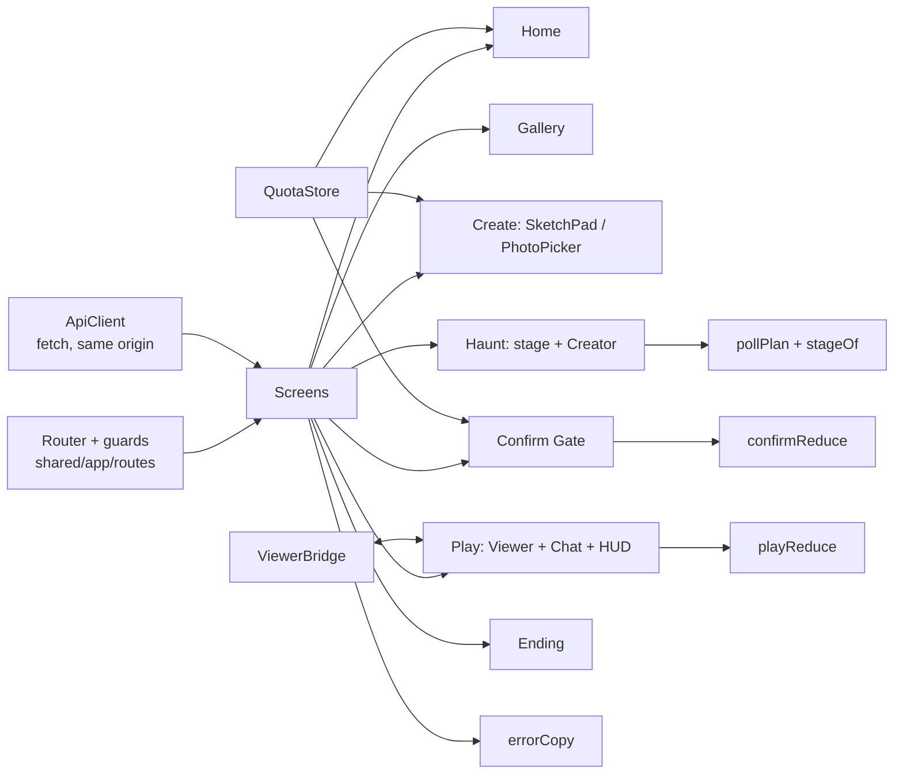
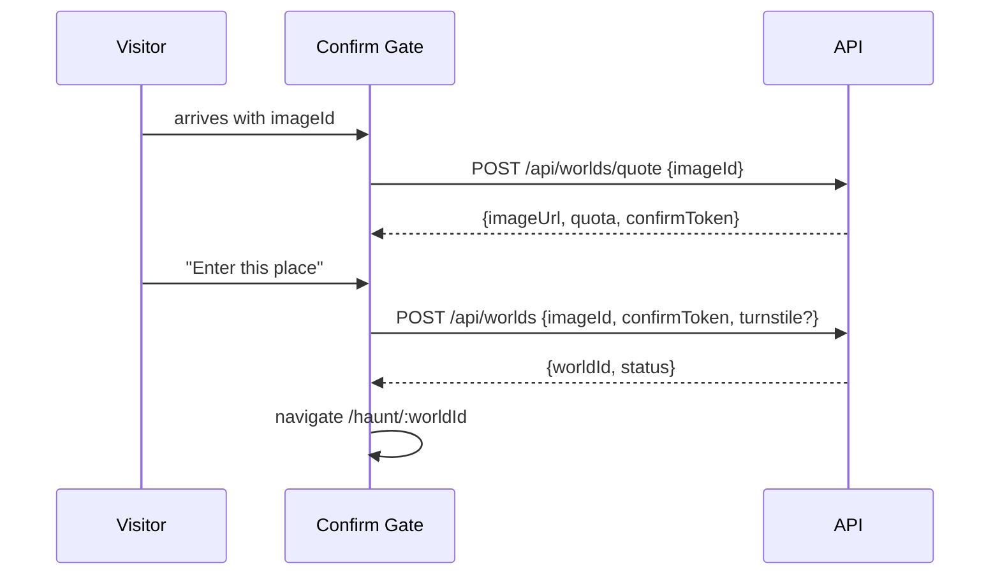
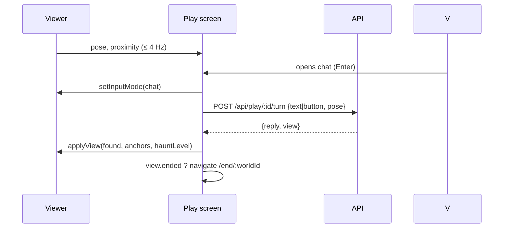

# Design Document

## Overview

The web shell is a thin React layer in `web/src/app` that sends the visitor through Home → Create or Gallery → Confirm → Haunt → (Wander: Play → Ending, or a case: Case)  and keeps the Viewer and the Chat in step. It owns no business rules. Every decision that can be a pure function (route table, flow guards, the confirm state machine, error-to-copy mapping, polling plan, Play screen reducer, resume target, sketch downscale) lives in `shared/src/app/` so it can be property-tested without a browser. React components render the state those functions return and run the effects they request.

This spec reuses, and does not restate, the engines it joins:
- `world-pipeline`: the sketch pad tool rules (2.1, 2.2), `inkCoverage`, quote and create routes, job states, `DELETE /api/worlds/:id`, `GET /api/gallery`, `GET /api/quota`.
- `world-viewer`: Input Mode, content notice, HUD, `ViewerBridge`, degradation ladder.
- `ghost-creator` and `ghost-engine`: Creator screens, `POST /api/play/*`, scripted fallback.

`world-pipeline` tasks 10.1 to 10.4 (photo picker, sketch pad, confirm screen, progress screen) are implemented under this spec's tasks and satisfy those task lines.

Decisions:
- **One effect-returning reducer per flow.** `confirmReduce(state, event, imageId) → {state, effects}` and `playReduce(state, event, worldId)` never perform I/O (`confirmStart` and `playStart` give each screen its first state and effects). The React layer runs effects and feeds results back as events. This is what makes "world creation fires at most once" provable.
- **The server is the source of truth.** Quota, job state, found memories and the ending come from the API. The shell keeps only the picked Place Image id, the Confirm Token (memory only), the world id and the acknowledged-notice flag.
- **The world id survives reload in the Session, not in storage the visitor can lose.** The API keeps `lastWorldId` and `lastPlayId` on the Session record, and `GET /api/session` returns them. The shell never writes photos, sketches or captions to local storage, cookies or IndexedDB.
- **Lazy Viewer.** three.js, Spark and three-mesh-bvh load by dynamic `import()` when Play mounts. Home ships without them.
- **Error boundaries per Screen and one around the Viewer.** A Viewer crash leaves the Chat, HUD and Exit alive.
- **Hash-free client routes** (`/`, `/gallery`, `/create`, `/confirm`, `/haunt/:worldId`, `/play/:worldId`, `/case/:worldId`, `/end/:worldId`, `/expired`), served by the Worker with an SPA fallback to `index.html`. A world id is 1 to 64 characters of `A-Z a-z 0-9 _ -`; any other path, including a bad world id, is `not_found`. A query string, a fragment and one trailing slash are ignored.

## Architecture



### Key flows





## Components and interfaces

### Routes the shell calls
| Call | Used by | Req |
|---|---|---|
| `GET /api/session` → `{lastWorldId?, lastPlayId?, ackNotice, flags}` | boot, resume | 4.5, 6.8, 7.7 |
| `GET /api/quota` | boot | 1.3, 1.4 |
| `GET /api/gallery` | Gallery, prefetch | 5.1, 10.4 |
| photo upload, `POST /api/sketch/render`, `POST /api/sketch/select`, `POST /api/places/brief` | Create | 2.3, 2.5, 2.6 |
| `POST /api/worlds/quote`, `POST /api/worlds` | Confirm Gate | 3.1, 3.3 |
| `GET /api/worlds/:id` | Haunt (poll), Play (manifest) | 4.1 |
| `DELETE /api/worlds/:id` | "Delete my place" | 3.8 |
| `POST /api/play/start`, `POST /api/play/:id/turn`, `GET /api/play/:id` | Play | 6.2, 6.3, 6.8 |
| `POST /api/conditions/search` `{q}` | the Set the sky card (city search, at most five matches, a POST so the query is not in a URL) | 12.1 |
| `POST /api/voice/speak` `{playId, lineId}`, `POST /api/voice/listen` (the clip) | speaking a line the server holds, and hold-to-talk | 12.3 |
| `POST /api/session/ack-notice` | content notice | 6.1 |

`GET /api/session` and `POST /api/session/ack-notice` are new thin routes. They read and write only fields of the Session record and are covered by the same cookie and origin checks as every state-changing route. `ghost-engine` already persists the play session; the Session record stores only the ids. The Session record is a signed cookie, `hw_session` (versioned JSON signed with HMAC-SHA-256, HttpOnly, SameSite=Lax, Secure on https, seven days, renewed past half its life). It holds the session id, `lastWorldId`, `lastPlayId` and `ackNotice` and nothing else: no photo, sketch, caption or chat text. A malformed, edited, re-signed or expired cookie is not a Session, and the visitor gets a new one with no ids. A state-changing request must carry an `Origin` equal to the origin it was sent to (or a listed development origin), otherwise it is refused with `bad_origin` before any Session is made. A route that needs earlier state answers `session_expired`. The shared contract in `api/src/contract/world-access.ts` pins the world access rule below for every route that serves worlds.

`ShellApi` (`shared/src/app/api.ts`) is the shell's typed view of these routes: one method per call, each returning an `ApiResult` (`Ok` or a failure with a stable `ErrorCode` and an optional `retryAfterSec`), none throwing. The real `ApiClient` and the demo `FakeApi` both implement it, so a screen cannot tell them apart. Two shapes the shell needs go beyond what the pipeline specs list, and the routes must return them: each Gallery item has a short `description` (shell Requirement 5.1; world-pipeline 9.2 lists id, title, thumbnail and attribution), and each sketch candidate has an `imageUrl` on the app's own origin.

### `web/src/app/`
`App.tsx` (router, providers), `screens/` (one folder per Screen), `ApiClient.ts` (typed fetch, maps failures to `Result`), `QuotaStore.ts` (single boot request, shared by Screens), `ErrorBoundary.tsx`, `LiveRegion.tsx`, `DebugOverlay.tsx`, `FakeApi.ts` and `demo.ts` (`?demo=1`, non-production builds only; `fast=1` short stages, `zero=1` every quota at zero with the kill switch on, `turnstile=1`, `fail=1`).

### `shared/src/app/`
`types.ts` (the data types below and the literal lists they come from), `api.ts` (the `ShellApi` interface and its result types), `routes.ts` (`resolveRoute`, `pathFor`, `guardRoute`), `confirm.ts` (`confirmStart`, `confirmReduce`), `errors-copy.ts` (`errorCopy`, `retryGate`), `capabilities.ts` (`capabilities`), `stage.ts` (`stageOf`, `pollPlan`), `play.ts` (`playStart`, `playReduce`), `resume.ts` (`resumeTarget`, `resumedFlow`), `sketch-size.ts` (`downscaleSize`, `inkGate`), `events.ts` (the Shell-to-Viewer contract), `fake-api.ts` (fixture timeline for demo mode).

```ts
type ScreenId = 'home' | 'gallery' | 'create' | 'confirm' | 'haunt' | 'play' | 'case' | 'end' | 'not_found' | 'expired';
type Route = { screen: ScreenId; worldId?: string };

type FlowState = {
  pickedImageId?: string;          // set when a Place Image is chosen
  worldId?: string;                // known world (own or Gallery)
  ghostReady: boolean;             // preset or created ghost chosen
  noticeAcked: boolean;
  playEnded: boolean;
};

type Capabilities = {
  canDraw: boolean; canUpload: boolean; canGallery: true;
  reason?: 'kill_switch' | 'day_cap' | 'total_cap' | 'quota_image' | 'quota_world';
};
```

### Route guards
`guardRoute(route, flow) → {allow: true} | {allow: false, redirect: Route}`.
- `confirm` requires `pickedImageId`, else redirect to `create`.
- `haunt`, `play` and `end` are each about one world: the route's world id must equal the flow's `worldId`. A missing or different world redirects to `gallery`.
- `play` also requires `ghostReady`, else redirect to `haunt` for that world.
- `end` also requires `playEnded`, else redirect to `play` when `ghostReady` is set, otherwise to the redirect `play` itself would give (`haunt`). A redirect never lands on a route that redirects again.
- All other screens always allow.

### Confirm Gate state machine
```ts
type ConfirmState =
  | { k: 'quoting' }
  | { k: 'ready'; imageUrl: string; token: string; quota: QuotaSnapshot; needsTurnstile: boolean }
  | { k: 'challenge'; token: string }                 // Turnstile needed
  | { k: 'creating'; token: string }
  | { k: 'created'; worldId: string }
  | { k: 'rejected'; code: ErrorCode }
  | { k: 'cancelled' };
type ConfirmEvent =
  | { t: 'quote_ok'; imageUrl: string; token: string; quota: QuotaSnapshot; needsTurnstile: boolean }
  | { t: 'quote_fail'; code: ErrorCode }
  | { t: 'turnstile_ok'; turnstile: string }
  | { t: 'enter' } | { t: 'back' } | { t: 'retry' }
  | { t: 'create_ok'; worldId: string } | { t: 'create_fail'; code: ErrorCode };
type ConfirmEffect =
  | { e: 'quote'; imageId: string }
  | { e: 'create'; imageId: string; token: string; turnstile?: string }
  | { e: 'navigate'; to: Route };
```
Rules: `enter` from `ready` with `needsTurnstile` false emits `create`. `enter` from `ready` with `needsTurnstile` true moves to `challenge` and emits nothing; `turnstile_ok` in `challenge` then emits `create`. `retry` is accepted only from `rejected` (for example `confirm_expired` or a failed quote): it emits one `quote` effect and moves to `quoting`, and the new token replaces the old one. From `quoting`, `challenge`, `creating`, `created`, `rejected` and `cancelled`, `enter` is ignored. A token is never emitted twice. `back` is accepted from `quoting`, `ready`, `challenge` and `rejected`: it moves to `cancelled` and emits one `navigate` to Create, never a `create`. It is ignored while `creating` (the request is in flight), after `created` and after `cancelled`; a late answer after `back` changes nothing.

### Stage mapping and polling
`stageOf(jobState)`: `queued → queued`, `generating → dreaming`, `ingesting → stitching`, `ready → ready`, `failed → failed`, matching `world-pipeline` states and the labels in `steering/visual-style.md`.
`pollPlan({ now, lastPollAt, visible, stage, rateLimitedUntil, startedAt }) → { pollAt: number | null; overdue: boolean }`:
- `null` when the tab is hidden or the stage is terminal.
- otherwise the next time is `max(lastPollAt + 3000, rateLimitedUntil)`, where `rateLimitedUntil` is `null` when not rate limited. Without a limit that runs past the normal interval it is 3000 ms after the last poll, so a change shows within 5 s of the next poll. It may lie in the past (the tab was hidden), and the caller then polls at once.
- `overdue` is true once `now − startedAt` passes 15 minutes, and never for a terminal stage (the job times out at 20), which triggers the honest "taking long" copy and the Gallery offer without cancelling.

### Play screen reducer
```ts
type PlayState = { mode: 'play' | 'chat'; found: number; noticeAcked: boolean; ended: boolean; degraded?: 'pano' | 'thumb' };
type PlayEvent =
  | { t: 'ack_notice' } | { t: 'open_chat' } | { t: 'close_chat' }
  | { t: 'exit'; to?: 'home' | 'gallery' }
  | { t: 'view'; found: number; ended: boolean } | { t: 'viewer_degraded'; rung: 'pano' | 'thumb' };
type PlayEffect =
  | { e: 'start_viewer' } | { e: 'set_input_mode'; mode: 'play' | 'chat' }
  | { e: 'dispose_viewer' } | { e: 'navigate'; to: Route };
```
`start_viewer` is emitted only after `ack_notice` (or at once when the Session already has the notice acknowledged), and once. `open_chat` and `close_chat` each emit `set_input_mode` once; the Chat cannot open behind the content notice or after the end. `view` with `ended` true (the first time) emits `dispose_viewer` and then `navigate` to `end` for this world. `exit` always emits `dispose_viewer` before `navigate` to Home, or to the Gallery when `to` says so. `found` never goes down or past 3, and a fallback rung (`pano`, then `thumb`) never gets better.

### Shell-to-Viewer contract (`events.ts`)
Defined once in `shared` and used by both sides, so neither imports the other's internals.
```ts
type ViewerToShell =
  | { t: 'pose'; pos: Vec3; yaw: number }                 // ≤ 4 Hz, from ViewerBridge
  | { t: 'prompt'; target: 'anchor' | 'ghost' | null }
  | { t: 'degraded'; rung: 'pano' | 'thumb' };
type ShellToViewer =
  | { t: 'set_input_mode'; mode: 'play' | 'chat' }
  | { t: 'set_atmosphere'; atmosphere: Atmosphere | null }   // the frozen conditions of the place, no coordinates; null restores the normal look
  | { t: 'apply_view'; found: AnchorId[]; anchors: Anchor[]; hauntLevel: number; ghostVisible: boolean };
```
The shell attaches the last `pose` to each `POST /api/play/:id/turn`; the server runs `sanitizePose`. The shell never sends hidden seeds because it never receives them.

### Resume
`resumeTarget(session, facts) → Route`, where `facts` is `{ worldStatus?: JobState | 'missing'; playLive: boolean }` fetched by the caller: with no Session, no `lastWorldId` or a `missing` world → `home` (with a short notice for a missing Session); with `lastPlayId` and a live play session → `play`; with a `lastWorldId` whose status is `queued | generating | ingesting` → `haunt`; with a `ready` world and no live play → `play` (the persisted ghost, or the default one); otherwise `home`. `resumedFlow(session, facts)` returns the flow state this leaves behind (the world is known, `ghostReady` is true for `play`, the notice flag comes from the Session), so the target passes `guardRoute`. Resume applies only when the visitor opens `/` or a stale route; it never overrides a deep link that passes its guard.

### Error copy
`errorCopy(code: string) → { title: string; body: string; next: 'retry' | 'gallery' | 'home' | 'wait' }`, an exhaustive table over `ErrorCode` in `shared/src/errors.ts`. The table is a `Record<ErrorCode, …>`, so adding a code without copy is a compile error. Unknown strings from the network map to a single generic entry. Server `message` text is never rendered.
`retryGate(retryAfterSec, now) → { enabledAt }` clamps the advised delay to [1 s, 120 s].

`errors.ts` lacked several codes that the `world-pipeline` design lists (`blank_sketch`, `unsafe_image`, `bad_confirm`, `confirm_expired`, `turnstile_failed`, `quota_session`, `quota_day`, `quota_total`, `timeout`, `ingest_failed`) and used different names for three conditions. Task 1.1 reconciled them: `errors.ts` is the source of truth, keeps its existing names (`upload_bad_type`, `upload_too_large`, `world_gen_disabled`) and adds `upload_too_small` and `upload_bad_magic` for the design's `too_small` and `bad_magic` (`world_too_small` is a party code and stays apart). The shell adds `shell_crash` (screen boundary fallback) and `session_expired` (Expired screen), alongside the existing `world_not_found`. `errorCopy` is exhaustive over the one list.

### Capabilities
`capabilities(quota, flags) → Capabilities`. `canDraw` needs image quota, world quota and `WORLD_GEN_ENABLED`; `canUpload` needs world quota and the flag; `canGallery` is always `true`. `reason` follows a fixed priority (kill switch, total cap, day cap, image quota, world quota).

### Sketch downscale
`downscaleSize(w, h, max = 512) → {w, h}`: preserves aspect ratio within rounding, longest side ≤ `max`, never enlarges, always ≥ 1 px on each side.

### Sketch Pad, photo picker, Turnstile
- The pad is a `<canvas>` with pointer events and `touch-action: none`. It stores strokes in memory for undo and redo (≥ 30 steps, per `world-pipeline`). Ink coverage uses `inkCoverage` and `INK_FLOOR` from `shared/src/sketch.ts`, the same function and constant the server uses; `inkGate(bitmap)` returns `{enabled, coverage}`. A pixel is ink when it is mostly opaque and dark, so black strokes count on a white or a transparent page.
- A keyboard path to the same outcome is the photo picker and the Gallery, both reachable by Tab. The pad itself is a pointer tool and is labelled as such.
- The photo picker re-encodes through a canvas (drops EXIF, GPS and XMP) before upload, per `world-pipeline` task 10.1, and shows the retention notice before the file is chosen.
- Turnstile loads only when the quote says it is required. The script is fetched from Cloudflare's own URL (`https://challenges.cloudflare.com/turnstile/v0/api.js`). It is never proxied, cached or self-hosted, because Cloudflare's [client-side rendering docs](https://developers.cloudflare.com/turnstile/get-started/client-side-rendering/) warn that proxying or caching it breaks Turnstile when Cloudflare updates it. The CSP allows `https://challenges.cloudflare.com` in `script-src` and `frame-src` and only when Turnstile is configured.

### Sky and voice
- **Set the sky.** An optional card on the Haunt screen, beside the ghost choice: a city search (`ShellApi.searchPlaces`, at most five matches, the position already rounded by the server), a "Use my location" action that asks the browser only after an explicit tap and sends nothing finer than two decimals, and a Memory Day (1940 to yesterday, plus a time of day). The choice is a `ConditionsChoice` held in memory, never in storage, and goes with `POST /api/play/start`, where the snapshot is frozen once (the `conditions` spec). With no choice the normal look applies and nothing waits: "Walk in" never depends on the card. The chosen place is shown as a label only. A search failure shows `errorCopy` (`geocode_unavailable`, `conditions_disabled`, `bad_place`) and leaves the card usable.
- **Photo date.** `PhotoPicker` reads the capture date and time with the `conditions` spec's `readCaptureDate` from the original file in the browser, then re-encodes. It offers the date as a suggested Memory Day that the visitor can change or clear, and keeps no other field.
- **Atmosphere.** The play view carries `atmosphere` (or null). Play sends it to the Viewer as `set_atmosphere` (the contract in `events.ts`); the Viewer owns how it looks.
- **Voice.** The turn reply may carry `voice {lineId}`. When the speak switch is on (default on in Wander) and `flags.voiceEnabled` is true, Play asks `ShellApi.speak` for the audio and plays it after a user gesture has unlocked audio; the line is always shown as a subtitle in the polite live region, spoken or not. A refusal (`voice_unavailable`, a spent meter, a failure, a permission denial) is silent: the subtitle and typing carry on, with no error screen. Hold-to-talk (Single player only, shown only when `flags.voiceEnabled`) records up to 8 seconds with a visible microphone indicator, sends the clip through `ShellApi.listen`, and puts the returned transcript through exactly the path typed text takes. The shell never stores audio. Live mode (a stretch, shown only when `flags.liveEnabled`) adds a stop button and a microphone indicator whenever it listens, stops after 10 seconds of silence or when the page is hidden, and falls back to hold-to-talk on any problem.
- **Quota and flags.** `QuotaSnapshot` has six meters (`world`, `image`, `llm`, `tts`, `stt`, `live`), and `ShellFlags` carries `voiceEnabled` and `liveEnabled` from `GET /api/session`, so a control is hidden instead of failing.

### Play: controller, Viewer seam and memory
`PlayController` (`web/src/app/play/controller.ts`) owns one visit to the Play screen and holds no DOM. It starts a new game or restores a live one (from this tab, or the one the Session names for this world, unless `startFresh` was set), feeds `playReduce` and runs the effects it returns one after another, so the Viewer is disposed, and the promise awaited, before the next Screen mounts. It reaches the Viewer only through `ViewerPort` (`start`, `send`, `dispose`) and drops any Viewer message that `parseViewerMessage` refuses. A Viewer that fails to start or throws on a message leaves the Chat and Exit working and shows a still picture. `PlayMemory` (`play/memory.ts`) keeps, in memory only, the ghost and sky chosen on Haunt, the play id and the ghost's last line for the Ending. `shared/src/app/memory-card.ts` makes the memory card as an SVG with no outside reference until the canvas card of `world-viewer` 9 exists. The platform kit (`platform.ts`) is the one place the browser's Viewer loader, microphone, speaker and file saving are named, so tests and the demo can replace them.

### Two ways to play: a case and Wander
When a world is ready the Haunt screen offers two actions (Requirement 13): "Play a case" and "Wander". Wander is the Play screen of this design, unchanged. A case is a solo `party-mode` Room: the setup card (a preset of Classic, Relaxed or Quick, and two to five Bots) is kept in `PlayMemory.caseSetup`, in memory only, and "Start" navigates to `/case/:worldId`. The Case Screen mounts the party Host page in solo mode (party task 8.15): it runs `soloSetup`, creates the Room, joins as Master, adds the Bots and starts, so the shell holds no game rule. `guardRoute` lets `case` through when the route's world is the flow's world, as for `haunt`; it needs no ghost, because a case fills every Suspect from the Preset Ghosts. A reload of the Case Screen, or leaving it, ends the Room and returns to the setup, so nothing is restored and nothing is stored. "Play a case" is hidden or disabled with a one-line reason when `flags.partyEnabled` is false or the world is `world_too_small`. `ShellFlags` gains `partyEnabled` (the server's `PARTY_ENABLED`). The Play screen's title and heading read "Wander".

### Accessibility and motion
- On route change the router focuses the Screen's `h1` (`tabIndex={-1}`) and announces the title in a polite live region.
- Stage changes, errors and ghost speech go through one `LiveRegion` component (`aria-live="polite"`).
- Transitions use a single `fade` token (300 to 600 ms) that drops to 0 to 150 ms under `prefers-reduced-motion`.
- Chat is a bottom sheet below 900 px and a side panel at 900 px and above. The layout is CSS grid with a container query; no JS breakpoint logic.

### Security and privacy
- **World access.** Gallery worlds are public. A visitor's own world is private to the Session that created it. The shell assumes `GET /api/worlds/:id`, its assets, `DELETE /api/worlds/:id` and `POST /api/play/start` serve an own world only to that Session, and answer `world_not_found` for both a missing and a foreign id, so ids cannot be probed. `/haunt/:worldId` and `/play/:worldId` are therefore not shareable for own worlds. A visitor shares the memory card image, not a link. This is a requirement on the `world-pipeline` and `ghost-engine` routes, tracked in `docs/IMPLEMENTATION.md` until those specs state it.
- Same-origin `fetch` with `credentials: 'same-origin'`. No third-party origin appears in the CSP `script-src`, `connect-src`, `font-src` or `img-src` except Turnstile when configured.
- User text is rendered through React text nodes. A lint rule bans `dangerouslySetInnerHTML` in `web/`.
- Production builds replace `console.*` with a logger that accepts only `(code, screenId)`.
- Image URLs come from the API's own origin (`/api/worlds/:id/assets/:name` or R2 proxy paths), never from an upstream host.
- Confirm Token lives in the reducer state only. It is never put in a URL, storage or log.
- `?demo=1` and `FakeApi` are tree-shaken from production builds (`import.meta.env.PROD` guard) and tested for absence in the bundle.

### Performance
- Route-level code splitting: Play, Creator and Sketch Pad are dynamic imports. A size test fails the build if Home's initial JavaScript exceeds 150 KB gzipped.
- Gallery prefetch uses `requestIdleCallback` (or a 1 s timeout fallback) after Home mounts.
- Leaving Play calls `dispose_viewer`, waits for the dispose promise, then mounts the next Screen.

## Error handling
- Screen boundary fallback shows `errorCopy('shell_crash')`, the code, a Home link, and logs `(code, screenId)`.
- Viewer boundary fallback replaces the canvas with the thumbnail and keeps the Chat and Exit.
- Offline: `navigator.onLine` plus fetch failure shows the offline banner; idempotent reads (`GET`) retry on the `online` event. `POST` never retries automatically.
- 429: the API client reads `Retry-After`, passes it to `retryGate`, and the triggering control stays disabled until `enabledAt`.
- Unknown route → `not_found`. A world that returns `world_not_found` or `session_expired` → `expired`.

## Testing strategy
- Property tests (below) on every module in `shared/src/app/`, seeded, at least 100 runs, generators in `*.arb.ts`.
- Component tests (jsdom, Testing Library) per Screen: one main path and one failure path, using `FakeApi`. Focus management and live-region announcements are asserted.
- A model-based test drives `confirmReduce` and `playReduce` with random event sequences against a small oracle.
- A bundle test asserts Home's gzipped size, the absence of `FakeApi` and `console.log` in the production build, and that no origin outside the allow-list appears in built output.
- A Playwright smoke run (local, fixtures only) walks the Zero-Quota Path: Home → Gallery → preset ghost → Play → three memories → Ending. It runs against `?demo=1` and the API in `wrangler dev` with fakes; it never calls a paid upstream.
- Manual checks, recorded in `docs/spikes/shell.md`: keyboard-only run, 320 px width, iOS Safari scroll and zoom inside the pad, screen-reader pass on Haunt and Play.

## Correctness Properties

### Property 1: Routes are total and round-trip
*For any* string path, `resolveRoute` returns exactly one `ScreenId` (unknown paths give `not_found`), and for any route produced by `resolveRoute`, `resolveRoute(pathFor(route))` equals that route.
**Validates: Requirements 1.5, 7.6**

### Property 2: Guards never expose a screen without its prerequisites
*For any* flow state and route, `guardRoute` allows `confirm` only when `pickedImageId` is set, `play` only when `worldId` is set and `ghostReady` is true, and `end` only when `playEnded` is true; otherwise it returns a redirect to a route that itself passes the guard.
**Validates: Requirements 3.7, 5.2, 6.5**

### Property 3: World creation fires at most once and only after consent
*For any* sequence of confirm events, a `create` effect is emitted at most once per accepted quote (so a Confirm Token is used at most once), only after an accepted `enter` on that quote (and, when Turnstile is needed, after its result), never after `back`, and never after `create_fail` or `create_ok` until a new quote and a new `enter`; `quote` effects number one plus the accepted retries; ignored events leave the very same state and emit nothing.
**Validates: Requirements 3.2, 3.3, 3.4, 3.6**

### Property 4: Every error code has fixed copy and no raw server text is shown
*For any* `ErrorCode` and any server-supplied message string, `errorCopy` returns non-empty title and body drawn from the fixed table, independent of the message, with `next` set to one of the allowed actions; any string that is not an `ErrorCode` maps to the generic entry.
**Validates: Requirements 2.7, 3.4, 4.4, 7.3**

### Property 5: Gallery is always available and creation follows quota
*For any* quota snapshot and flags, `canGallery` is true; `canDraw` and `canUpload` are false whenever the kill switch is on or the relevant quota is zero; and when they are false `reason` is set.
**Validates: Requirements 1.3, 5.3**

### Property 6: Stage mapping and polling plan are safe
*For any* job state, `stageOf` returns the matching label and `ready` maps to a Stage that offers "Walk in" without auto-starting; for any timeline of polls, `pollPlan` returns `null` while hidden or terminal, never schedules a poll earlier than `lastPollAt + 3000` or before `rateLimitedUntil`, never schedules more than 5000 ms after the last poll when visible and the rate limit does not run past the normal interval (when it does, the next poll is exactly `rateLimitedUntil`), and flags `overdue` only after 15 minutes and never for a terminal stage.
**Validates: Requirements 4.1, 4.3, 4.4, 4.7, 10.3**

### Property 7: Play reducer keeps input mode and Exit consistent
*For any* sequence of play events, the viewer input mode equals `chat` exactly while the chat is open, `start_viewer` is emitted only after the notice is acknowledged, `exit` always emits `dispose_viewer` before `navigate`, and `ended` leads to exactly one navigation to the Ending.
**Validates: Requirements 6.1, 6.2, 6.4, 6.5, 6.6**

### Property 8: Sketch downscale preserves shape and never enlarges
*For any* positive width and height, `downscaleSize` returns dimensions with longest side at most 512, both sides at least 1, aspect ratio within one pixel of rounding of the input, and no side larger than the input.
**Validates: Requirements 2.3**

### Property 9: Retry gate honours the advised delay
*For any* advised delay and time, `retryGate` returns `enabledAt` at least one second and at most 120 seconds after `now`, equal to the clamped advice, and a control is enabled if and only if `now ≥ enabledAt`.
**Validates: Requirements 7.5**

### Property 10: Resume picks a reachable, correct target
*For any* Session record and world status, `resumeTarget` returns `haunt` only for in-flight worlds, `play` only for a world that is ready or has a live play session, `home` when the Session is missing or expired, and always a route that passes `guardRoute` for the resulting flow state.
**Validates: Requirements 4.5, 6.8, 7.7**

### Property 11: The ink floor gate matches the server
*For any* canvas bitmap, the shell enables "Make it real" if and only if `inkCoverage(bitmap) ≥ 0.005`, using the same function and constant as the API's sketch route.
**Validates: Requirements 2.4**
