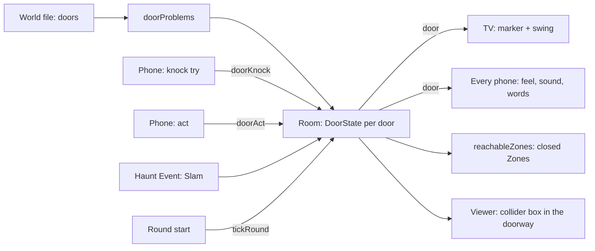

# Design Document

## Overview

A door is a few numbers in a world's file and a few bits in the Room. Everything that can be a pure function is one and lives in `shared/src/party/doors.ts`, so it can be property-tested without a Room, a phone or a GPU: the manifest check, the door state, which Zones are reachable, the knock lock, how many Players a heavy door asks for, the act count and the Slam rule. The Durable Object stores the result and sends it; the Viewer and the TV only draw it.

Decisions:
- **The server owns the door.** A phone only asks (puzzles 25.2). A knock door is the Secret knock Kind of `shared/src/puzzles/knock.ts`; a heavy door is the shared action of puzzles Requirement 25 with a number of Players.
- **A door decides reach, not the Case.** A shut door closes the Zones behind it; it never touches a card, the Solution, the Turn order or the winners.
- **No door stays shut for good.** A failed knock or a Slam sets `opensAtRound`; `tickRound` opens it by itself. The manifest check refuses a list that would cut a Zone off even with every door open.
- **The lock is a function of the Room seed and the door id** (`doorKnock`), never of the order of doors, the Turn or the Haunt level, so the server, the clue and the Lock cannot disagree.
- **The first doors are written by hand.** How a door gets into a Marble world is left open (see Open questions).

## Architecture



## Components and interfaces

All in `shared/src/party/doors.ts` unless noted.

```ts
type DoorLock = "knock" | "heavy";
type Door = { id: string; at: Point; width: number; a: string; b: string; lock: DoorLock; need?: number };
type Passage = readonly [string, string];                       // open ground between two Zones
type DoorState = { id: string; open: boolean; opensAtRound: number | null; autoOpenedRound: number | null };
type DoorAct = { seat: number; atMs: number };

doorProblems(doors, zoneIds, passages, home): string[]          // empty = valid; [] for a world with no doors
validateDoors(doors, zoneIds, passages, home): boolean
initialDoors(doors, puzzlesOn): DoorState[]                      // shut with puzzles on, open (for good) with puzzles off
openDoor(states, id): DoorState[]                                // a Player opened it
failKnock(states, id, round): DoorState[]                        // three wrong tries: opens by itself at round + 1
shutDoor(states, id, round, puzzlesOn): DoorState[]              // a Slam: shut, opens by itself at round + 1; no-op with puzzles off
tickRound(states, round): DoorState[]                            // the start of a Round: due doors open, autoOpenedRound = round
reachableZones(zoneIds, doors, states, passages, home): string[]
zonesBehind(doorId, zoneIds, doors, states, passages, home): string[]
doorKnock(roomSeed, doorId): { level: Level; seed: number }      // then makeLock("knock", level, seed)
heavyNeed(door, seated): number                                  // 1 for a knock door; 2 or 3 for heavy, clamped to 1..seated
liveActs / actCount / actsTogether(acts, nowMs, need)            // different seats inside ACT_WINDOW_MS (2000)
canSlam(state, playersBehind, round): boolean
slamTargets(states, behind, round): string[]

// the Room's side (task 2)
type DoorSetup = { doors: Door[]; passages: Passage[]; home: string };
type DoorsState = { v: 1; doors; passages; home; states: DoorState[]; acts: Record<id, DoorAct[]>; tries: Record<id, number>; heardBy: Record<id, seat> };
setupDoors(setup, zoneIds, puzzlesOn): { state: DoorsState | null; problems: string[] }   // null and no problems for no doors; null and the reasons when the check fails
parseDoorsState(raw): DoorsState | null                          // a saved value, or null so the Room falls back to the start
closedZones(d, zoneIds): string[]                                // the Zones nobody can reach now
actOnDoor(d, doorId, seat, nowMs, seated): { ok, state, opened, need, have } | { ok: false, code }
knockOnDoor(d, doorId, times, round, roomSeed): { ok, state, outcome, heard, triesLeft } | { ok: false, code }
newTurnDoors(d) / newRoundDoors(d, round): { state, opened: id[] }
nearZone / knocksHeardOnEntry / markHeard / knockSightFor        // the ghost's knock, once, to one phone
publicDoors(d, seated, nowMs): PublicDoor[]                      // what every screen sees; never the pattern
```

In `engine.ts`: `createEngine({ doors })`, `repairDoors(engine)` (used when a Room wakes), the `doorAct` and `doorKnock` messages, `walk` refused with `zone_closed` for a closed Zone, Bots choosing only among open Zones (`BotTurn.open`), `tickDoors` at a Round start, and the public view's `doors`, `closedZones` and `doorProblems`.

- **Manifest check** (`doorProblems`): at most 3 doors; ids valid and unique; `at` finite; width 0.9 to 1.6 m; both Zones known and different; lock known; `need` 2 or 3 on a heavy door and absent on a knock door; every Zone reachable from `home` through Passages and doors taken as open. Reasons are short codes: `count`, `0:id`, `1:id_dup`, `0:at`, `0:width`, `0:zone`, `0:same_zone`, `0:lock`, `0:need`, `home`, `cut_off:<zone>`.
- **Closed Zones**: `reachableZones` is the Zones a Player can reach from the Home Zone now. The Turn picker and the Lock placement use it, so a Zone behind a shut door is not offered. `zonesBehind` is what a Slam counts Players in.
- **Knock door in a Turn**: the Detective's try goes to the same `judgeKnock` as any Secret knock. Three wrong tries call `failKnock` and end the Turn.
- **Heavy door**: the Room keeps the recent acts of each heavy door; `doorAct` appends one; when `actsTogether(acts, now, heavyNeed(door, seated))` holds, `openDoor` runs and the acts are cleared.
- **Slam**: an added `HauntOption`, `slam` (`haunt.ts`), kept out of `HAUNT_OPTIONS` so the Voice Library's line groups do not change. At threshold 6 only, when the Engine says `slamOffered` (puzzles on, Gentle off, and `slamTargetsAt` not empty), `fireEvent(..., slam = true)` offers `slamOptions`: the ordinary first option and the Slam, in an order from their own seeded stream, so the Slam is sometimes the one that applies by default. The Engine's `slam` shuts the first target with `shutDoor` and starts a `TvKnock` (easy level, from the Room seed and the Round). Only the active Player has a place between Turns (each Turn starts at the Home Zone), so `slamTargetsAt(d, zoneIds, at, round)` counts that one Player, in `at`, as behind a door when `zonesBehind` says so, and nobody when `at` is null. A Player's `tvKnock` message is judged by `knockBackAtTv`; the first right one sets `answeredBy` and adds the seat to `helpOwed`, and `startTurn` gives that seat +10 s (capped at 120 s) once.
- **TV and phones**: a `door` message carries `{id, open, reason}` where `reason` is `knock`, `together`, `skip`, `timeout` or `slam`. The TV swings the door slowly (never a flash); each phone runs `feel` from its own place and facing, so a near phone buzzes and a far one only sees the picture shake.
- **Viewer**: a shut door is one box collider across the doorway, `width` wide, 0.2 m thick, up to 2.2 m, added or removed when the state changes. Whether this stops the walker cleanly is the spike of task 7.

## Data model

```ts
// in RoomState's game part (Durable Object storage key `room:<code>:doors`)
{ v: 1, doors: DoorState[], acts: { [doorId: string]: DoorAct[] } }
```

A stored value that does not parse falls back to `initialDoors(doors, puzzlesOn)` with no acts.

## Messages

| Message | From | To | Holds |
|---|---|---|---|
| `doorKnock` | a Detective's phone | server | `doorId`, the try's knock `times`; only on their own Turn |
| `doorAct` | a Player's phone | server | `doorId` |
| `door` | server | every screen | `id`, `open`, `reason`, and `need`/`have` while a heavy door waits |
| `welcome` | server | one screen | `doors`: every door's state, joining late |
| `doorResult` | server | the one Detective | `doorId`, `outcome` (`opened`, `wrong`, `failed`), `heard` ("You knocked 2, 3."), `triesLeft` |
| Sight (knock) | server | the one Player | `sightId` `door-<id>`, the pattern, once; never in `door`; given to the first Detective into the door's near Zone |
| `tvKnock` | a Player's phone | server | `times`: a knock-back after a Slam, any seat, any time in the Slam's Round |
| `tvKnock` | server | every screen | `groups`, `long`, `answeredBy` (null until the first right knock-back); public by design |
| `tvKnockResult` | server | the one Player | `outcome` (`help` or `wrong`), `heard` |
| `choose` | a Poltergeist's phone | server | `option` may now be `slam` |
| `public` view | server | every screen | adds `doors` (each with `need` and `have`), `closedZones`, `doorProblems` and `tvKnock` (this Round's, or null) |

`welcome` also carries `doors` when the world has any. The Room gets a world's doors from the optional `doors()` port of `Ports` (`server.ts`); `createEngine` takes them as `doors` and `step` checks them with the pool's Zones at the start.

## Error handling

- A world whose doors fail the check is played with no doors; the Master is told the reasons in words (Requirement 1.4).
- A malformed door message closes the socket (4400) and one over the per-socket limit gets `rate_limited`, as for every message. A refused `doorKnock` or `doorAct` changes nothing and tells only the sender a code: `not_your_turn`, `not_a_detective`, `not_at_door`, `door_unknown`, `not_knock`, `not_heavy`, `door_open`, `no_knocks`, `no_tries_left`, `paused`, `game_over`.
- A stored door state that does not parse falls back to the start.
- A Slam finds no target: it is not offered, and the Haunt Event offers its other options.

## Testing strategy

- Property tests on every pure function in `doors.ts` (below), at least 100 runs, seeded.
- Mutation checks on the load-bearing rules: the route check, the Player cap, the act count, the Slam rule, the puzzles-off rule and the seed rule.
- The Room wiring is tested through the same in-memory store as the rest of `server.test.ts`, with a fake clock.
- The Viewer collider is a spike, recorded in `docs/spikes/`, on a real Gallery world. The swing and the phone feel are checked by eye on the lab.

## Open questions

1. **How a door gets into a Marble world.** The first doors are written by hand in a world's file. A later pass could place them from the Collider's narrow gaps, or ask the world maker for a doorway; this spec does not decide it.
2. **Whether a box across the doorway stops the walker cleanly.** The walker may slide along it, snag on it or step through at speed. Task 7 is the spike.
3. **What "stands at a door" means with one shared TV camera.** This spec uses 1.5 m from the door's place on the plan (Requirement 9.2) and keeps the TV from needing to pick a nearest Player; a wrong guess here costs a sentence, not a rule.

## Correctness Properties

### Property 1: A door list is valid, or it is refused with a reason
For any list of doors, `doorProblems` is empty exactly when the list is empty or: it has at most 3 doors with unique valid ids, finite places, widths from 0.9 to 1.6 m, two different known Zones, a known lock and the right `need`, and every Zone is reachable from the Home Zone through Passages and doors taken as open.
**Validates: Requirements 1.1, 1.2, 1.3**

### Property 2: Doors start by the puzzle setting
With puzzles on, `initialDoors` returns every door shut; with puzzles off, every door open, and `shutDoor` with puzzles off changes nothing.
**Validates: Requirements 2.2**

### Property 3: A shut door closes only what lies behind it
`reachableZones` never loses a Zone when a door opens, a Zone with another way in is never behind a door (`zonesBehind`), and with every door open it equals the Zones joined to the Home Zone by Passages and doors.
**Validates: Requirements 2.3**

### Property 4: The lock comes from the Room seed and the door id only
`doorKnock(seed, id)` returns the same level and seed whatever else is asked or listed, the level is easy, medium or hard, and `makeLock("knock", level, seed)` gives the same Lock each time.
**Validates: Requirements 3.1**

### Property 5: A door never asks for more Players than are seated
`heavyNeed` is 1 for a knock door, and for a heavy door it is at least 1, at most 3, at most the number seated (1 when none), and never more than the door's own `need`.
**Validates: Requirements 4.2**

### Property 6: Acts count each Player once inside the window
`actCount` counts different seats whose acts are inside the Window and not in the future; it never counts more than the different seats or the acts, an act exactly one Window old does not count, and `actsTogether` is true exactly when that count reaches `need`.
**Validates: Requirements 4.1, 4.3**

### Property 7: A Slam shuts only an open door that nobody stands behind
`canSlam` holds only when the door is open, nobody is behind it and it did not open by itself this Round; `shutDoor` then sets it to open by itself next Round, and for any run of Slams and Round starts a door ends open.
**Validates: Requirements 2.6, 5.2, 5.4**

## Shared look (design system, 2026-11-19)

The screens of this spec are built from `design/elements.css`, with the values of `design/tokens.json`; every element is shown, with its markup, on `design/catalogue.html` (run `pnpm voice-demo` and open `/design/`).

| Part of this spec | Elements |
|---|---|
| Door prompts & Heavy/Skip/Tap controls | `ui-panel ui-prompt ui-button ui-hint ui-status` |
| Diorama & Viewer doorway box | drawn from `shared/src/design/tokens.ts` |
