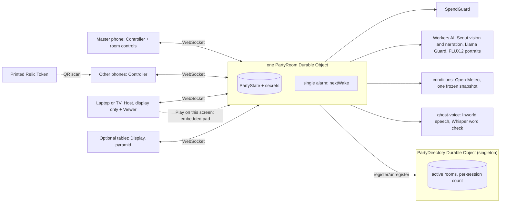
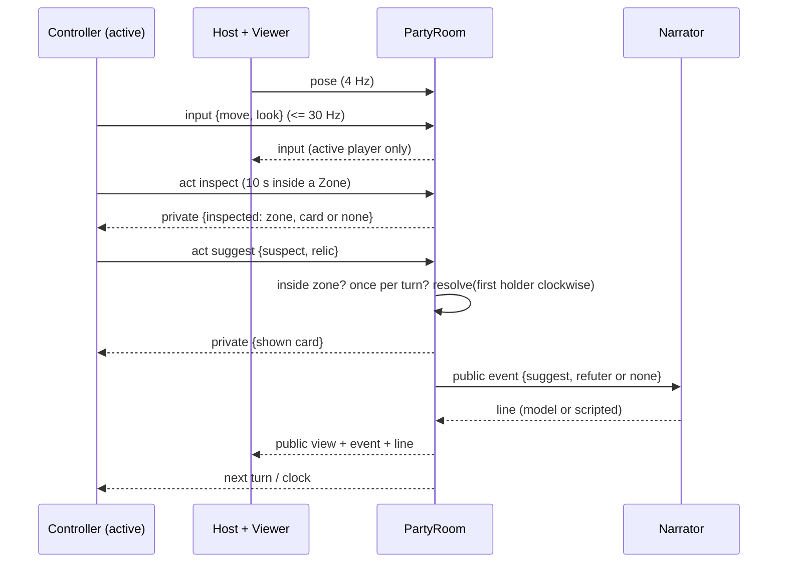

# Design Document

## Overview

**The server holds the secrets, the engine decides, the model narrates.** A `PartyRoom` Durable Object owns one game: seats, the Master, contributions, the Solution, the Residue, every Hand, the Haunt, the turn clock and the event log. Phones, the display-only Host screen and the optional Display are all thin clients that receive *views* the server computes for them. Every control lives on a phone. One Player, the **Master**, runs the room; the laptop or TV only displays. Game rules are pure functions in `shared/src/party/` (deal, residue, haunt, resolve, nudges, cues, phone sound, frames, presets, master, views, turn order, clock, achievements, suggestion, accusation, bots), so they are property-tested without a network or a model. Narration reuses the ghost engine's validation and scripted-fallback approach, with party-specific directives and a prompt builder that can only see the Public View.

Decisions:
- **Premise stays gentle.** "Who is haunting this place?" (visitor ghost, zone, relic), not a murder. This keeps `steering/product.md` principle 3 intact and the content safe for a shared screen.
- **Every control is on a phone.** The Host never takes game input. The first Player to join is the Master and runs the room. A laptop-only visitor uses "Play on this screen", which seats the Host page itself as a Player and embeds that Player's pad beside the world.
- **One screen is the solo game.** Playing alone is not a special mode. "Play a case" creates an ordinary Room, seats the Host page as the first Player and Master, adds two to five Bots and starts. The rules are Multiplayer's, the Bots play by `botMind`, and the embedded pad shows the Private View because every other seat is a Bot. The memory walk is renamed Wander and is untouched.
- **Replace weak mechanics, do not stack new ones.** Walking was only a commute, five of six players idled on each Turn, a wrong Accusation ended your game, and the ghost only narrated. Residue and Inspect give walking a purpose, Resolve and Eavesdrop give waiting players a reaction, Poltergeists keep everyone in, and the Haunt turns the round limit into a rising threat. If time runs short, cut Frames and phone sound first, then Cues and Nudges, then Resolve and Eavesdrop (Nudges spend Resolve), then spoken narration. The Haunt, Residue and Poltergeists stay in the core.
- **The app is the antagonist.** Ideas are borrowed from table games (an app as the opponent, a dead player who switches sides, objective markers, reactions). None of their content is used.
- **Phones are pads and private screens, as an installable web app.** The same page switches between pad layout (landscape) and panel layout (portrait). A manifest, an offline shell and a wake lock make it feel like an app. No native app and no account.
- **Server-authoritative clock and rules.** Clients render; they never decide. The Host reports pose at 4 Hz (it owns the collider) and the room sanitises it exactly as the ghost engine does.
- **Suggestions resolve with one optional choice.** The first holder clockwise shows a card. A human Detective holding two or three named cards may choose within 10 seconds; otherwise the default (a card already shown to that suggester, else seeded) applies, so an absent or Bot player never stalls the table and tests stay deterministic.
- **A wrong guess never wins.** Accusations are sealed and revealed together at the end of the Round; correct ones share the win; the house's win has no player winners. Players who joined the haunting keep every action but cannot win, and earn scare points for the Most Haunting award instead.
- **Narration never changes rules.** Haunt levels, Haunt Event choices, Poltergeists, Resolve, Nudges, Cues and Frames are rules or rule-free effects. Spoken or written narration reads them and cannot change them. Cue, Nudge and Frame lines are always scripted and never call a model.
- **Waiting is play, within limits.** Players off their Turn can Nudge the clock, play Cues and, with consent, Frame a friend's phone. Every one of them is bounded so that it cannot break the core game: Spook costs 2 Resolve, a Turn never drops under 30 seconds, there is at most one Help and one Spook per Turn and one Spook per Round for the table and none within three Turns of the last, a Spook timeout never raises the Haunt, and Cues and sounds have their own caps. Frames cost nothing because they change no rule; they only make someone look guilty.
- **Sound is opt-in, never required and never the only signal.** A phone plays sound only after its owner says yes. Every sound has a text line in the log, a consenting phone that cannot play sound flashes and vibrates instead, and the Master can turn sounds, Frames or Spooks off (the Gentle preset).
- **Everything physical is optional.** Relic tokens and the pyramid are bonuses; manual selection and a plain single-view Display always work.
- **Reuse, do not fork.** Zone placement extracts a helper from `ghost/anchors.ts`; contributions reuse the Ghost Creator, the world pipeline's upload and moderation rules, `SpendGuard`, and `validateGhostReply`.
- **Amendments C and E.** This spec was extended with Cues, Nudges and Resolve costs (Amendment C, rebuilt here from the summary in Amendment E, because C itself was not in the repo) and with phone sound, Frames and the balance limits (Amendment E). Where they disagree, the later amendment wins. The master amendment then settled the rest: the Cues are creak, whisper, bell and laugh (sound files), Poltergeists can Cue, Frame, Rattle and Nudge, and Help and Spook are plus and minus 10 seconds. Still my choices, open to review: Bots never Nudge, Cue, Frame or Rattle, and the one extra rule below (a Spook at most once in any four consecutive Turns), added because one Spook per Round alone lets a 2-player table be Spooked on 40% of Turns in the worst case. The Multiplayer rules amendment (2026-11-14, also lettered E) then made the rules sound: sealed Accusations, a rotating first player, an answer choice, a stronger Eavesdrop, Bots that reason from the public log, and no win for a wrong guess. It replaces the earlier balance change that named every haunting Player a winner with the house, and it sets the default Haunt maximum back to 10 (Quick keeps 8, Gentle is 12).
- **The real world, the ghost's voice, light and shake are borrowed and optional.** Conditions come from the `conditions` spec and are read once and frozen; the voice comes from the `ghost-voice` spec. The sky, the hour strike, the light bar, the Spirit lens, Rattle and Stitch change looks, sound and the ghost's words but never a rule, each player says yes for themselves where it touches their phone or voice, and a missing sound file, sensor, microphone or service always leaves a playable game.
- **A Poltergeist is still at the table.** Joining the haunting gives Cues, Frames, Rattles, Nudges and the Becoming sting, on the same costs and the same table-wide limits as everyone, so the worst-case Spook share does not change.
- **Cut order for the extras:** live mode (ghost-voice), then Stitch, then the Rattle and Becoming extras, then the Spirit lens and light bar, then Frames and phone sound. Build order, cheapest first: the sky dome, the Spirit lens, the light bar and tilt to look; Rattle before Stitch.
- **Held back for later:** secret missions for each player and asymmetric player roles. Both need a lot of content.

Depends on: `ghost-creator` (Traits, Preset Ghosts, portrait and sprite routes, Persona), `ghost-engine` (anchor placement helper, `sanitizePose`, reply validation, scripted lines), `world-pipeline` (SpendGuard meters, upload rules, moderation, retention), `world-viewer` (`ViewerBridge`, haunt layer, billboard, `setAtmosphere`), `conditions` (the frozen snapshot, `CONDITIONS_ENABLED`), `ghost-voice` (speech, the Word Bank and the word check).

## Architecture





## Components and interfaces

### Master and the Host screen
- **Creation.** The Host page opens the Party page and calls `POST /api/party/rooms` with no body. The Room has a code, a join URL and a host token, and `settings.worldId = null`. No world is chosen yet, so `world_too_small` cannot happen at creation.
- **The Master.** The first Player seated is the Master (`masterSeat`). The Master picks the world, settings, Bots and the start from their phone. A world is validated when the Master chooses it: `world_too_small` is returned there, and `start` without a valid world returns `world_not_set`.
- **Authority.** `canControl(state, token, command)` is the only check for room controls. Master token: `settings`, `start`, `pause`, `resume`, `addBot`, `end`, `playAgain`, `handOver`, `speech`. Host token: `end` only. Any other token: none.
- **Hand-over and timeout.** `nextMaster(players, current)` returns the next human seat in seat order, wrapping, never a Bot, or `null` when there is no other human. The Master can hand over at any time. When the Master has been disconnected for 60 seconds, the Room passes the role the same way, once. If `null`, the Master keeps the role until the Room expires.
- **Display-only Host.** The Host shows the Room Code and QR until `start`, asks for a screen wake lock, shows a reconnect state when its socket drops, and then shows the Viewer with the Public HUD. It still owns the collider and reports pose, and it still has the host token, which can only end the Room.
- **Play on this screen.** When no phone has joined, the Host offers a button that joins the page itself as a Player through the normal join flow. That Player becomes the Master, and the Host embeds that Player's Controller pad beside the world. The pad may also accept keyboard and mouse bindings, but every input still travels as that Player's own `input` message. The Master adds Bots from the embedded pad's menu. The embedded pad shows the Private View only when `peekAllowed` (every other seat is a Bot).
- **Solo case.** `soloSetup({worldId, preset, bots, sky?}) → {settings, seats} | {error}` (in `solo.ts`) is the whole of it. `settings` is `applyPreset(defaults, preset)` with `speech: false` and the sky the visitor chose (else the host's clock and a clear sky); `seats` is the visitor at seat 0 as the Master followed by `bots` Bots (2 to 5, default 2) at the level the preset gives (Gentle gives Gentle Bots, the others Standard), with names from a fixed list. No contribution is needed: every Suspect and Zone name comes from the Preset Ghosts and the curated Zone names. A Bot count outside 2 to 5, or a world refused with `world_too_small`, gives `{error}` and the shell offers Wander and the Gallery. The Host page runs `soloSetup`, creates the Room, joins itself, adds the Bots and sends `start`, with no Room Code and no QR. With no other human, Nudges, Frames and Rattles are not offered (they need a human Turn to change or a phone to play on), the light bar, Stitch and the Spirit lens are absent, and spoken narration stays off unless the visitor turns it on. A reload or leaving the page ends the Room (the Host token can only `end`), so the solo case keeps nothing in the browser. Costs are the Room's own caps, and with the Zero-Quota Path a case runs on a Gallery World, Preset Ghosts and scripted narration.
- **Spoken narration.** `settings.speech` (default `false`) tells the Host to read each narration line aloud with the ghost voice of the `ghost-voice` spec (at most 20 spoken lines per Room, and after the 15th only Haunt Event lines, the midnight line and the ending), falling back to the browser's `speechSynthesis` and then to the subtitle. The Room keeps a counter `voice.spoken` (a stitched line does not count, it costs no speech call), and the Host asks for one tap to unlock audio. Audio plays on the Host only; phones get the same text in the log. The Master sends `speech {action: 'mute' | 'unmute' | 'replay' | 'skip'}`, which the Room relays to the Host. The text is always shown. Voices differ on every device, which is why the feature is off by default.
- **Installable web app.** The Controller ships a web manifest, a service worker with an offline shell that explains how to rejoin, and requests a screen wake lock while `phase === 'playing'`. Nothing depends on a native app.

### Routes and sockets
| Route | Purpose | Req |
|---|---|---|
| `POST /api/party/rooms` | create Room, no world → `{code, joinUrl, hostToken}` or `party_disabled`, `rooms_full` | 1.1, 10.6, 10.7 |
| `POST /api/party/:code/join` `{nickname}` | seat a Player; the first is the Master → `{playerToken, seat, master}` or reason | 1.2, 1.3 |
| `GET /api/party/:code/ws` | WebSocket upgrade (origin checked); first message `hello {token, role}` within 5 s | 1.4, 1.6 |
| `POST /api/party/:code/contribute/photo` | multipart image + `promptId?`; moderation (includes `person_visible`); frame | 3.2, 3.9 |
| `POST /api/party/:code/prompt/skip` | up to three skips per Player → `{round, prompts}` or `{error}` | 3.8 |
| `POST /api/party/:code/contribute/suspect` | traits → Ghost Creator flow charged to the Room | 3.3 |
| `PUT /api/party/:code/contribute/zone` | zone name | 3.1 |
| `DELETE /api/party/:code` | Master or host token ends Room; delete everything | 1.5, 1.7, 10.4 |

### PartyDirectory Durable Object
A single named DO (key `"party-directory"`) is the only place that tracks live rooms. `createRoom(code, sessionId)` atomically checks the 20-room total cap and the one-active-room-per-session rule, inserts the entry and returns `ok` or `rooms_full`. `deleteRoom(code)` removes the entry. `PartyRoom` calls both under its own mutex so the directory is always consistent; a failed `createRoom` rolls back the new DO stub immediately. The directory stores only: code → {createdMs, sessionId}. It has no sockets and no alarm of its own. **This is the only place that enforces the total Room cap and the per-session cap** (Req 10.6).

Roles: `host`, `controller`, `display`. The Master is a `controller` whose seat is `masterSeat`. The join URL carries only the Room Code. Tokens are issued after join (players) or at creation (host), are random 128-bit values, and are sent only in the socket's first message or an `Authorization` header, never in URLs.

### Socket messages (zod schemas in `shared/src/party/protocol.ts`)
Client → Room: `hello`, `ready`, `input {seq, move:[x,y], look:[dx,dy], aim?:[dx,dy]}`, `pose {pos, yaw}` (host only), `act {kind:'suggest', suspect, relic}`, `act {kind:'seal', suspect, zone, relic}`, `act {kind:'show', card}` (the answering Player, within 10 s), `act {kind:'endTurn'}` (after a Suggestion), `act {kind:'inspect'}`, `act {kind:'pass'}`, `eavesdrop {eventId}`, `choose {eventId, option}` (Poltergeists only), `cue {cue, place: 'tv' | 'phone'}`, `nudge {kind: 'help' | 'spook'}`, `frame {target, cue}`, `sound {consent}`, `light {consent}`, `rattle {via: 'shake' | 'button'}`, `rattleOn {on}`, `stitchAnswer {yes, tick}`, `stitchClip {word, audio}` (at most 2 s), `ping {id, clientMs}` (the clock offset exchange).
Master only: `settings {worldId?, baseSeconds?, hauntMax?, speech?, preset?: 'classic' | 'gentle' | 'quick', nudges?: 'all' | 'help-only' | 'off', frames?, sounds?, autoCross?, botLevel?: 'standard' | 'gentle', conditions?, hourStrike?, lightBar?, rattle?, stitch?}`, `start`, `pause`, `resume`, `addBot`, `end`, `playAgain`, `handOver {seat}`, `speech {action}`. Host token only: `end`.
Room → Client: `publicView`, `privateView`, `event {id, kind, data}` (public), `shown {card}` (private), `inspected {zone, card | null}` (private), `heard {eventId, card}` (private: one named card that was not shown), `answer {eventId, options, deadlineMs}` (private, to the Player who must choose which card to show), `choice {eventId, options, deadlineMs}` (to Poltergeists), `haunt {level, event?}` (public), `clock {deadlineMs, serverNowMs}` (sent again after every Nudge), `cue {eventId, cue, playAtMs}` (to the Host, or to the one phone that plays it; `playAtMs` is on the server clock), `notYou {eventId}` (private, to the target of a House Cue or Frame), `speech {action}` (to the Host), `strike {atMs, count}` (the hour strike), `lightCue {cue, startAtMs, durationMs}` (translated to each phone's own clock), `becoming {atMs}`, `prompt {kind: 'rattle-first' | 'rattle-join'}` (private, to a Poltergeist), `whisper {lineId}` (to the Host, with the subtitle), `pong {id, serverMs}`, `voice {lineId, kind: 'narration' | 'haunt_event' | 'midnight' | 'ending'}` (to the Host, which asks `POST /api/voice/speak` with the host token), `stitch {open}` (to phones: whether the Stitch question is open), `stitchResult {word, ok, reason?}` (private, after the word check), `error {code, reason?}`.
Every message is validated; unknown or oversized messages close the socket. `input` and `pose` are not persisted.

### `shared/src/party/`
`roomCode.ts` (`generateRoomCode`, `normalizeCode`), `nickname.ts` (`sanitizeNickname`), `seats.ts` (`seatPlayer`, `canJoin`), `auth.ts` (`authorize(token, resource)`), `master.ts` (`canControl`, `nextMaster`, `handOver`), `room.ts` (serialise/parse, expiry), `input.ts` (`sanitizeInput`, `coalesceInput`, `releaseAll`), `pool.ts` (`buildPool`), `photoPrompts.ts` (`PHOTO_PROMPTS`, `offerPrompts`, `skipOffer`), `deal.ts` (`dealCase`), `residue.ts` (`placeResidue`, `canInspect`, `inspect`), `views.ts` (`publicView`, `privateView`), `zones.ts` (`placeZones`, `validateZones`, `ringZones`), `notebook.ts` (`autoMarks`, `markCard`, the grid of 18 cards against every Player and the Residue), `turns.ts` (`firstPlayer`, `nextPlayer`, `advance`), `budget.ts` (`turnBudget`), `achievements.ts` (`earned`, `bonusSeconds`), `clock.ts` (`clockStatus`, `nextWake`, `onDisconnect`), `haunt.ts` (`hauntRise`, `eventOptions`, `fireEvent`, `chooseOption`, `applyEvent`), `resolve.ts` (`gainResolve`, `canEavesdrop`, `eavesdrop`), `nudge.ts` (`nudgeCost`, `canNudge`, `nudge`), `cue.ts` (`CUES`, `canCue`, `playCue`), `phoneSound.ts` (`setConsent`, `soundPlan`, `houseCuePhones`, `restlessSchedule`), `frame.ts` (`canFrame`, `frame`, `phoneCueEvent`), `presets.ts` (`applyPreset`), `hour.ts` (`hourStrike`), `conditions.ts` (`roomConditions`), `lens.ts` (`lensData`, `lensPlan`), `light.ts` (`lightCue`, `lightSync`), `rattle.ts` (`shakeDetect`, `canRattle`, `rattleIntensity`, `becoming`, `rattlePrompts`), `stitch.ts` (`stitchEnabled`, `recordConsent`, `stitchSchedule`, `stitchLifecycle`), `sounds.ts` (`SOUND_FILES`, `soundAvailability`), `suggest.ts` (`canSuggest`, `resolveSuggestion`, `defaultShown`, `isBluff`), `solo.ts` (`soloSetup`), `accuse.ts` (`sealAccusation`, `roundEnd`, `gameOver`), `botMind.ts` (`observe`, `propagate`, `candidates`, `chance`), `awards.ts` (`scarePoints`, `firstDetective`), `relicToken.ts` (`parseRelicToken`), `ending.ts` (`endingPayload` with the Frame and House Cue reveal and the recap, `playAgain`), `recap.ts` (`buildRecap`), `bots.ts` (`botAct`), `narrate.ts` (`PartyDirective`, `buildPartyPrompt`, `partyScripted`), `spend.ts` (`roomCaps`, `narrationRequests`), `telemetry.ts` (whitelist), `limits.ts` (`acceptJoin`, `acceptRoom`), `display.ts` (`pyramidLayout`, `effectLimits`).
`shared/src/print/`: `stl.ts` (`writeStl`, `checkMesh`), `qrPlate.ts` (`qrPlateMesh`, `rasterTop`), `pyramid.ts` (`pyramidTrapezoid`, `holderParams`), `standee.ts` (`standeeMesh`).

**Photo Prompts.** `PHOTO_PROMPTS` is a fixed catalogue of 12 entries, each `{ id, text, tip, source: 'camera_roll' | 'take_now' }`: a meal you ate recently, a pet or any animal, the view from a window, a street or building near home, a place outdoors you like, a mug or cup you use, your shoes, the sky right now, something on the nearest table, a plant, a door you use every day, a favourite chair or corner. Every `tip` ends with "No people or faces." `offerPrompts(seed, seat, round) → [PromptId, PromptId, PromptId] | null` shuffles the catalogue with the seeded stream `photo:<seat>` (derived from the Room seed) and returns entries `3 × round` to `3 × round + 2`, for `round` 0 to 3, and `null` for any larger round. Four rounds of three use all 12 entries exactly once, so a Player who skips three times never sees a repeat. The Room stores only each Player's current `round` (the skips used); there is no cross-Player rule, so two Players may be offered or choose the same Prompt. `skipOffer(round) → round + 1 | null` returns `null` after the third skip. Prompts are not secret and travel in the lobby view; they are not a Contribution and are never required. The vision verdict returns `{safe, personVisible}`; `personVisible` turns into the `photo_rejected:person_visible` reason.

```ts
type Seat = 1 | 2 | 3 | 4 | 5 | 6;
type CardKind = 'suspect' | 'zone' | 'relic';
type Card = { kind: CardKind; id: string };            // s1..s6, z1..z6, r1..r6
type Solution = { suspect: string; zone: string; relic: string };
type Settings = { worldId: string | null; baseSeconds: 30 | 45 | 60 | 90 | null; hauntMax: 8 | 10 | 12 /* 10 */; speech: boolean;
                  nudges: 'all' | 'help-only' | 'off'; frames: boolean; sounds: boolean; autoCross: boolean /* false */; botLevel: 'standard' | 'gentle';
                  // Classic: 60 s, 10, all, frames on, auto-cross off, standard. Gentle: 90 s, 12, help-only, frames off, auto-cross on, gentle. Quick: 45 s, 8, all, frames on, auto-cross off, standard.
                  conditions: { mode: 'place' | 'table' | 'off'; place?: Place }; hourStrike: boolean /* true */;
                  lightBar: boolean /* true */; rattle: boolean /* true */; stitch: boolean /* false */; selfies: boolean /* false */;
                  puzzles: 'off' | 'easy' | 'medium' | 'hard' /* from the preset */; errands: boolean /* false, see errands spec */; cluePlace: 'phone' | 'world' /* 'phone', see world-clues spec */ };
type Player = { seat: Seat; nickname: string; kind: 'human' | 'bot'; connected: boolean;
                poltergeist: boolean; resolve: number /* 0..3 */; inspected: string[] /* zone ids */;
                hand: Card[]; achievements: AchievementId[]; missedTurns: number;
                suggestions: number; turnMsUsed: number; sealed: Solution | null /* an Accusation, secret until the Round ends */; joinedRound: number | null;
                soundConsent: boolean; soundsThisRound: number; lastCueMs: number | null;
                frameSentRound: number | null; framedRound: number | null;   // these limits belong to the seat and survive a reconnect
                lightConsent: boolean; rattleOn: boolean; stitchYes: boolean; guardianTick: boolean;
                becomingPlayed: boolean; clockOffsetMs: number | null; offsetErrorMs: number | null };
type Phase = 'lobby' | 'playing' | 'ended';
type Turn = { seat: Seat; round: number; startedMs: number; budgetMs: number | null; pausedMs: number; suggested: boolean;
              cueCount: number; rattles: number; nudges: { help: boolean; spook: boolean };   // budgetMs already includes Nudges
              inspecting?: { zone: string; untilMs: number };
              window?: { untilMs: number } /* the 15 s after a Suggestion: seal or end the Turn */;
              answering?: { eventId: string; seat: Seat; options: Card[]; untilMs: number } /* the 10 s to choose which card to show */ };
type HauntOption = 'cold-spot' | 'blackout' | 'restless' | 'lull';
type Haunt = { level: number; max: 8 | 10 | 12; fired: (3 | 6 | 9)[];
               pending?: { eventId: string; level: 3 | 6 | 9; options: [HauntOption, HauntOption]; deadlineMs: number };
               coldSpot?: { zone: string; untilRound: number }; blackoutNext: boolean };
type Residue = { zone: string; card: Card }[];           // exactly three, three different Zones, secret
type LogEvent =
  | { kind: 'turn-start'; seat: Seat; atMs: number } | { kind: 'visit'; seat: Seat; zone: string; sinceTurnMs: number }
  | { kind: 'suggest'; seat: Seat; zone: string; suspect: string; relic: string; passed: Seat[]; refuter: Seat | null }   // never carries the card shown
  | { kind: 'inspect'; seat: Seat; zone: string }                                  // never carries what was found
  | { kind: 'seal'; seat: Seat } | { kind: 'accuse'; seat: Seat; correct: boolean } /* at the reveal */ | { kind: 'eavesdrop'; seat: Seat } | { kind: 'timeout'; seat: Seat } | { kind: 'achievement'; seat: Seat; id: AchievementId }
  | { kind: 'haunt'; level: number } | { kind: 'haunt-event'; level: 3 | 6 | 9; chosen: HauntOption }
  | { kind: 'cue'; seat: Seat; cue: CueId; place: 'tv' | 'phone' }
  | { kind: 'nudge'; seat: Seat; nudge: 'help' | 'spook'; target: Seat }
  | { kind: 'phone-cue'; seat: Seat /* the phone it came from */; cue: CueId }   // the same event for a House Cue and a Frame, no source
  | { kind: 'strike'; hour: number } | { kind: 'rattle'; level: 1 | 2 | 3 } | { kind: 'whisper' };   // no sender, no clip
type PartyState = { code: string; phase: Phase;
                    // seed is a secret 128-bit value (crypto.getRandomValues); it never leaves the DO.
                    // Anything visible to clients (e.g. bot wait times on the Host) uses a separate
                    // derived stream so the deal cannot be replayed from observable output.
                    seed: Uint8Array /* 16 bytes, CSPRNG */;
                    masterSeat: Seat | null; masterDisconnectedSinceMs: number | null;
                    settings: Settings; players: Player[]; turn: Turn | null; haunt: Haunt;
                    solution: Solution | null; residue: Residue | null; pool: Pool; log: LogEvent[];
                    eavesdrop?: { eventId: string; suggester: Seat; shower: Seat; named: Card[]; shown: Card; untilMs: number };   // all of it SECRET
                    firstSeat: Seat; sealedThisRound: Seat[]; nudgeCounts: { haunting: number; others: number };
                    lastSpook: { seat: Seat; round: number; turnIndex: number } | null;
                    playing: { endMs: number }[];                       // Cues still sounding, pruned lazily
                    cueSources: { eventId: string; source: 'house' | Seat }[];   // Frames, House Cues and Rattles. SECRET until the game ends
                    conditions: ConditionsSnapshot | null;               // read once at start, frozen; no rule function takes it
                    createdMs: number; lastActiveMs: number; hostToken: string };
// Public and Private Views are derived; they are separate types so a Hand cannot be put in a Public View by mistake.
type PublicView = { phase: Phase; masterSeat: Seat | null;
                    players: { seat: Seat; nickname: string; poltergeist: boolean; connected: boolean; handSize: number }[];
                    turnSeat: Seat | null; round: number; haunt: { level: number; max: number; coldSpotZone?: string };
                    pool: PublicPool; log: PublicEvent[]; solution?: Solution /* only when ended */;
                    conditions?: { weather: WeatherClass; timeOfDay: TimeOfDay; moon: MoonPhase } /* cosmetic only */ };
type PrivateView = { seat: Seat; hand: Card[]; shown: Card[]; found: { zone: string; card: Card }[]; resolve: number; sound: boolean };
```

### Case building and dealing
`buildPool(contributions, presets, seed)`: suspects = contributed Ghost Profiles first (one per Player, at most six), then Preset Ghosts by seeded order until six; zones = contributed names first then the curated list by seeded order; relics = the fixed catalogue `r1 music box, r2 wax hand, r3 locket, r4 planchette, r5 silver key, r6 bell`. `dealCase(pool, seats, seed)`: seeded shuffle per category, the first card of each shuffled category is the Solution; the other 15 are shuffled together, the first three become the Residue and the remaining 12 are dealt round robin from a seed-chosen seat, so hand sizes differ by at most one (two cards each at six Players). `seed` here and in `botAct` / `resolveSuggestion` / `placeResidue` / `playAgain` is a **derived substream** (e.g. HKDF or XChaCha20 keystream) of the room's secret seed, never the raw bytes. The derived stream for public-facing output (bot wait times as seen by the Host, refuter selection visible in the public event) is separate from the stream for private choices (shown card selection, Residue placement), so observing public output cannot help a player reconstruct the deal.

### Residue and Inspect
`placeResidue(zones, residueCards, seed)` assigns each of the three Residue cards to a different Zone, from a seeded shuffle of the six Zone ids (the stream `residue`). `canInspect(state, seat, pose, zone)` is true only for the active Player who is not a Poltergeist, stands inside that Zone, and has not inspected it before (`player.inspected`). A Cold Spot does not block Inspect. `inspect` starts `turn.inspecting = {zone, untilMs: now + 10 000}`; the Turn Clock keeps running, and the Turn can still end, a Suggestion can still be made and the Player can still move. Leaving the Zone, or the Turn ending (including the clock expiring), before `untilMs` cancels the Inspect. When `untilMs` passes with the Player still inside, the Room records the Zone in `player.inspected` and sends the private `inspected {zone, card | null}`. The only public trace is the log event `{kind: 'inspect', seat, zone}`. Inspect does not end the Turn.

### Views and leakage
`publicView(state)` and `privateView(state, seat)` are the only functions that cross the room boundary. The Public View exposes hand *sizes*, never cards, never Residue, and exposes the Solution only when `phase === 'ended'`. Public events are redacted constructions: a `suggest` event carries seat, zone, suspect, relic and the refuter seat (or null), never the card shown; an `inspect` event carries seat and zone only. `heard` and `inspected` are private messages. The narrator's `buildPartyPrompt(publicState, directive)` takes a `PublicView` by type, so private data cannot reach it.

### Zones
`placeZones(sampler, spawn, bounds, walkRadius, seed)` calls the shared `placePoints` helper extracted from `ghost/anchors.ts` with `count = 6`, the same rules as Anchors (walkable floor, inside the walk radius and bounds, ≥ 3 m from the spawn, ≥ 4 m apart, radius 2.5 m), and `ringZones` as fallback: six points 60° apart on a ring of radius clamp(0.6 × walkRadius, 4, 8). Precondition: walk radius ≥ 7 m, else authored Zones or `world_too_small`. The check runs when the Master chooses the world. Extracting the helper must not change `placeAnchors`.

### Turns, clock, achievements
`firstPlayer(state, round)`: for Round 1 a seat chosen from the seed; for each later Round the next Detective clockwise from the previous first player (Poltergeists and skipped seats are passed over). `nextPlayer(players, current, now)`: next seat clockwise that is not a Poltergeist and not skipped for missed turns; a Round is one Turn for every Detective starting at `firstPlayer`, and it ends when the order comes back to the first player, when `roundEnd` runs before the next Round begins. A Suggestion pauses the Turn Clock (`pausedMs`), which stays paused for the answer and for the 15 seconds after it; the end of that window ends the Turn with no Haunt rise. `turnBudget({baseSeconds | null, bonusSeconds, capSeconds = 120, blackout})` returns `min(cap, base' + bonus)` seconds, where `base' = max(15, base − 15)` when `blackout` is true and `base` otherwise, or `null` for no clock. The clock lives in the Durable Object as a **single alarm**. Because a Durable Object supports only one alarm at a time, `nextWake(state, now): number` is a pure function that returns the earliest of all pending deadlines: the turn expiry (`startedMs + pausedMs + budgetMs`), the 10-second warning, the 20-second disconnect-pause grace, the Inspect completion (`turn.inspecting.untilMs`), the Haunt Event choice deadline (`haunt.pending.deadlineMs`, 15 s), the Eavesdrop window close (`eavesdrop.untilMs`, 10 s), the answer-choice deadline (`turn.answering.untilMs`, 10 s), the end of the window after a Suggestion (`turn.window.untilMs`, 15 s), the Master disconnect timeout (60 s), any pending bot-think deadline, and the 6-hour room TTL. A Nudge moves the turn expiry, so every Nudge recomputes `nextWake`; Cues need no alarm because `playing` is pruned when read. The DO always sets its alarm to `nextWake`, recomputes on every state change, and dispatches in the alarm handler by comparing `now` against each deadline. `clockStatus(turn, now)` returns `running`, `warning` (≤ 10 s) or `expired`. `onDisconnect` pauses the clock for up to 20 s then ends the Turn; two consecutive missed Turns skip the Player until they reconnect. Achievements are detectors over the event log: `wanderer` (three distinct `visit` zones by that seat), `cartographer` (all six), `quick feet` (a `visit` with `sinceTurnMs ≤ 20 000`), `persistent` (three `suggest`), `second wind` (two `timeout`). `earned(log, seat)` is a set, so evaluation is idempotent and order-independent; `bonusSeconds` sums the catalogue values of earned ids (10, 15, 5, 10, 10) and applies from the next Turn.

### The Haunt
`hauntRise(state, cause)` with `cause` one of `round-end`, `timeout`, `wrong-accusation` returns the state with `level = min(max, level + 1)`, except that `timeout` returns the state unchanged when a Spook was used on that Turn (`turn.nudges.spook`), so a Spook can shorten a Turn but never feeds the Haunt. A rise never ends the game: only `roundEnd` does. A lost Turn raises the Haunt at once, and a wrong Accusation only when `roundEnd` reveals it, so a Round always finishes. After a rise, `fireEvent(state)` checks whether the new level is 3, 6 or 9, is not in `haunt.fired`, and is below `max`; if so it adds the level to `fired` and sets `haunt.pending` with `eventOptions(seed, level)`, two distinct options chosen from `cold-spot`, `blackout`, `restless`, `lull` by a seeded shuffle (thresholds crossed in the same step fire one after another). The Poltergeist who joined earliest and has not yet chosen (`joinedRound`, then seat) receives `choice` and has 15 seconds, and the choice then rotates among Poltergeists in that order; `chooseOption` accepts `choose` only from that Player. When the deadline passes, or when no Poltergeist exists, the first option applies. A Bot never chooses: a Bot that has joined the haunting is skipped in the rotation. `applyEvent`:
- `cold-spot`: `coldSpot = {zone, untilRound}`, a Zone picked by the seeded stream and the Round after the one in which it fired, so it holds until the end of the next Round. While active, `canSuggest` is false in that Zone. Inspect is not affected: it is the only way to find Residue, and without all three no one can be certain.
- `blackout`: `blackoutNext = true`; the next `turnBudget` uses it and clears it. The Host dims the scene through `effectLimits`, within the photosensitivity limits.
- `restless`: public event only; the Host moves the ghost Sprite to another Zone. No rules effect. Every Haunt Event, Restless included, also plays a House Cue (see Phone sound).
- `lull`: `level = max(0, level − 1)`.
The game ends only in `roundEnd`, and when the house wins no Player is a winner. If the Haunt reaches `max` during a Round (from lost Turns) the Round is still played to its end, and correct Accusations sealed in it still win. Because a level can rise only by 1 for each cause, each of 3, 6 and 9 fires at most once, and Lull can add at most three Rounds, so a game always ends within `max + 3` Rounds.

### Resolve and Eavesdrop
`gainResolve(players)` runs at the start of every Round, Round 1 included: every Player, Poltergeists included, gets `resolve = min(3, resolve + 1)`, and every Player starts the game at 0. After a Suggestion with a refuter, the Room opens `state.eavesdrop = {eventId, suggester, shower, named, shown, untilMs: now + 10 000}`, all of it secret. `canEavesdrop(state, seat, eventId, now)` is true for a Detective (not a Poltergeist) who is not the suggester and not the Player who showed the card, has `resolve ≥ 1`, and acts before `untilMs`. `eavesdrop` subtracts 1, publishes `{kind: 'eavesdrop', seat}` ("Sam listened in") and sends the private `heard {eventId, card}`, where `card` is one of the two named cards that was not shown, chosen by a seeded pick for that Player (the stream `eavesdrop:<seat>:<eventId>`). It is never the card shown. When no one could answer there is nothing to eavesdrop on, because the log already says it. Resolve also pays for Nudges (`nudgeCost`: Help 1, Spook 2) and is never negative. Resolve, Eavesdrop and Nudges are cut together if time runs short.

### Cues and Nudges
**Cues.** `CUES` is a fixed catalogue of four sounds `{ id, caption }`: creak, whisper, bell and laugh. Each plays from a sound file (see Sound files; the game works without them), lasts at most 3 seconds, and its caption is its log text. `canCue(state, seat, cue, now)` accepts a human Player who is not the active Player when the last Cue of that Player (`player.lastCueMs`) was at least 4 000 ms ago, fewer than three Cues are still sounding (`state.playing` entries with `endMs > now`) and `turn.cueCount < 6`. `playCue` pushes `{endMs: now + 3 000}`, adds one to `turn.cueCount`, sets `player.lastCueMs`, logs `{kind: 'cue', seat, cue, place}` and changes nothing else. A Cue has no rule effect and no Resolve cost. When `settings.sounds` is false the Cue is still accepted, counted and logged as text, and nothing plays. Bots never play Cues.

**Nudges.** `nudgeCost('help') = 1` and `nudgeCost('spook') = 2`. `canNudge(state, seat, kind, now)` returns `{ok: true}` or `{ok: false, reason}`, where `reason` is one of: `no_clock` (no Turn Clock, or it is paused), `own_turn`, `bot`, `spook_off` (Nudges are help-only), `nudges_off` (Nudges are off), `no_resolve`, `help_turn_limit`, `spook_turn_limit`, `clock_at_cap` (a Help would add nothing), `spook_time_left` (fewer than 20 s remain), `spook_turn_too_short` (the Turn total would fall under 30 s), `spook_round_limit` (a Spook has already been used this Round, by anyone), `spook_gap` (a Spook was used in one of the previous three Turns, `turnIndex - lastSpook.turnIndex < 4`) and `spook_repeat` (this Player Spooked on the previous Turn). With these two table-wide rules the worst-case Spook share is about 20% of Turns at any table size, where one per Round alone gives 40% at two players, 27% at three and 20% at four (my own worst-case simulation, 10 Rounds, everyone Spooking whenever allowed). `nudge` spends `nudgeCost`, then sets `turn.budgetMs` to `min(120 000, budgetMs + 10 000)` for a Help or `budgetMs - 10 000` for a Spook, marks `turn.nudges.help` or `.spook`, records `lastSpook = {seat, round, turnIndex}` for a Spook, logs `{kind: 'nudge', ...}` and sends `clock` to every screen. A Spook needs `budgetMs - 10 000 >= 30 000`, so a 30 s clock never allows one (and a 45 s clock under Blackout, which is 30 s, does not either). A refused Nudge costs nothing and changes nothing. Bots never Nudge. A Poltergeist can Help and Spook on the same costs and the same table-wide limits as everyone else, and Spike 1.5 checks whether that feels fun or like piling on. Each accepted Nudge adds one to `state.nudgeCounts.haunting` (the Nudger is a Poltergeist) or to `state.nudgeCounts.others`; the counters change no rule, are in no live view, and appear in `endingPayload` and in the balance simulation's report. Whether Poltergeists need separate Nudge tokens is decided after Spike 1.5 from these numbers.

### Phone sound, House Cues and Frames
**Consent.** At join the Controller asks once, with a tap that also unlocks Web Audio, whether the house may play sounds on this phone and sends `sound {consent}`. The answer lives on the seat (`player.soundConsent`, false until answered), can be changed from the menu at any time and survives a reconnect. The embedded pad of "Play on this screen" is a seat like any other and plays through the Host page's audio. `soundPlan(state, targets, cue, now)` returns for each target `play` (consent, and the phone reports audio), `flash` (consent, no audio: a flash of at most three per second, none under reduced motion, and a vibration where supported) or `none` (no consent, sounds off, or `soundsThisRound` already 3). `soundsThisRound` counts every sound that lands on a phone (Phone Cues, House Cues, Frames, the hour strike and Rattle sounds, but not the Becoming) and is reset at each Round end. Nothing depends on sound.

**Phone Cue.** A Cue carries `place: 'tv' | 'phone'` (default `tv`). On `tv` the Host plays it with its caption. On `phone` it plays on the sender's own phone, which needs their consent and uses one of its three sounds. Either way the public log says the Player played it.

**House Cue.** When a Haunt Event fires, `houseCuePhones(state, level, seed)` uses the seeded stream `housecue` to pick a Cue from the catalogue and one consenting phone with a free sound slot, or none; for Restless it returns every such phone in seat order, and `restlessSchedule(phones, nowMs)` gives phone number `k` the time `playAtMs = nowMs + 400 * k`. The server sends all messages at once and each phone plays at its own `playAtMs` against the server clock. The public log says "a creak came from Sam's phone" and never that the house made it. The phone's owner is told `notYou`.

**Frame.** `canFrame(state, sender, target, cue, now)` accepts a human sender who is not the active Player, and a different human target with consent and a free sound slot, when `settings.frames` is on, within the sender's Cue limits, at most one Frame per sender and one per target per Round (`player.frameSentRound`, `player.framedRound`). A Frame costs no Resolve and changes no rule. It produces exactly the public event of a House Cue, `{kind: 'phone-cue', seat: target, cue}`, and the private `notYou` to the target. A refusal is `frame_denied` with a reason: `frames_off`, `own_turn`, `self`, `no_consent`, `phone_busy`, `sender_round_limit`, `target_round_limit` or `cue_limit`.

**The secret.** Who sent each Frame, and which events came from the house, live only in `state.cueSources`. They are in no view, log line, event or narrator prompt. `endingPayload` adds `reveal: {eventId, source}[]` for the ending screen, and `playAgain` clears `cueSources`, `nudgeCounts`, `sealedThisRound`, every Player's `sealed`, `suggestions`, `turnMsUsed` and `joinedRound`, and every counter and Round limit. `endingPayload` also carries `winners` (empty when the house wins; ranked by `firstDetective` otherwise), the Residue placements, `mostHaunting` (from `scarePoints(log, reveal)`, which counts for each Poltergeist one per Frame sent, one per Rattle accepted, two per Spook applied and three for each Turn that ended by the clock while they had Spooked or Rattled during it) and `nudges: {haunting, others}`. Until the end, a House Cue and a Frame are the same to everyone except the sender, and the target knows only that it was not them.

### Presets and switches
`applyPreset(settings, 'classic' | 'gentle' | 'quick')` sets every field of its row and nothing else. Classic: `baseSeconds: 60, hauntMax: 10, nudges: 'all', frames: true, autoCross: false, botLevel: 'standard'`. Gentle: `90, 12, 'help-only', frames: false, autoCross: true, botLevel: 'gentle'`. Quick: `45, 8, 'all', frames: true, autoCross: false, botLevel: 'standard'`. Sounds, Rattle, the light bar, the hour strike, spoken narration and Stitch keep their own switches. The defaults are Classic's. The Master sends `settings {preset?, baseSeconds?, hauntMax?, nudges?, frames?, sounds?, autoCross?, botLevel?}`, may still change any single setting after a preset, and only the Master's token can. With Nudges help-only every Spook is refused (`spook_off`), with Nudges off every Nudge is refused (`nudges_off`), with Frames off every Frame is refused (`frames_off`), and with sounds off nothing plays and every line stays in the log as text. Cue, Nudge and Frame lines come from `partyScripted` and never from a model.

### Conditions and the hour strike
When the Master picks a place, the table's location or off (`settings.conditions`), the Room calls the `conditions` service once at `start`, stores the frozen snapshot in `state.conditions` (it is never refreshed during the game) and sends it to the Host as `setAtmosphere`. `roomConditions(snapshot)` returns only the cosmetic Public View fields `{weather, timeOfDay, moon}`; the position, temperature and wind never leave the Room. With conditions off, or on a timeout or failure in the service, the default (the host's clock, a clear sky) applies and nothing blocks the start. No rule function takes the snapshot as an input, which is what Property 38 checks. `hourStrike(hostLocalMs, offsetMin, prev)` returns the next strike `{atMs, count}`: `count` is the hour on a 12-hour dial (twelve at midnight), all targets get the same server time, and `nextWake` includes the next hour boundary. The Bell plays on the Host and on every phone with Sound Consent and a free sound slot (it counts toward the three sounds), together with a light cue; at midnight the Host strikes twelve and the ghost speaks one scripted line, through the ghost voice when it is on. `settings.hourStrike` is on by default and the Master can turn it off. The strike changes no rule.

### Light cues and sync
`lightCue(kind, targets, startAtMs, reducedMotion)` with `kind` one of `wave`, `heartbeat`, `failing-bulb`, `creeping-dark` and `glow` returns a per-phone schedule `{seat, startAtMs, steps: {atMs, level}[]}` in seat order. `level` is a grey from 0 to 0.9 (never full white, never a colour), steps are fades with no jumps, there are at most two brightness changes in any second, and the whole cue lasts at most 6 seconds. A phone that has not agreed to light, or whose Player prefers reduced motion, gets nothing. Triggers are a Haunt Event, the hour strike, a House Cue, the Rattle levels and the Becoming. `lightSync(now, phones)`: each phone answers `ping` and `pong` exchanges, `clockOffsetMs` is the median offset of the last few and `offsetErrorMs` their spread; the common start is `now` plus at least 500 ms on the server clock; a phone whose error is over 150 ms is dropped from the cue; each phone starts at the common start minus its own offset. The numbers 500 ms and 150 ms are starting guesses for Spike 1.7. The same start rule serves sound cues and `restlessSchedule` (400 ms steps from the common start). Phones are not synced to the millisecond and a phone that sleeps misses a cue.

### The Spirit lens
Off by default and local to the phone (no server state). `lensData(privateView, publicView)` returns only the Player's own notebook marks, the Zones they inspected and recent Cue ripples from the Public View log, so no new message exists for the lens and the server sends no new hidden information. `lensPlan({sensors, faceDown, hidden, reducedMotion, now})` says whether to draw, the frame interval (at least 33 ms, so at most 30 frames per second), a fixed view when there are no sensors, and the calibration after a tap (a re-tap calibrates again; drift is expected). The lens draws simple sprites and uses no camera and no markers. Lining it up with the TV picture would need the camera and markers on screen; that is a stretch experiment in Spike 1.7 and not part of this spec.

### Rattle and the Becoming
`shakeDetect(readings, now)` is pure. It counts swings (a magnitude above a set strength, with a change of direction) and reports a Rattle when three swings fall within 1.5 seconds, ignoring a single bump, and dropping NaN and infinite readings. The Controller offers it only to a Poltergeist who turned Rattle on (`player.rattleOn`, off by default because iOS asks for motion permission), with a hold-to-rattle button as the fallback; the Master's `settings.rattle` is on by default. `canRattle(state, seat, now)` is `canCue` for the gesture: a Poltergeist with Rattle on, at least 4 s since their last send, fewer than three Cues sounding and `turn.cueCount < 6`, otherwise `rattle_denied:<reason>`. An accepted Rattle adds one to `turn.rattles` and one to `turn.cueCount`, records `{eventId, source: seat}` in `cueSources`, and plays `rattleIntensity(turn.rattles)`: level 1 for 1 to 2 Rattles (a creak and a slow grey breathing), level 2 for 3 to 4 (wind and a grey wave in seat order), level 3 for 5 to 6 (a low rumble and a creeping dark that returns as a pale swell), at most 80 percent volume, on the Host and every phone with Sound Consent and a free sound slot (a phone with no sounds left gets the light only, if it agreed to light). `turn.rattles` resets each Turn. The public log says only "the floorboards creaked" (level 1), "a wind passed" (2) or "the house rumbled" (3); the senders appear only in the ending payload. A Rattle touches no clock, Resolve, Haunt level, Hand or Solution. `becoming` plays once per Player (`player.becomingPlayed`) when they join the haunting: a sting of at most 4 seconds on their own phone and the Host, with a grey fade of the light bar outward from their seat, not counted toward the three sounds; their phone then offers Rattle. `rattlePrompts(state, seat)` returns at most one `rattle-first` prompt per Turn (while no Rattle has landed) and at most one `rattle-join` prompt per Turn (after someone else's Rattle lands), private to that Poltergeist, never naming a sender, with a button to turn Rattle on. There is no "about to win" detector: the server cannot know who is close without leaking hidden cards.

**Colour while at the table, black and white once in the haunting.** Every character is drawn in full colour; a Player who joins the haunting is shown in black and white (the daguerreotype look of `docs/story/CHARACTERS.md`). `seatLook(publicView, seat) → 'colour' | 'mono'` is pure and reads only the public `poltergeist` flag of the seat in `publicView.players`, so it reveals nothing hidden and needs no new message or field: it is `'mono'` exactly when the seat is a Poltergeist, and it never goes back to `'colour'` in the same game (the set of Poltergeist seats only grows). `seatPortrait(player, look)` returns what to draw: for `'colour'` the Player's Seat Portrait (the portrait of the Ghost Profile they contributed, or a nickname chip in the seat colour when they contributed none and for every Bot); for `'mono'` the Preset Ghost's pre-made black and white picture when the Ghost Profile is a Preset (`GhostProfile.monoUrl`), and otherwise the same picture with a greyscale filter (`filter: grayscale(1)`), so a designed ghost or a selfie ghost needs no second image call; a chip loses its colour the same way. The Controller header, the Host HUD and the ending screen show it with a cross-fade of at most 0.6 s on the first draw after the Becoming (a cut under `prefers-reduced-motion`), and the nickname row says "joined the haunting" in words, so the colour is never the only signal. Nothing else changes colour: a Suspect card, the Lodger's speaker badge (the named Suspect's own picture, always in colour), Mr. Ashby and the Whisper keep their pictures whatever happens at the table, so the colour of a Suspect says nothing about the case and the Lodger still gives no tell. The Display and the pyramid are untouched. The pre-made art (colour and black and white, three crops and cut-outs) lives in `docs/story/art/`.

### Stitch in the room
Stitch is `settings.stitch`, off by default; while it is off nothing is asked or recorded. When the Master turns it on, the join question asks each Player for their own yes (`player.stitchYes`) and the tick "I am 16 or older, or a parent or guardian is saying yes for me" (`player.guardianTick`, kept as a yes or no; no age is stored or checked). The Master has no message that can set another Player's yes. A Player records the Word Bank (the `ghost-voice` spec owns the words, the templates, the word check and its limits) with `stitchClip` messages on the seat's own WebSocket; the word check runs inside the Room, and a clip never touches a route, R2, KV or a log. Clips live only in the Room's own storage and reach no model except the word check. A Player with no clips is never used, and the lobby and the start never wait for a clip. `stitchSchedule(state, trigger, now)` allows a line only at a Haunt Event or at midnight, at most one per Round and two per game, never in the first 60 seconds or during an Accusation, never from the same Player twice running, and only from a Player with a yes and clips. The line plays on the Host with a subtitle (`whisper {lineId}`) and the log says only "a voice whispered". Leaving deletes that Player's clips at once, `nextWake` includes the 6-hour deadline, and the end of the game deletes them all. The ending payload lists each stitched line and whose words it used. A Stitch line changes no rule. Voice is personal data and the project is based in the EU, where a child's consent usually needs a parent: the question tells a parent or guardian to say yes for a child, but nothing checks a player's age, and this is not legal advice. Stitch is second in the cut order, after live mode.

### Sound files
`SOUND_FILES` lists `creak`, `whisper`, `bell` and `laugh` (the four Cues, also used by Frames, House Cues and, for the bell, the hour strike), `wind` and `rumble` (Rattle levels 2 and 3; level 1 uses the creak) and `becoming`. Each is mono `.m4a` of at most 50 KB, at most 350 KB in all, at most 3 seconds (the becoming 4), levelled to about -16 LUFS, with no words and no real person's voice, and credited in `docs/sounds/CREDITS.md`. `soundAvailability(files)` says which exist. A missing file means that phone flashes and vibrates (within the light limits) and the Host shows the log line; the game state is identical. `tools/check-sounds.mjs` fails the build on a file with no credit, over a limit or in the wrong format, and passes when there are no files at all, because the game works without them. The sourcing brief is `docs/SOUNDS.md`.

### Suggestion, answer and sealed Accusation
`canSuggest(state, seat, pose)`: active seat, not a Poltergeist, pose inside a Zone's radius, the Zone not under a Cold Spot, `turn.suggested === false`. A Suggestion pauses the Turn Clock. `resolveSuggestion(state, seat, {zone, suspect, relic})` walks the seats clockwise from `seat + 1` (wrapping, excluding `seat`), Poltergeists and Bots included, and returns `{passed: Seat[], refuter: Seat | null, held?: Card[]}`: every Player who holds none of the three named cards is in `passed` (published in the `suggest` event), and the first Player who holds at least one is the refuter, where the walk stops. With one held card it is shown at once. With two or three and a human Detective as refuter, the Room sends the private `answer {eventId, options, deadlineMs}` and waits 10 seconds for `act {kind:'show', card}`; a `show` naming a card that is not held, or not named, is refused. `defaultShown(state, refuter, suggester, held, seed)` is used for a Bot, a Poltergeist and a timeout: a held card already shown to this suggester if there is one, else `seededPick(seed, turnIndex)`. Only the suggester receives `shown`, and the public event says who passed and who showed a card, never which. After the answer the Room sets `turn.window = {untilMs: now + 15 000}`: the Player may seal an Accusation or `endTurn`, and when the window ends the Turn ends with no Haunt rise.

`sealAccusation(state, seat, triple)` is legal once per Player per game, from anywhere during that Player's Turn. It stores `player.sealed = triple`, ends the Turn, adds `seat` to `state.sealedThisRound` and publishes only `{kind: 'seal', seat}`; a sealed Accusation is in no view but its owner's Private View until `roundEnd`. `roundEnd(state)` runs when the last Detective's Turn of a Round is over, in this order: (a) reveal together every Accusation sealed this Round (order never matters): when any equals the Solution, the game ends with exactly those Players as the winners; each wrong one makes that Player a Poltergeist (`joinedRound`), tells only them it was wrong, publishes that they joined the haunting and applies `hauntRise('wrong-accusation')`; (b) when every Player is a Poltergeist the house wins; (c) `hauntRise('round-end')`; (d) `fireEvent` for each threshold reached; (e) when the Haunt is at `max` the house wins. A house win has no winners. `gameOver(state)` is true exactly after a correct reveal, when every Player is a Poltergeist, or when the Haunt is at `max` at a Round end, and the ended state is absorbing. `firstDetective(players)` ranks the winners by fewest `suggestions` then least `turnMsUsed`; a tie shares the title.

**Bluff.** A Suggestion may name a Suspect or a Relic that is in the suggester's own Hand (the Zone is where the Player stands, so it is not a choice and does not count). No new rule is needed: `resolveSuggestion` already walks only the other seats, and `canSuggest` does not look at the suggester's Hand. The Controller's Suggest list offers every card (including cards in the Hand and cards the notebook marks as no). The server decides whether a Suggestion was a Bluff, for every Suggestion including a Bot's, with `isBluff(hand, {suspect, relic})` (true when either is in `hand`), and records only the id of the public event in `state.bluffs: string[]`. Like `state.cueSources`, `state.bluffs` is in no view, log line, event or narrator prompt until the game ends, so a Bluff looks exactly like any other Suggestion with the same result. `endingPayload` hands it to `buildRecap`, and `playAgain` clears it. Bots are otherwise unchanged.

### Ending recap
`buildRecap(publicLog, players, solution, reveal, bluffs)` is pure and runs once, when `gameOver` becomes true. Its input is the redacted public log (`PublicEvent[]`, the same list a Public View carries), the Players (seat and nickname), the Solution, the `reveal` list of the Frame and House Cue senders and `bluffs` (the event ids from `state.bluffs`), so no Hand, no Residue, no shown card and no Inspect or Eavesdrop result can reach it. It returns `{entries: RecapEntry[], counts: {seat, turns, suggestions, inspects, bluffs}[], solution, reveal}`, where an entry is `{round, turn, seat | null, kind, text, bluff?: true}` in log order and `kind` is one of `turn`, `suggestion`, `inspect`, `accusation`, `haunt`, `haunt-event`, `poltergeist`, `frame`, `house-cue`. A Suggestion entry names the Zone, the Suspect, the Relic and who showed a card, and nothing about which card; it carries `bluff: true` exactly when its event id is in `bluffs`, and the text says so in words ("a bluff"), and `counts[].bluffs` is the number of such entries for that Player. An Inspect entry names the Zone only. The recap is part of `endingPayload` as `recap`, so `playAgain` drops it with the rest of the game.

The Display plays the entries as a scripted sequence, one at a time, within the limits of `effectLimits` and with no motion under reduced motion, and the Master has a Skip control. Phones show the same entries as a plain list with a text line each, so the recap works with no Display and no sound. Nothing in the recap changes a rule, and it is built after the game is over, so it never touches the clock or the Haunt.

### Selfie ghosts (optional, off by default)
A Player may make their Suspect from their own selfie, or choose a Preset or a designed ghost instead. Nothing requires a selfie, no rule or line treats a selfie Suspect differently, and it speaks as the Lodger like every Suspect.

- **Switch and consent.** `settings.selfies` (default `false`, Master only, set with the other switches). The consent is `player.selfieYes`, a yes or no per seat, asked on the selfie step with the plain words of Requirement 3.11 (own face, used once, deleted at once, never stored, nobody under 16, a fictional ghost is always available).
- **Pure.** `selfieAllowed(settings, player)` is true only with the switch on, the seat's yes and no selfie already made for that seat. `selfieQuality(report)` takes a small report (`faces`, `faceAreaShare`, `blur`, `brightness`) and returns `{ok}` or `{ok: false, reason: 'no_face' | 'many_faces' | 'too_small' | 'blurry' | 'dark'}`. The Controller computes the report in the browser so a bad frame is never uploaded (a small WASM face detector, since Safari has no `FaceDetector`); the server repeats the check with the vision model and trusts nothing. `withTransientSelfie(fn)` holds the bytes for one call and zeroes the buffer and drops the reference exactly once on success, throw or timeout, as `withTransientClip` does in `ghost-voice`.
- **Capture.** The live front camera only (`getUserMedia`, one frame), with a guide ("face the light, arm's length, plain wall") and a retake. No photo picker, so a Player cannot upload someone else's picture by habit. This is not proof: nothing can check that a face is the Player's own.
- **Route.** `POST /api/party/:code/contribute/selfie` (seat token, one frame, the `selfies` switch and the seat's yes checked first). It checks the quality, asks the vision model for a safety verdict (`{safe, faces, inFrame}`, fail closed), then calls one guarded wrapper `editPortrait`: `google/nano-banana-2.1` with `image_input: [selfie, styleRef]` (up to 3 allowed), `aspect_ratio: '1:1'`, `resolution: '1K'`, `output_format: 'png'`, and a fixed server-built prompt with no Player text ("the same person as image 1 as a hand-coloured 19th century ghost photograph in soft natural colour, faintly translucent, head and shoulders, pure black background, no border, no text, no blood or gore, in the style of image 2"; the portrait is in colour because colour is the living look, and it turns black and white through the greyscale filter of the Seat Portrait when the Player joins the haunting). The style reference is one of the approved narrator portraits. The Sprite is cut out as in the Ghost Creator, with its alpha rule (8% to 85%), one retry, then a Preset Ghost.
- **Never kept.** The selfie lives in Worker memory for one call inside `withTransientSelfie`. It is written to no R2, KV, Durable Object storage, log, event, prompt, view or counter, and is deleted the moment the portrait is made or fails. Only the ghost portrait and Sprite are kept, and only until the Room ends (Requirement 10.4). Logs hold counters and codes only.
- **Cost and budget.** About 4 cents per selfie, an estimate from $30 per million output tokens and an assumed 1,100 to 1,300 tokens for a 1K image (not measured), so about 25 cents for a party of six. It is charged to the Room's image budget (12 by default) like any portrait, so it can never exceed it.
- **Likeness and law.** The house style is photographic, so a selfie ghost is easier to recognise than an illustration. A face is personal data in the EU: the design keeps the consent, the minimum age tick, no storage and immediate deletion. Whether Nano Banana 2.1 keeps an input image is not stated on Cloudflare's page for it (the pages for Nano Banana 2 and Pro say zero data retention); a spike confirms it, and if it is not zero the route uses `google/nano-banana-2`.
- **Fallback.** A refusal, a failed check, a cap, the budget, an unreachable model or a failed cut-out all give a Preset Ghost, with no error screen and no block on starting.

### Narration
Directives: `turn-start`, `suggest`, `shown`, `none-shown`, `inspect`, `seal`, `reveal`, `accuse-wrong`, `accuse-right`, `achievement`, `time-warning`, `haunt-event`, `poltergeist`, `ended-solved`, `ended-haunted`, and the scripted-only `cue`, `nudge` and `phone-cue` (these three never call a model and are not counted against the narration cap). `speakerFor(kind)` gives every kind its Speaker from the three characters of the `ghost-voice` spec (`whisper`, `keeper`, `lodger`), and `partyScripted(kind, speaker, rng)` has at least five variants per kind in that Speaker's voice. The first split is: the Keeper for `turn-start`, `time-warning`, `achievement`, `suggest`, `shown`, `none-shown`, `inspect`, `seal`, `cue`, `nudge` and `phone-cue`; the Whisper for `haunt-event`, `poltergeist` and `ended-haunted`; for `reveal` and `accuse-wrong` the Keeper announces and a Lodger stall follows; for `accuse-right` and `ended-solved` a Lodger confession follows and the Keeper closes. A Suspect named in a Suggestion gets a text-only Lodger aside. The Lodger is spoken aloud only for an Accusation and the reveal, so it adds at most about three spoken lines a Round to the 20-line cap of the `ghost-voice` spec. **The Lodger gives no tell.** `partyScripted(kind, 'lodger', rng)` and the Lodger's delivery take no Solution, no Hand and no guilt flag as input, and the six Suspects share one bank, so the same `(kind, seed)` gives the same line for a guilty and an innocent Suspect; the only line that names guilt is the confession, and it is built only after `solution` is public and only for the Suspect in it. The tag `[speak nervously]` is added by the Inworld wrapper for every Lodger line alike. **A Suspect's voice is part of its profile.** Each Ghost Profile carries `lodgerVoice` (Mark, Conrad, Arjun, Chloe, Eleanor or Victoria, see `ghost-voice` 1.11): the Preset Suspects have it fixed (Percy Mark, Captain Thorne Conrad, Dr. Pike Arjun, Cora Bell Chloe, Lady Vane Eleanor, Mrs. Dunmore Victoria), and a designed or selfie Suspect gets the one its Player picked in the Suspect step ("a lower voice" is Mark, "a lighter voice" is Chloe, Mark when nothing is picked), never guessed from a face. `PartyRoom` passes `lodgerVoiceFor(profile)` to `toVoiceLine`, so the voice is as public and as fixed as the portrait, differs between Suspects without depending on guilt, and changes no card, rule or line. At most one model narration is requested per public event, for the whole Room; `narrationRequests(eventLog) ≤ publicEventCount`. The reply passes `validateGhostReply`; failure or cap or kill switch means a scripted line. Game state never reads the narration, and no narration changes the Haunt, an event choice or Resolve.

### Spend
Room caps default to 12 image units and 60 model units, enforced through `SpendGuard` with the Room id as the scope; global caps still apply. Preset Ghosts, Gallery Worlds and scripted lines make a zero-spend game possible.

### Display and pyramid
`pyramidLayout({width, height, innerPx, tilePx, orientation, mirror})` returns four tiles centred at `innerPx + tilePx/2` from the centre along ±x and ±y, rotated 0°, 90°, 180°, 270° (so each faces its pyramid side), each tile shrunk with `fitTile` when it would leave the screen, never overlapping. `innerPx` and `tilePx` come from the on-screen calibration (the user matches a drawn square to the pyramid's footprint); no pixel density is assumed. `effectLimits(events, prefersReducedMotion)` schedules reactions (including the Blackout dimming and Haunt Event reactions) so flashes ≤ 3 per second and luminance step ≤ 20%, and returns none when reduced motion is preferred. Whether tops point inward or outward, and whether to mirror, is decided by Spike 1.3 on real hardware.

### Print Kit
- `pyramidTrapezoid({baseMm, topMm})` returns an isosceles trapezoid whose slant height is `(baseMm − topMm)/2 × √2`, which puts the faces at 45° to the screen. Defaults 60 mm and 10 mm (about 6 cm base, 1 cm top, 3.5 cm slant, as in common phone-sized templates). `holderParams` scales it for larger screens.
- `qrPlateMesh(matrix, {moduleMm ≥ 1.2, baseMm, reliefMm})` builds a watertight heightfield solid: a base plate with dark modules raised by `reliefMm`; vertices are on a 1 µm integer grid so welding is exact. The plate is at most 40 mm per side.
- `checkMesh(mesh, {bedMm: 180})` welds vertices, requires every edge to be shared by exactly two faces with opposite orientation, positive signed volume, and a bounding box that fits the bed. `writeStl` emits binary STL.
- `standeeMesh(alphaMask, {thicknessMm, baseMm})` traces the alpha silhouette, simplifies it, extrudes it and adds a base (stretch).
- Relic and holder `.scad` files take their parameters from a shared header; `tools/build-print.mjs` runs `openscad` when installed, writes STLs to `dist/print/`, runs `checkMesh` on every one and exits non-zero on failure. QR scan reliability of a single-colour relief plate is unverified; Spike 1.2 compares it with a two-colour plate.

### Bots
`botAct(privateView, publicView, settings, rng)` returns one legal action from the Bot's own Private View and the public log only: never another Hand, an unfound Residue card or the Solution. All its choices are seeded, so a game replays exactly. `botMind` keeps, for each of the 18 cards, where it is (a named Player, Residue or unknown), for each Player the cards they surely lack, and a list of "holds at least one of these three" clues, and updates them by rules repeated until nothing changes: `observe` (its own Hand, cards shown to it and Residue it found are placed; a pass means that Player lacks all three named cards; "X showed Y a card" adds the clue that X holds one of the three; its own Eavesdrop hint narrows that clue to the other two) and `propagate` (a clue with two cards ruled out places the third; a Player whose Hand is fully placed, by the public Hand sizes, lacks every other card; a Player whose possible cards are exactly their unplaced cards holds them all). `candidates(mind)` gives, for each category, the cards whose place is unknown, and once all three Residue cards are found every other unknown card is Solution. `chance(mind)` is one divided by the product of the candidate counts. On its Turn a Standard Bot seals when every category has one candidate, a Gentle Bot when `chance ≥ 0.5` (so it sometimes joins the haunting); otherwise it walks to the Zone with the highest score (+3 if not yet inspected while fewer than three Residue cards are known, +2 if still a Zone candidate, plus a seeded tie-break), Inspects it if it has not, and Suggests a Suspect and a Relic from the candidates (when a category is down to one candidate it names a card of its own in that category instead), waiting 1.5 to 6 seconds before each action. Off its Turn it answers by `defaultShown`, Eavesdrops when it has Resolve and the showing is not already resolved in its notes, and never sends a Cue, Nudge, Frame or Rattle or chooses a Haunt Event. A Standard Bot never seals a wrong Accusation. It receives no other Hand and no unfound Residue by construction.

## Error handling
Codes: `party_disabled`, `rooms_full`, `world_too_small`, `room_unknown`, `room_full`, `game_started`, `bad_token`, `rate_limited`, `photo_rejected:<reason>`, `quota_image`, `moderation_unavailable`, `not_your_turn`, `not_in_zone`, `already_suggested`, `bad_relic_token`, `not_master`, `world_not_set`, `poltergeist`, `cold_spot`, `already_inspected`, `eavesdrop_denied`, `nudge_denied:<reason>`, `cue_denied:<reason>`, `frame_denied:<reason>`, `rattle_denied:<reason>`, `stitch_denied:<reason>`. A refusal never spends Resolve and never changes state. Contribution failures never stop the lobby: the Player is told and the Preset or default is used. A lost Host connection pauses the game and shows a reconnect state; the Room persists until its time to live. The narrator never blocks a turn.

## Testing strategy
- Property tests for every pure module; a model-based test drives `PartyState` with random sequences of join, leave, input, inspect, suggest, show, seal, round end, eavesdrop, Haunt choice, timeout, disconnect and Master hand-over events against a small oracle and asserts the invariants (no leakage, hand partition, termination, Resolve bounds).
- A leakage fuzz test plants unique tokens in every Hand, the Residue, the Solution the source of every Frame, House Cue and Rattle, and the content of every Stitch clip, runs a game, and asserts no token appears in any Public View, public event, narrator prompt or log line before the game ends, and that a token appears in a Private View only for the Player who found it.
- `PartyRoom` is tested with an in-memory storage fake, a fake clock and a fake Workers AI. Sockets are tested with a fake pair.
- A statistical balance regression (`tools/balance.mjs`, not a property): 500 seeded games each at 3 to 6 Players, all Standard Bots, must solve at least 95%, with mean Rounds between 4 and 7 and every seat's win share within 8 points of its fair share; a failing run blocks merges that touch `shared/src/party/`. A seeded balance simulation plays whole games with every Player Nudging as often as the rules allow, and reports the share of Turns that are Spooked, the average seconds removed, the timeout rate and how fast the Haunt rises, for Classic and Gentle. For four Players on a 60 s clock the amendment's worst-case model gives about half of all Turns Spooked under Amendment C's limits and 23% (2.3 s on average) under these; those figures are the amendment's, not re-derived here, and Spike 1.5 measures the real ones.
- STL and QR tests use a test-only decoder. Print builds in CI skip `openscad` steps when the binary is absent but still run `checkMesh` on the TS-generated parts.
- Manual spikes record latency, device behaviour and pyramid photos in `docs/spikes/party-*.md`. The design numbers (Haunt maximum 10 for Classic, 12 for Gentle and 8 for Quick, a Quick preset of 45 s Turns, thresholds 3, 6 and 9, Resolve cap 3, Inspect 10 s, choice window 15 s, Master timeout 60 s, Help +10 s and Spook -10 s costing 1 and 2 Resolve, a Turn floor of 30 s, 20 s left to Spook, one Spook per Round, Cue limits of one per 4 s, three playing and six per Turn, three sounds per phone per Round, Restless 400 ms apart, a light cue peak under full white with at most two changes a second and 6 s, a 500 ms start lead and 150 ms offset error, three swings in 1.5 s for a shake, Becoming 4 s, Rattle volume 80%) are untested and are tuned in playtests once the core layer plays end to end. Open watch points: thin hands at six Players (two cards each), a Player accusing wrongly on purpose to become a Poltergeist (they can no longer win, and the Round finishes first), shared wins (about one game in five at four to six Players), who nudges (the two counters), and the fact that the balance numbers of the Multiplayer rules amendment come from perfect note-takers, so real tables will be slower and should decide the Haunt maximum and the presets, and the variable quality of browser speech.

## Correctness Properties

### Property 1: Room codes are well formed
*For any* seed, `generateRoomCode` returns four characters from the unambiguous alphabet, and `normalizeCode` maps any case and spacing variant of a valid code to the same canonical code and rejects every other string.
**Validates: Requirements 1.1**

### Property 2: Seating and nicknames
*For any* sequence of join attempts, the number of seated Players never exceeds six, seats are unique, joins are refused with the correct reason when the Room is full or the game has started, the first seated Player is the Master, and `sanitizeNickname` returns at most 16 characters with no control characters, markup or URLs and is idempotent.
**Validates: Requirements 1.2, 1.3**

### Property 3: Tokens grant exactly their own data
*For any* Room state and any token, `authorize` grants a Private View only to the token that owns that seat, grants the Public View to any valid token of that Room and to no other Room's token, a reconnect with a player token restores the same seat and Hand while a tokenless join after the start is refused, and `peekAllowed` returns true if and only if every other seated player is a Bot (this check runs server-side in `authorize`, not on the client).
**Validates: Requirements 1.4, 1.6, 9.3**

### Property 4: Room lifecycle round-trips and deletes completely
*For any* Room state, serialising then parsing yields an equal state, a Room older than its time to live is reported expired, and after deletion no photo, Sprite, nickname or state can be retrieved by any operation.
**Validates: Requirements 1.5, 10.4**

### Property 5: Controller input is bounded and never sticks
*For any* stream of raw input including NaN, infinities and oversized values, `sanitizeInput` returns a stick vector inside the unit disc and clamped look deltas, `coalesceInput` emits at most 30 messages per second, input from a non-active Player or from a Poltergeist produces no movement, and `releaseAll` yields a zero stick and no held buttons.
**Validates: Requirements 2.2, 2.3**

### Property 6: The case pool is complete, deterministic and never blocked
*For any* set of Contributions (including none, duplicates, rejected photos and injected generation failures) and any seed, `buildPool` returns exactly six distinct Suspects, six distinct Zones and the six Relics, with contributed items first, equal output for equal inputs, and the lobby can always start.
**Validates: Requirements 3.1, 3.2, 3.3, 3.4**

### Property 7: The deal is a valid partition
*For any* pool, seat count from two to six and seed, `dealCase` yields one Suspect, one Zone and one Relic as the Solution, three further cards as the Residue, each of the other 12 cards in exactly one Hand, no Solution or Residue card in any Hand, Hand sizes differing by at most one, and identical output for identical inputs.
**Validates: Requirements 4.1**

### Property 8: Views never leak secrets
*For any* reachable state with unique random tokens planted in every Hand, the Residue, the Solution and the source of every Frame, House Cue and Rattle, and the content of every Stitch clip, no Public View, public event, narrator prompt or log entry before the game ends contains any token, a Private View contains only its own Hand, cards shown to it and Residue it has found, and after the game ends the Public View contains the Solution and the ending payload names every source.
**Validates: Requirements 4.2, 4.3, 14.5, 19.5**

### Property 9: Zones are valid and the world-size rule holds
*For any* generated room, seed and spawn meeting the precondition, `placeZones` returns six Zones that pass `validateZones` (walkable, inside bounds and walk radius, ≥ 3 m from spawn, ≥ 4 m apart), identical for identical inputs; `validateZones` rejects any violation; `ringZones` always passes when the walk radius is at least 7 m; and a world below 7 m with no authored Zones is refused as `world_too_small`.
**Validates: Requirements 4.5**

### Property 10: Notebook marks are monotone
*For any* Hand, shown cards, inspected Residue, passes and Player marks, `autoMarks` fills exactly the Hand, the shown cards and the found Residue (and, only with `autoCross`, a lacks mark for each pass), the Residue counter equals the number found, a Player's mark is never removed, and the result is independent of update order.
**Validates: Requirements 4.4**

### Property 11: Turn order is fair
*For any* seating, Poltergeists and skips, `nextPlayer` never returns a Poltergeist or skipped Player, visits every Detective once per Round starting at `firstPlayer(round)`, and `firstPlayer` moves one Detective clockwise each Round.
**Validates: Requirements 5.1, 5.7**

### Property 12: Turn budgets and achievements are bounded and monotone
*For any* base, achievement set, cap and Blackout flag, `turnBudget` equals `min(cap, base' + bonus)` with `base' = max(15, base − 15)` under Blackout and `base` otherwise, is non-decreasing as achievements are added, is `null` exactly when no clock is selected, never exceeds 120 seconds with the default cap, and `earned` over any event log is a set that is idempotent, independent of event order, awards each achievement at most once, and only counts events by that seat.
**Validates: Requirements 5.2, 5.4, 5.6**

### Property 13: The clock, nextWake, and disconnects end turns exactly once
*For any* turn, pause and disconnect timeline, `nextWake(state, now)` returns the minimum of all pending deadlines (turn expiry, 10-second warning, disconnect-pause grace, Inspect completion, Haunt Event choice, Eavesdrop window, Master disconnect timeout, bot-think deadline, room TTL); the DO alarm is always set to `nextWake` and is recomputed on every state change. `clockStatus` is `warning` exactly in the last 10 seconds and `expired` exactly at or after the deadline; an expired Turn ends exactly once with no penalty other than the lost Turn and one Haunt level (none when a Spook was used on that Turn); a disconnect pauses the clock for at most 20 seconds before the Turn ends; and two consecutive missed Turns cause a skip until reconnect.
**Validates: Requirements 5.3, 5.5**

### Property 14: Suggestions resolve to the first holder clockwise
*For any* state, suggester and suggestion, `canSuggest` is true only for the active Player who is not a Poltergeist, inside a Zone not under a Cold Spot, who has not yet suggested this Turn, and `resolveSuggestion` returns the Players who passed (those holding none of the three cards) and the first Player clockwise whose Hand intersects the three cards (Poltergeists and Bots included), with no refuter exactly when no Hand intersects; when the refuter holds one named card it is shown, and when they hold several and send no `show` the shown card is `defaultShown` (a card already shown to that suggester if any); a `show` naming a card they do not hold or that was not named is refused; the shown card is in both the suggestion and that Hand, the result is the same for the same seed, and the public event says who passed and who showed but does not contain the shown card; and a Suggestion that names a Suspect or a Relic from the suggester's own Hand (a Bluff) is accepted, is resolved by the other Hands only, and, until the game ends, gives the same public event, log line and narrator prompt as the same Suggestion with the same result and no card from the suggester's Hand and leaves no trace in any view of whether it was a Bluff; `isBluff` is true exactly when the Suspect or the Relic is in the suggester's Hand.
**Validates: Requirements 6.1, 6.2, 6.7**

### Property 15: Accusations decide the game and the game terminates
*For any* state, a sealed Accusation is visible only in its owner's Private View until `roundEnd`; a Player seals at most once per game; `roundEnd` makes the winners exactly the Players whose sealed Accusations equal the Solution, makes every other sealer a Poltergeist and raises the Haunt by one each; `gameOver` is true exactly after a correct reveal, when every Player is a Poltergeist, or when the Haunt is at its maximum at a Round end; the ended state is absorbing; and every game ends within `hauntMax + 3` Rounds.
**Validates: Requirements 6.3, 6.5, 11.1, 11.5**

### Property 16: Relic tokens parse strictly
*For any* string, `parseRelicToken` returns a Relic id if and only if the string is exactly `hw:` followed by one of the six ids, never throws, and `parseRelicToken(`hw:${id}`)` returns `id` for all six.
**Validates: Requirements 6.4**

### Property 17: Endings and replays preserve what they should
*For any* ended game, `endingPayload` contains the Solution, the Residue placements, every winner ranked by `firstDetective`, the Most Haunting award, the two Nudge counters and the recap, and `playAgain` keeps the Players, the Master, the world and Contributions, resets Hands, Poltergeists, Haunt, Residue, Resolve, achievements, the log and the recap, and uses a new seed. The recap lists the public log in order, has one count per Player that equals the matching public events, marks as a Bluff exactly the Suggestions whose Suspect or Relic was in the suggester's Hand (Bots included) and no others, ends with the Solution and the Frame and House Cue senders, and, in the token-planting fuzz game of Property 8, contains no planted token from any Hand, shown card, unfound Residue card, Inspect or Eavesdrop result or Stitch clip; before the game ends there is no recap.
**Validates: Requirements 6.6, 6.8, 11.6**

### Property 18: The pyramid layout is symmetric and in bounds
*For any* screen size, inner offset and tile size, `pyramidLayout` returns four tiles with rotations 0, 90, 180 and 270, symmetric about the centre, inside the screen, non-overlapping, and tile size non-decreasing in the requested size until clamped.
**Validates: Requirements 7.3**

### Property 19: Display effects respect photosensitivity limits
*For any* sequence of public events (including Haunt Events and Blackout), the schedule from `effectLimits` has at most three flashes in any one-second window and a luminance step of at most 20%, and is empty when reduced motion is preferred.
**Validates: Requirements 7.4**

### Property 20: Printed meshes are valid and QR plates round-trip
*For any* QR matrix, `qrPlateMesh` produces a mesh that passes `checkMesh` (every edge shared by two opposite-facing faces, positive volume, fits a 180 mm bed), has modules of at least 1.2 mm and a side of at most 40 mm, and `rasterTop` of the mesh equals the matrix; and `checkMesh` rejects a mesh with a missing face, a flipped face, or a bounding box over the bed.
**Validates: Requirements 8.2**

### Property 21: Pyramid faces are consistent
*For any* base and top edge with `top < base`, `pyramidTrapezoid` returns an isosceles trapezoid whose faces are within one degree of 45° to the screen, whose slant height increases with the base, and whose defaults are a 60 mm base and a 10 mm top.
**Validates: Requirements 8.3**

### Property 22: Bots are legal and blind to other hands
*For any* state and seed, every `botAct` action is legal in that state, is unchanged when other Hands are replaced by any assignment consistent with the Bot's views, and is never a Cue, Nudge, Frame, Rattle or Haunt Event choice; a Standard Bot seals only when `candidates` has one card per category and a Gentle Bot only when `chance ≥ 0.5`; and `peekAllowed` is true if and only if every other seated player is a Bot (determined server-side in `authorize`, not by the client).
**Validates: Requirements 9.2, 9.3**

### Property 23: Spend is bounded and narration never changes the game
*For any* sequence of events and any narration outcomes (success, failure, timeout, over cap, kill switch), reserved plus committed units never exceed any Room or global cap, no upstream call is made after a denial, at most one narration is requested per public event, and the sequence of game states, Haunt levels and Haunt Event choices is identical in every case.
**Validates: Requirements 10.1, 10.2**

### Property 24: Telemetry carries no content and abuse is capped
*For any* game with random nicknames, Zone names, details and photos, every telemetry event uses only whitelisted counter names and error codes and contains none of that content, and for any stream of join and create attempts `acceptJoin` and `acceptRoom` never exceed their per-hash, per-session and total limits.
**Validates: Requirements 10.5, 10.6**

### Property 25: Room controls obey the Master
*For any* Room state, token and command, `canControl` allows `settings` (including the preset, the Nudge, Frame and sound switches, the conditions choice and the hour strike, light bar, Rattle and Stitch switches), `start`, `pause`, `resume`, `addBot`, `end`, `playAgain`, `handOver` and `speech` only for the Master's token, allows the host token only `end`, and refuses every other token; `nextMaster` returns the next human seat in seat order, wrapping, never a Bot, and `null` when no other human is seated; and a Master disconnected for 60 seconds passes the role exactly once, while a hand-over changes the Master to the chosen human only.
**Validates: Requirements 1.7**

### Property 26: The Haunt rises by the rules and events fire once
*For any* sequence of rise causes and Haunt Event choices, the level never goes below 0 or above its maximum, rises by exactly one for each Round end, each Turn lost to the clock without a Spook on it and each wrong Accusation (applied in `roundEnd`), falls by one only through Lull, and ends the game only at a Round end, and each of the levels 3, 6 and 9 fires at most one Haunt Event, only when below the maximum, with two distinct options, resolved by the Poltergeists' picks in the order they joined or by the first option when no pick arrives within 15 seconds or no Poltergeist exists; Blackout never lowers a Turn's base seconds below 15, and a Cold Spot refuses Suggestions (not Inspect) in its Zone until the end of the next Round.
**Validates: Requirements 11.1, 11.2**

### Property 27: Poltergeists keep their Hand and never take a Turn
*For any* state in which a Player becomes a Poltergeist, that Player's seat, nickname and Hand are unchanged, `nextPlayer` never returns them, their movement, Suggestion, Accusation, Inspect and Eavesdrop are refused, they still answer Suggestions by seat order with the default choice, a Poltergeist is never a winner, and they are the only Players who may choose Haunt Event options.
**Validates: Requirements 11.3**

### Property 28: Residue is hidden, and inspection is private and once only
*For any* seed and seat count, the Residue is three non-Solution cards in three different Zones and in no Hand; for any sequence of Inspect actions, a Player learns a Residue card only by staying 10 seconds of a Turn inside that Zone, at most once per Zone per Player, never inside a Cold Spot, receives it only in their own Private View, and the public log shows only the Zone.
**Validates: Requirements 4.6**

### Property 29: Resolve is bounded and Eavesdrop reveals one card that was not shown
*For any* sequence of Rounds, Eavesdrop attempts and Nudges, Resolve stays between 0 and 3, rises by one at the start of every Round for every Player, Poltergeists included, each Eavesdrop costs exactly one and is accepted only within 10 seconds of another Player's resolved Suggestion by a Detective with Resolve who is neither the suggester nor the Player who showed the card, and its result is one card that was named in the Suggestion and is not the card shown, never the shown card and never a category alone.
**Validates: Requirements 11.4, 11.5, 12.2**

### Property 30: Photo Prompt offers are deterministic, complete and bounded
*For any* Room seed and seat, `offerPrompts` returns three distinct catalogue entries for rounds 0 to 3, equal output for equal inputs, the four rounds together contain every catalogue entry exactly once, and rounds above 3 return `null`; `skipOffer` advances the round by one for rounds 0 to 2 and returns `null` at round 3; and offers for one seat do not depend on any other seat's round.
**Validates: Requirements 3.6, 3.7, 3.8**

### Property 31: Nudges obey cost, floor and limits
*For any* Turn and any sequence of Nudges by any Players, `nudgeCost` is 1 for a Help and 2 for a Spook, a Nudge without enough Resolve is refused, Resolve never goes below 0, a Help adds exactly 10 seconds up to the 120-second cap and a Spook removes exactly 10 seconds and is accepted only when at least 20 seconds remain, the Turn total stays at 30 seconds or more, no Spook has been used in the Round or in the previous three Turns and the same Player did not Spook on the previous Turn, there is at most one Help and one Spook per Turn, each accepted Nudge adds exactly one to exactly one of the two counters (haunting Players or everyone else) and changes nothing else, a 30-second clock never allows a Spook, nothing is accepted from the active Player or a Bot, or when no clock runs, a refused Nudge costs nothing and changes nothing, and a Turn that ends by the clock after a Spook raises no Haunt level.
**Validates: Requirements 12.2, 12.3, 12.4**

### Property 32: Cues are rate limited and change no rule
*For any* sequence of Cue attempts by any Players at any times, accepted Cues number at most one per Player in any 4 seconds, at most three are sounding at once, at most six fall in one Turn, a Cue from the active Player, a Bot or an unknown Player is refused, a refused Cue plays nothing and changes nothing, and the game state apart from the log and the limit counters is identical with and without the Cues.
**Validates: Requirements 12.1, 14.1, 14.2**

### Property 33: Presets and switches do what they say
*For any* settings and any Player, `applyPreset` gives Classic (60 seconds, Haunt maximum 10, Help and Spook, Frames on, auto-cross off, Standard Bots), Gentle (90, 12, Help only, Frames off, auto-cross on, Gentle Bots) and Quick (45, 8, Help and Spook, Frames on, auto-cross off, Standard Bots) and changes no field outside its row, only the Master's token can change a preset or a switch, with Nudges help-only every Spook is refused and costs nothing, with Nudges off every Nudge is refused and costs nothing, with Frames off every Frame is refused and costs nothing, with sounds off nothing plays anywhere while the log lines are unchanged, and no Cue, Nudge or Frame ever causes a model call.
**Validates: Requirements 12.5, 14.6**

### Property 34: Per-seat limits survive a reconnect
*For any* state and any sequence of disconnects, reconnects with the player token and hand-overs, each seat's Resolve, Nudges used this Turn, Cue timing, sounds this Round, Frames sent and received this Round and the Sound, light, Rattle and Stitch consents are unchanged, and an action that a limit refused before a reconnect is still refused after it.
**Validates: Requirements 12.1, 12.4, 14.4**

### Property 35: Phone sound needs consent and always has a fallback
*For any* set of phones with any Sound Consent and audio capability, a sound plays only on a phone whose owner said yes and at most three times per phone per Round (the Becoming does not count), a consenting phone that cannot play sound gets a flash (at most three per second, none under reduced motion) and a vibration where supported, a phone that said no gets nothing, every sound has a text line in the log, and the game's outcome is identical with every phone's sound off.
**Validates: Requirements 13.1, 14.1, 14.2**

### Property 36: A House Cue and a Frame look the same until the end
*For any* Haunt Event and any Frame, the public event, the public log line and the private message to the target have the same shape and carry no source, only the sender of a Frame can tell it from a House Cue, every source stays out of every view, log line, event and narrator prompt until the game ends and then appears in the ending payload, Restless plays on every consenting phone in seat order 400 milliseconds apart, and a Frame costs no Resolve, changes no rule and is limited to one per sender and one per target per Round.
**Validates: Requirements 14.3, 14.4, 14.5**

### Property 37: The hour strike is exact, shared and rule-free
*For any* host time, offset and set of phones, `hourStrike` returns a strike exactly at the top of each hour (the hour on a 12-hour dial, twelve at midnight, and at midnight one scripted line from the ghost), at one server time for the Host and every consenting phone with a free sound slot, nothing when the Master turned it off, and the game state apart from the log and the sound counters is identical with and without it.
**Validates: Requirements 15.1, 15.2, 15.3**

### Property 38: The real world never changes a rule
*For any* conditions snapshot (any weather, time of day, moon, Memory Day, or none) and conditions on or off, the sequence of game states, clocks, Resolve, Haunt levels, deals and outcomes is identical; only the cosmetic Public View fields (weather class, time of day, moon) differ; and the snapshot is read once and never changes during the game.
**Validates: Requirements 15.4**

### Property 39: The Spirit lens draws only from what the phone may already see
*For any* state, `lensData(privateView, publicView)` contains only that Player's own notebook marks, the Zones they inspected and Cue ripples, depends on no other Player's Private View, Hand, Residue or Solution, and the server sends no message for the lens beyond the existing views.
**Validates: Requirements 16.2**

### Property 40: The Spirit lens obeys its limits
*For any* sensor state, visibility and reduced-motion setting, `lensPlan` draws at most 30 frames per second, pauses when the phone is face down or the page is hidden, shows a fixed view without sensors, offers a re-calibration, and never asks for the camera.
**Validates: Requirements 16.1, 16.3, 16.4**

### Property 41: Light cues stay inside the limits
*For any* light cue, set of phones and reduced-motion settings, `lightCue` produces only greys and whites, at most two brightness changes per second, only fades, a peak below full white and a length of at most 6 seconds, nothing for a phone that has not agreed or whose Player prefers reduced motion, and runs across the consenting phones in seat order.
**Validates: Requirements 17.1, 17.2, 17.3**

### Property 42: Cue starts are ahead of now and late phones are dropped
*For any* set of phones with measured clock offsets and errors, `lightSync` sets a common start at least 500 ms after now on the server clock, converts it to each phone's own clock with that phone's offset, and drops every phone whose offset error is over 150 ms.
**Validates: Requirements 17.4**

### Property 43: Stitch is off, then each Player's own yes
*For any* Room, Stitch is off by default and nothing is asked or recorded while it is off; when it is on, only a Player's own yes counts, the Master cannot say yes for another Player, a yes needs the tick kept as a yes or no, a missing yes means no clip is used, and leaving deletes that Player's clips at once.
**Validates: Requirements 18.1, 18.2**

### Property 44: Stitched lines are rare and never at the wrong moment
*For any* sequence of Haunt Events, midnights and Round ends, `stitchSchedule` plays at most one line per Round and two per game, never in the first 60 seconds or during the end-of-Round reveal, never from the same Player twice running, only from a Player with a yes and clips, and the log line says only "a voice whispered".
**Validates: Requirements 18.4**

### Property 45: Stitch clips stay in the room and are revealed at the end
*For any* game, every clip is deleted when the game ends or after 6 hours, whichever is first, no clip reaches a model other than the word check, the lobby and the start never wait for a missing clip, and the ending shows each stitched line with whose words it used.
**Validates: Requirements 18.3, 18.5**

### Property 46: A deliberate shake is three swings in 1.5 seconds
*For any* stream of readings including noise, single bumps and NaN, `shakeDetect` reports a Rattle exactly when three swings above the strength fall within 1.5 seconds and never on a single bump, the hold-to-rattle button works with no readings, and only a Poltergeist who turned Rattle on can Rattle.
**Validates: Requirements 19.1, 19.3**

### Property 47: Rattle shares every Cue limit
*For any* mix of Cues, Frames and Rattles, accepted sends never exceed one per Player every 4 seconds, six per Turn for the whole table, or three sounds per phone per Round, and a refused Rattle plays nothing and changes nothing.
**Validates: Requirements 19.2**

### Property 48: Rattle intensity follows the count and resets each Turn
*For any* Turn, the level is 1 for 1 to 2 accepted Rattles, 2 for 3 to 4 and 3 for 5 to 6, volume never exceeds 80 percent, a phone with no sounds left gets the light only, and the count is zero at the start of the next Turn.
**Validates: Requirements 19.4**

### Property 49: Rattles are anonymous until the ending
*For any* Rattles, the public event, the log line and every message to a phone carry no sender, the log says only one of the three lines, the senders appear only in the ending payload, and no clock, Resolve, Haunt level, Hand or Solution changes.
**Validates: Requirements 19.5**

### Property 50: The Becoming plays once per Player
*For any* sequence of Accusations, a Player gets the Becoming exactly once, when they join the haunting, it lasts at most 4 seconds, it does not count toward their three sounds, and afterwards their phone offers Rattle.
**Validates: Requirements 19.6**

### Property 51: Rattle prompts appear at most once per Turn each
*For any* Turn, a Poltergeist sees the first prompt at most once and the stronger prompt at most once, only while a Turn runs, never naming a sender.
**Validates: Requirements 19.7**

### Property 52: Sound files are checked
*For any* set of sound files, `checkSounds` accepts exactly the mono `.m4a` files within the limits (50 KB each, 350 KB in all, 3 seconds, the becoming 4) that are credited, and fails on any missing credit, size or format.
**Validates: Requirements 20.1, 20.3**

### Property 53: Absent sound files change nothing
*For any* game played with some or all sound files missing, the game states and outcomes are identical, a phone that would have played a sound flashes and vibrates within the light limits, and the Host shows the log line.
**Validates: Requirements 20.2**

### Property 54: A wrong guess never wins
*For any* reachable state and action sequence, no Player whose Accusation was wrong is ever a winner, and a house win has an empty winner set.
**Validates: Requirements 6.5, 11.3**

### Property 55: Reveals do not depend on order
*For any* Round, permuting the order in which its Accusations were sealed gives the same winners, Poltergeists and Haunt, and the game never ends before that Round's last Turn.
**Validates: Requirements 6.3, 6.5**

### Property 56: The first player rotates fairly
*For any* run of Rounds in which no one joins the haunting, each Detective is first player once in every d consecutive Rounds, where d is the number of Detectives.
**Validates: Requirements 5.1**

### Property 57: Bot inference is sound
*For any* small case (up to 9 cards and 3 Players), every card the Bot places by `propagate` is in that place in every deal consistent with the Bot's views, checked by brute force, and a Standard Bot never seals a wrong Accusation.
**Validates: Requirements 9.2**

### Property 58: Scare points change nothing
*For any* game, `scarePoints` is a pure function of the event log and the Frame and Rattle reveal list the ending already holds, and removing it from the build leaves every state and view identical.
**Validates: Requirements 11.6**

### Property 59: A solo case is an ordinary Room
*For any* world, preset and Bot count from 2 to 5, `soloSetup` returns exactly one human Master at seat 0 and that many Bots, three to six Players in all, settings equal to the preset's row with spoken narration off, Bots at the preset's level (Gentle Bots for Gentle, Standard for the others), no contribution needed (every Suspect and Zone name comes from the Preset Ghosts and the curated names), and `peekAllowed` is true for the human; a Bot count outside 2 to 5, and a world that is too small, are refused.
**Validates: Requirements 9.5**

### Property 60: Speakers are fixed by kind and the Lodger gives no tell
*For any* narration kind, state and seed, `speakerFor(kind)` returns exactly one of the Whisper, the Keeper and the Lodger, the same one every time, and a Lodger line is marked for speech only for an Accusation and the reveal; and *for any* two states that differ only in the Solution (and therefore in which Suspect is guilty), any Suspect and any Lodger kind before the reveal, `partyScripted(kind, 'lodger', rng)` returns the same line with the same delivery, draws from one bank shared by all six Suspects, and contains no word from the guilt list ("guilty", "innocent", "confess", "did it", "not me", "wasn't me"); and the confession exists only after `solution` is public and only for the Suspect in it; and the voice of any Lodger line is the Lodger Voice of that Suspect's profile (a Preset's fixed one, a made-up Suspect's picked one or Mark), the same in both states and the same before and after the reveal, and picking a voice changes no card, turn or line text.
**Validates: Requirements 3.14, 7.8, 7.9**

### Property 61: Selfies are opt-in, transient and never change a rule
*For any* Room, settings and Player: `selfieAllowed` is false unless `settings.selfies` is on, the seat has said yes and no selfie was made for the seat; no selfie call is made without the Master's switch and the seat's yes; the selfie bytes appear in no storage, log, event, prompt, view or counter, and the buffer is zeroed exactly once after success, failure or timeout; the camera path has no photo-picker input; a refusal, failed check, cap or exhausted budget gives a Preset Ghost and starts the game anyway; a selfie counts as one image toward the Room cap; and two Rooms that differ only in whether a Suspect came from a selfie or a Preset deal the same cards, give the same turns and speak the same lines.
**Validates: Requirements 3.10, 3.11, 3.12, 3.13**

### Property 62: A Seat Portrait is black and white exactly when its Player has joined the haunting
*For any* sequence of Accusations and any seat: `seatLook` is `'mono'` exactly when the seat is in the public Poltergeist seats and `'colour'` otherwise, it never returns to `'colour'` once `'mono'`, it depends on nothing but the Public View (two Rooms with the same Poltergeist seats and different Hands, Residues or Solutions give the same looks), `seatPortrait` returns the Preset's pre-made black and white picture for a Preset Ghost and the greyscale filter of the same picture otherwise, a Player with no Ghost Profile and every Bot get a chip that loses its colour the same way, and no Suspect card, speaker badge or narrator picture is ever given a `'mono'` look by this rule.
**Validates: Requirements 19.8, 19.9**

## Integration notes (2026-11-15)

**Puzzles.** Each Zone has one Lock (the `puzzles` spec places them at game start without reading the Solution). Inspect stays the only way to find Residue; with the Puzzle setting on, a human Detective's Inspect on a phone opens the Lock, and a solved Lock gives the `inspected` result a plain Inspect gives. The Lock time counts against the Turn Clock, capped by the preset (`capFor`), and a Turn can still end while a Lock is open (the Lock closes as failed, the Zone stays uninspected). Bots get a plain Inspect; in the solo case the Lock opens on the shared screen, played by touch or mouse. The level of a Lock follows the Haunt when it opens (`puzzles` 1.4). Players who joined the haunting may play one Haunting puzzle per Round for a Scare point (`puzzles` Requirement 17). Clues for memory Locks (Sights) are shown in an earlier Zone; with `cluePlace: 'world'` some of them stand in the TV world instead (`world-clues`).

The order in which these rules are joined into a running game, and the Engine that joins them, are in the `integration` spec. Three additions there touch this design:

- **Settings** gain `puzzles` (the Puzzle setting of the `puzzles` spec, Classic medium, Gentle easy, Quick off; hard only by the Master), `errands` and `cluePlace` (the `errands` and `world-clues` specs), each Master-only and applied from the next Inspect or Round.
- **Protocol** gains, behind those switches: `errandDone`, `caught {poltergeist, object}` and `errandAnswer {yes}` (Client to Room); `errand {object, target, ruleLine}` to one Poltergeist, `errandAsk {object, deadlineMs}` to one Target, and the public `errand-done` and `caught` events without the sender (Room to Client); and `worldClues` in the Public View when `cluePlace` is `world`.
- **The ending recap** lists every Errand with its sender, Target, object and outcome, after the Frames and House Cues.

## Shared look (design system, 2026-11-15)

The screens of this spec are built from `design/elements.css`, with the values of `design/tokens.json`; every element is shown, with its markup, on `design/catalogue.html` (run `pnpm voice-demo` and open `/design/`). The play-through in `tools/voice-demo` is the reference screen. Rules: `.kiro/steering/design-system.md`.

| Part of this spec | Elements |
|---|---|
| Host: the stage and the line | `ui-stage ui-portrait ui-nameplate ui-dialogue ui-speech` |
| The Haunt and the players | `ui-meter ui-seg ui-seg--event ui-seg--max` (Events at 3, 6 and 9), `ui-chips ui-chip is-active is-haunting` |
| Controller: actions and menu | `ui-button ui-tool ui-transport ui-sheet ui-fold` |
| Lobby and ending | `ui-card ui-panel ui-modal` |

A screen's own style says only where things go. A piece that is missing is added to the elements and the catalogue first. A screen built before this section moves onto the elements when it is next changed.
