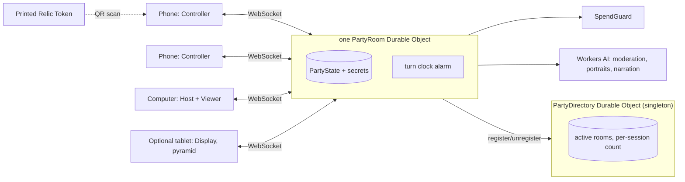
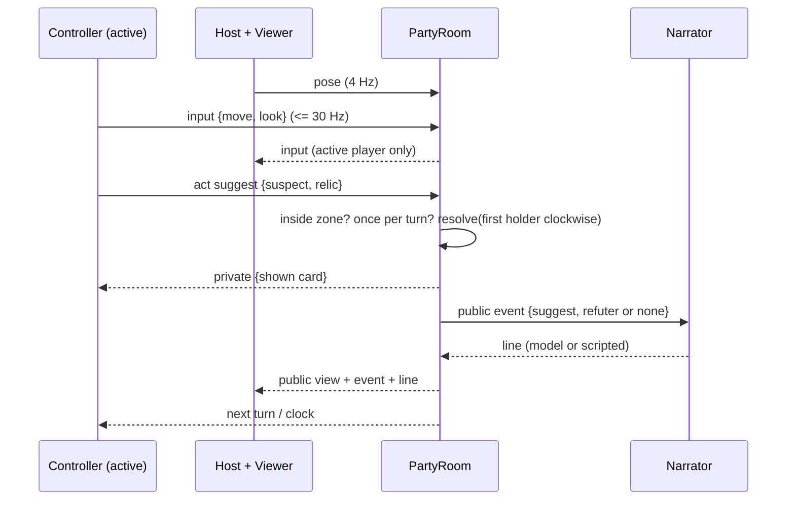

# Design Document

## Overview

**The server holds the secrets, the engine decides, the model narrates.** A `PartyRoom` Durable Object owns one game: seats, contributions, the Solution, every Hand, the turn clock and the event log. Phones, the shared Host screen and the optional Display are all thin clients that receive *views* the server computes for them. Game rules are pure functions in `shared/src/party/` (deal, views, turn order, clock, achievements, suggestion, accusation, bots), so they are property-tested without a network or a model. Narration reuses the ghost engine's validation and scripted-fallback approach, with party-specific directives and a prompt builder that can only see the Public View.

Decisions:
- **Premise stays gentle.** "Who is haunting this place?" (visitor ghost, zone, relic), not a murder. This keeps `steering/product.md` principle 3 intact and the content safe for a shared screen.
- **Phones are pads and private screens.** The same page switches between pad layout (landscape) and panel layout (portrait). No app, no account.
- **Server-authoritative clock and rules.** Clients render; they never decide. The Host reports pose at 4 Hz (it owns the collider) and the room sanitises it exactly as the ghost engine does.
- **Suggestions resolve automatically.** The first holder clockwise shows a card without anyone tapping, so a slow, absent or Bot player never stalls the table, and card choice is seeded for tests.
- **Everything physical is optional.** Relic tokens and the pyramid are bonuses; manual selection and a plain single-view Display always work.
- **Reuse, do not fork.** Zone placement extracts a helper from `ghost/anchors.ts`; contributions reuse the Ghost Creator, the world pipeline's upload and moderation rules, `SpendGuard`, and `validateGhostReply`.

Depends on: `ghost-creator` (Traits, Preset Ghosts, portrait and sprite routes, Persona), `ghost-engine` (anchor placement helper, `sanitizePose`, reply validation, scripted lines), `world-pipeline` (SpendGuard meters, upload rules, moderation, retention), `world-viewer` (`ViewerBridge`, haunt layer, billboard).

## Architecture





## Components and interfaces

### Routes and sockets
| Route | Purpose | Req |
|---|---|---|
| `POST /api/party/rooms` `{worldId}` | create Room → `{code, joinUrl, hostToken}` or `world_too_small`, `party_disabled`, `rooms_full` | 1.1, 4.5, 10.6, 10.7 |
| `POST /api/party/:code/join` `{nickname}` | seat a Player → `{playerToken, seat}` or reason | 1.2, 1.3 |
| `GET /api/party/:code/ws` | WebSocket upgrade (origin checked); first message `hello {token, role}` within 5 s | 1.4, 1.6 |
| `POST /api/party/:code/contribute/photo` | multipart image + `promptId?`; moderation (includes `person_visible`); frame | 3.2, 3.9 |
| `POST /api/party/:code/prompt/skip` | up to three skips per Player → `{round, prompts}` or `{error}` | 3.8 |
| `POST /api/party/:code/contribute/suspect` | traits → Ghost Creator flow charged to the Room | 3.3 |
| `PUT /api/party/:code/contribute/zone` | zone name | 3.1 |
| `DELETE /api/party/:code` | host ends Room; delete everything | 1.5, 10.4 |

### PartyDirectory Durable Object
A single named DO (key `"party-directory"`) is the only place that tracks live rooms. `createRoom(code, sessionId)` atomically checks the 20-room total cap and the one-active-room-per-session rule, inserts the entry and returns `ok` or `rooms_full`. `deleteRoom(code)` removes the entry. `PartyRoom` calls both under its own mutex so the directory is always consistent; a failed `createRoom` rolls back the new DO stub immediately. The directory stores only: code → {createdMs, sessionId}. It has no sockets and no alarm of its own. **This is the only place that enforces the total Room cap and the per-session cap** (Req 10.6).

Roles: `host`, `controller`, `display`. The join URL carries only the Room Code. Tokens are issued after join (players) or at creation (host), are random 128-bit values, and are sent only in the socket's first message or an `Authorization` header, never in URLs.

### Socket messages (zod schemas in `shared/src/party/protocol.ts`)
Client → Room: `hello`, `ready`, `input {seq, move:[x,y], look:[dx,dy], aim?:[dx,dy]}`, `pose {pos, yaw}` (host only), `act {kind:'suggest', suspect, relic}`, `act {kind:'accuse', suspect, zone, relic}`, `act {kind:'pass'}`, host-only `settings`, `start`, `pause`, `resume`, `addBot`, `end`, `playAgain`.
Room → Client: `publicView`, `privateView`, `event {id, kind, data}` (public), `shown {card}` (private), `clock {deadlineMs, serverNowMs}`, `error {code}`.
Every message is validated; unknown or oversized messages close the socket. `input` and `pose` are not persisted.

### `shared/src/party/`
`roomCode.ts` (`generateRoomCode`, `normalizeCode`), `nickname.ts` (`sanitizeNickname`), `seats.ts` (`seatPlayer`, `canJoin`), `auth.ts` (`authorize(token, resource)`), `room.ts` (serialise/parse, expiry), `input.ts` (`sanitizeInput`, `coalesceInput`, `releaseAll`), `pool.ts` (`buildPool`), `photoPrompts.ts` (`PHOTO_PROMPTS`, `offerPrompts`, `skipOffer`), `deal.ts` (`dealCase`), `views.ts` (`publicView`, `privateView`), `zones.ts` (`placeZones`, `validateZones`, `ringZones`), `notebook.ts` (`autoMarks`, `markCard`), `turns.ts` (`nextPlayer`, `advance`), `budget.ts` (`turnBudget`), `achievements.ts` (`earned`, `bonusSeconds`), `clock.ts` (`clockStatus`, `onDisconnect`), `suggest.ts` (`canSuggest`, `resolveSuggestion`), `accuse.ts` (`resolveAccusation`, `gameOver`), `relicToken.ts` (`parseRelicToken`), `ending.ts` (`endingPayload`, `playAgain`), `bots.ts` (`botAct`), `narrate.ts` (`PartyDirective`, `buildPartyPrompt`, `partyScripted`), `spend.ts` (`roomCaps`, `narrationRequests`), `telemetry.ts` (whitelist), `limits.ts` (`acceptJoin`, `acceptRoom`), `display.ts` (`pyramidLayout`, `effectLimits`).
`shared/src/print/`: `stl.ts` (`writeStl`, `checkMesh`), `qrPlate.ts` (`qrPlateMesh`, `rasterTop`), `pyramid.ts` (`pyramidTrapezoid`, `holderParams`), `standee.ts` (`standeeMesh`).

**Photo Prompts.** `PHOTO_PROMPTS` is a fixed catalogue of 12 entries, each `{ id, text, tip, source: 'camera_roll' | 'take_now' }`: a meal you ate recently, a pet or any animal, the view from a window, a street or building near home, a place outdoors you like, a mug or cup you use, your shoes, the sky right now, something on the nearest table, a plant, a door you use every day, a favourite chair or corner. Every `tip` ends with "No people or faces." `offerPrompts(seed, seat, round) → [PromptId, PromptId, PromptId] | null` shuffles the catalogue with the seeded stream `photo:<seat>` (derived from the Room seed) and returns entries `3 × round` to `3 × round + 2`, for `round` 0 to 3, and `null` for any larger round. Four rounds of three use all 12 entries exactly once, so a Player who skips three times never sees a repeat. The Room stores only each Player's current `round` (the skips used); there is no cross-Player rule, so two Players may be offered or choose the same Prompt. `skipOffer(round) → round + 1 | null` returns `null` after the third skip. Prompts are not secret and travel in the lobby view; they are not a Contribution and are never required. The vision verdict returns `{safe, personVisible}`; `personVisible` turns into the `photo_rejected:person_visible` reason.

```ts
type Seat = 1 | 2 | 3 | 4 | 5 | 6;
type CardKind = 'suspect' | 'zone' | 'relic';
type Card = { kind: CardKind; id: string };            // s1..s6, z1..z6, r1..r6
type Solution = { suspect: string; zone: string; relic: string };
type Player = { seat: Seat; nickname: string; kind: 'human' | 'bot'; connected: boolean; eliminated: boolean;
                hand: Card[]; achievements: AchievementId[]; missedTurns: number };
type Phase = 'lobby' | 'playing' | 'ended';
type Turn = { seat: Seat; round: number; startedMs: number; budgetMs: number | null; pausedMs: number; suggested: boolean };
type LogEvent =
  | { kind: 'turn-start'; seat: Seat; atMs: number } | { kind: 'visit'; seat: Seat; zone: string; sinceTurnMs: number }
  | { kind: 'suggest'; seat: Seat; zone: string; suspect: string; relic: string; refuter: Seat | null }
  | { kind: 'accuse'; seat: Seat; correct: boolean } | { kind: 'timeout'; seat: Seat } | { kind: 'achievement'; seat: Seat; id: AchievementId };
type PartyState = { code: string; phase: Phase;
                    // seed is a secret 128-bit value (crypto.getRandomValues); it never leaves the DO.
                    // Anything visible to clients (e.g. bot wait times on the Host) uses a separate
                    // derived stream so the deal cannot be replayed from observable output.
                    seed: Uint8Array /* 16 bytes, CSPRNG */;
                    settings: Settings; players: Player[]; turn: Turn | null;
                    solution: Solution | null; pool: Pool; log: LogEvent[]; createdMs: number; lastActiveMs: number; hostToken: string };
// Public and Private Views are derived; they are separate types so a Hand cannot be put in a Public View by mistake.
type PublicView = { phase: Phase; players: { seat: Seat; nickname: string; eliminated: boolean; connected: boolean; handSize: number }[];
                    turnSeat: Seat | null; round: number; pool: PublicPool; log: PublicEvent[]; solution?: Solution /* only when ended */ };
type PrivateView = { seat: Seat; hand: Card[]; shown: Card[] };
```

### Case building and dealing
`buildPool(contributions, presets, seed)`: suspects = contributed Ghost Profiles first (one per Player, at most six), then Preset Ghosts by seeded order until six; zones = contributed names first then the curated list by seeded order; relics = the fixed catalogue `r1 music box, r2 wax hand, r3 locket, r4 planchette, r5 silver key, r6 bell`. `dealCase(pool, seats, seed)`: seeded shuffle per category, the first card of each shuffled category is the Solution, the other 15 are shuffled together and dealt round robin from a seed-chosen seat, so hand sizes differ by at most one. `seed` here and in `botAct` / `resolveSuggestion` / `playAgain` is a **derived substream** (e.g. HKDF or XChaCha20 keystream) of the room's secret seed, never the raw bytes. The derived stream for public-facing output (bot wait times as seen by the Host, refuter selection visible in the public event) is separate from the stream for private choices (shown card selection), so observing public output cannot help a player reconstruct the deal.

### Views and leakage
`publicView(state)` and `privateView(state, seat)` are the only functions that cross the room boundary. The Public View exposes hand *sizes*, never cards, and exposes the Solution only when `phase === 'ended'`. Public events are redacted constructions: a `suggest` event carries seat, zone, suspect, relic and the refuter seat (or null), never the card shown. The narrator's `buildPartyPrompt(publicState, directive)` takes a `PublicView` by type, so private data cannot reach it.

### Zones
`placeZones(sampler, spawn, bounds, walkRadius, seed)` calls the shared `placePoints` helper extracted from `ghost/anchors.ts` with `count = 6`, the same rules as Anchors (walkable floor, inside the walk radius and bounds, ≥ 3 m from the spawn, ≥ 4 m apart, radius 2.5 m), and `ringZones` as fallback: six points 60° apart on a ring of radius clamp(0.6 × walkRadius, 4, 8). Precondition: walk radius ≥ 7 m, else authored Zones or `world_too_small`. Extracting the helper must not change `placeAnchors`.

### Turns, clock, achievements
`nextPlayer(players, current, now)`: next seat in order that is not eliminated and not skipped for missed turns; increments the round when the order wraps. `turnBudget({baseSeconds | null, bonusSeconds, capSeconds = 120})` returns `min(cap, base + bonus)` seconds, or `null` for no clock. The clock lives in the Durable Object as a **single alarm**. Because a Durable Object supports only one alarm at a time, `nextWake(state, now): number` is a pure function that returns the earliest of all pending deadlines: the turn expiry (`startedMs + pausedMs + budgetMs`), the 10-second warning, the 20-second disconnect-pause grace, any pending bot-think deadline, and the 6-hour room TTL. The DO always sets its alarm to `nextWake`, recomputes on every state change, and dispatches in the alarm handler by comparing `now` against each deadline. `clockStatus(turn, now)` returns `running`, `warning` (≤ 10 s) or `expired`. `onDisconnect` pauses the clock for up to 20 s then ends the Turn; two consecutive missed Turns skip the Player until they reconnect. Achievements are detectors over the event log: `wanderer` (three distinct `visit` zones by that seat), `cartographer` (all six), `quick feet` (a `visit` with `sinceTurnMs ≤ 20 000`), `persistent` (three `suggest`), `second wind` (two `timeout`). `earned(log, seat)` is a set, so evaluation is idempotent and order-independent; `bonusSeconds` sums the catalogue values of earned ids (10, 15, 5, 10, 10) and applies from the next Turn.

### Suggestion and accusation
`canSuggest(state, seat, pose)`: active seat, pose inside a Zone's radius, `turn.suggested === false`. `resolveSuggestion(state, seat, {zone, suspect, relic})`: walk seats clockwise from `seat + 1` (wrapping, excluding `seat`), the refuter is the first whose Hand intersects the three cards; `shown` is the intersection element chosen by `seededPick(seed, turnIndex)`; result `{refuter: Seat | null, shown?: Card}` where only the suggester receives `shown`. `resolveAccusation(state, seat, triple)` returns `{correct}`; wrong marks the Player eliminated (Hand stays). `gameOver(state)` is true on a correct Accusation, when every Player is eliminated, or when `round > maxRounds`.

### Narration
Directives: `turn-start`, `suggest`, `shown`, `none-shown`, `accuse-wrong`, `accuse-right`, `achievement`, `time-warning`, `ended-solved`, `ended-unsolved`. `partyScripted(kind, persona, rng)` has at least five variants per kind in the host ghost's voice. At most one model narration is requested per public event, for the whole Room; `narrationRequests(eventLog) ≤ publicEventCount`. The reply passes `validateGhostReply`; failure or cap or kill switch means a scripted line. Game state never reads the narration.

### Spend
Room caps default to 12 image units and 60 model units, enforced through `SpendGuard` with the Room id as the scope; global caps still apply. Preset Ghosts, Gallery Worlds and scripted lines make a zero-spend game possible.

### Display and pyramid
`pyramidLayout({width, height, innerPx, tilePx, orientation, mirror})` returns four tiles centred at `innerPx + tilePx/2` from the centre along ±x and ±y, rotated 0°, 90°, 180°, 270° (so each faces its pyramid side), each tile shrunk with `fitTile` when it would leave the screen, never overlapping. `innerPx` and `tilePx` come from the on-screen calibration (the user matches a drawn square to the pyramid's footprint); no pixel density is assumed. `effectLimits(events, prefersReducedMotion)` schedules reactions so flashes ≤ 3 per second and luminance step ≤ 20%, and returns none when reduced motion is preferred. Whether tops point inward or outward, and whether to mirror, is decided by Spike 1.3 on real hardware.

### Print Kit
- `pyramidTrapezoid({baseMm, topMm})` returns an isosceles trapezoid whose slant height is `(baseMm − topMm)/2 × √2`, which puts the faces at 45° to the screen. Defaults 60 mm and 10 mm (about 6 cm base, 1 cm top, 3.5 cm slant, as in common phone-sized templates). `holderParams` scales it for larger screens.
- `qrPlateMesh(matrix, {moduleMm ≥ 1.2, baseMm, reliefMm})` builds a watertight heightfield solid: a base plate with dark modules raised by `reliefMm`; vertices are on a 1 µm integer grid so welding is exact. The plate is at most 40 mm per side.
- `checkMesh(mesh, {bedMm: 180})` welds vertices, requires every edge to be shared by exactly two faces with opposite orientation, positive signed volume, and a bounding box that fits the bed. `writeStl` emits binary STL.
- `standeeMesh(alphaMask, {thicknessMm, baseMm})` traces the alpha silhouette, simplifies it, extrudes it and adds a base (stretch).
- Relic and holder `.scad` files take their parameters from a shared header; `tools/build-print.mjs` runs `openscad` when installed, writes STLs to `dist/print/`, runs `checkMesh` on every one and exits non-zero on failure. QR scan reliability of a single-colour relief plate is unverified; Spike 1.2 compares it with a two-colour plate.

### Bots
`botAct(privateView, publicView, settings, rng)` returns one legal action: move toward an unvisited Zone, make a Suggestion when inside one, and accuse only when its notebook (derived from its own Private View) leaves exactly one candidate per category. It receives no other Hand by construction.

## Error handling
Codes: `party_disabled`, `rooms_full`, `world_too_small`, `room_unknown`, `room_full`, `game_started`, `bad_token`, `rate_limited`, `photo_rejected:<reason>`, `quota_image`, `moderation_unavailable`, `not_your_turn`, `not_in_zone`, `already_suggested`, `bad_relic_token`. Contribution failures never stop the lobby: the Player is told and the Preset or default is used. A lost Host connection pauses the game and shows a reconnect state; the Room persists until its time to live. The narrator never blocks a turn.

## Testing strategy
- Property tests for every pure module; a model-based test drives `PartyState` with random sequences of join, leave, input, suggest, accuse, timeout and disconnect events against a small oracle and asserts the invariants (no leakage, hand partition, termination).
- A leakage fuzz test plants unique tokens in every Hand and the Solution, runs a game, and asserts no token appears in any Public View, public event, narrator prompt or log line before the game ends.
- `PartyRoom` is tested with an in-memory storage fake, a fake clock and a fake Workers AI. Sockets are tested with a fake pair.
- STL and QR tests use a test-only decoder. Print builds in CI skip `openscad` steps when the binary is absent but still run `checkMesh` on the TS-generated parts.
- Manual spikes record latency, device behaviour and pyramid photos in `docs/spikes/party-*.md`.

## Correctness Properties

### Property 1: Room codes are well formed
*For any* seed, `generateRoomCode` returns four characters from the unambiguous alphabet, and `normalizeCode` maps any case and spacing variant of a valid code to the same canonical code and rejects every other string.
**Validates: Requirements 1.1**

### Property 2: Seating and nicknames
*For any* sequence of join attempts, the number of seated Players never exceeds six, seats are unique, joins are refused with the correct reason when the Room is full or the game has started, and `sanitizeNickname` returns at most 16 characters with no control characters, markup or URLs and is idempotent.
**Validates: Requirements 1.2, 1.3**

### Property 3: Tokens grant exactly their own data
*For any* Room state and any token, `authorize` grants a Private View only to the token that owns that seat, grants the Public View to any valid token of that Room and to no other Room's token, a reconnect with a player token restores the same seat and Hand while a tokenless join after the start is refused, and `peekAllowed` returns true if and only if every other seated player is a Bot (this check runs server-side in `authorize`, not on the client).
**Validates: Requirements 1.4, 1.6, 9.3**

### Property 4: Room lifecycle round-trips and deletes completely
*For any* Room state, serialising then parsing yields an equal state, a Room older than its time to live is reported expired, and after deletion no photo, Sprite, nickname or state can be retrieved by any operation.
**Validates: Requirements 1.5, 10.4**

### Property 5: Controller input is bounded and never sticks
*For any* stream of raw input including NaN, infinities and oversized values, `sanitizeInput` returns a stick vector inside the unit disc and clamped look deltas, `coalesceInput` emits at most 30 messages per second, input from a non-active Player produces no movement, and `releaseAll` yields a zero stick and no held buttons.
**Validates: Requirements 2.2, 2.3**

### Property 6: The case pool is complete, deterministic and never blocked
*For any* set of Contributions (including none, duplicates, rejected photos and injected generation failures) and any seed, `buildPool` returns exactly six distinct Suspects, six distinct Zones and the six Relics, with contributed items first, equal output for equal inputs, and the lobby can always start.
**Validates: Requirements 3.1, 3.2, 3.3, 3.4**

### Property 7: The deal is a valid partition
*For any* pool, seat count from two to six and seed, `dealCase` yields one Suspect, one Zone and one Relic as the Solution, each of the other 15 cards in exactly one Hand, no Solution card in any Hand, Hand sizes differing by at most one, and identical output for identical inputs.
**Validates: Requirements 4.1**

### Property 8: Views never leak secrets
*For any* reachable state with unique random tokens planted in every Hand and the Solution, no Public View, public event, narrator prompt or log entry before the game ends contains any token, a Private View contains only its own Hand and cards shown to it, and after the game ends the Public View contains the Solution.
**Validates: Requirements 4.2, 4.3**

### Property 9: Zones are valid and the world-size rule holds
*For any* generated room, seed and spawn meeting the precondition, `placeZones` returns six Zones that pass `validateZones` (walkable, inside bounds and walk radius, ≥ 3 m from spawn, ≥ 4 m apart), identical for identical inputs; `validateZones` rejects any violation; `ringZones` always passes when the walk radius is at least 7 m; and a world below 7 m with no authored Zones is refused as `world_too_small`.
**Validates: Requirements 4.5**

### Property 10: Notebook marks are monotone
*For any* hand, set of shown cards and sequence of Player marks, `autoMarks` marks exactly the hand and the shown cards as no, a Player's mark is never removed by an automatic update, and applying the same updates in any order gives the same notebook.
**Validates: Requirements 4.4**

### Property 11: Turn order is fair
*For any* seating with any eliminations and skips, `nextPlayer` never returns an eliminated or skipped Player, visits every remaining Player once per Round in seat order, and increments the Round exactly when the order wraps.
**Validates: Requirements 5.1, 5.7**

### Property 12: Turn budgets and achievements are bounded and monotone
*For any* base, achievement set and cap, `turnBudget` equals `min(cap, base + bonus)` and is non-decreasing as achievements are added, is `null` exactly when no clock is selected, never exceeds 120 seconds with the default cap, and `earned` over any event log is a set that is idempotent, independent of event order, awards each achievement at most once, and only counts events by that seat.
**Validates: Requirements 5.2, 5.4, 5.6**

### Property 13: The clock, nextWake, and disconnects end turns exactly once
*For any* turn, pause and disconnect timeline, `nextWake(state, now)` returns the minimum of all pending deadlines (turn expiry, 10-second warning, disconnect-pause grace, bot-think deadline, room TTL); the DO alarm is always set to `nextWake` and is recomputed on every state change. `clockStatus` is `warning` exactly in the last 10 seconds and `expired` exactly at or after the deadline; an expired Turn ends exactly once with no penalty other than the lost Turn; a disconnect pauses the clock for at most 20 seconds before the Turn ends; and two consecutive missed Turns cause a skip until reconnect.
**Validates: Requirements 5.3, 5.5**

### Property 14: Suggestions resolve to the first holder clockwise
*For any* state, suggester and suggestion, `canSuggest` is true only for the active Player inside a Zone who has not yet suggested this Turn, and `resolveSuggestion` returns the first Player clockwise whose Hand intersects the three cards (eliminated Players and Bots included), a shown card that is in both the suggestion and that Hand, no refuter exactly when no Hand intersects, the same result for the same seed, and a public event that does not contain the shown card.
**Validates: Requirements 6.1, 6.2**

### Property 15: Accusations decide the game and the game terminates
*For any* state and accusation, `resolveAccusation` is correct if and only if all three cards equal the Solution, a wrong Accusation eliminates only the accuser and keeps their Hand in play, `gameOver` is true exactly when an Accusation was correct, every Player is eliminated, or the round limit is exceeded, the ended state is absorbing, and any sequence of legal actions ends within `maxRounds × players` Turns.
**Validates: Requirements 6.3, 6.5**

### Property 16: Relic tokens parse strictly
*For any* string, `parseRelicToken` returns a Relic id if and only if the string is exactly `hw:` followed by one of the six ids, never throws, and `parseRelicToken(`hw:${id}`)` returns `id` for all six.
**Validates: Requirements 6.4**

### Property 17: Endings and replays preserve what they should
*For any* ended game, `endingPayload` contains the Solution, the winner if any and a timeline without private data, and `playAgain` keeps the Players, world and Contributions, resets Hands, eliminations, achievements and the log, and uses a new seed.
**Validates: Requirements 6.6**

### Property 18: The pyramid layout is symmetric and in bounds
*For any* screen size, inner offset and tile size, `pyramidLayout` returns four tiles with rotations 0, 90, 180 and 270, symmetric about the centre, inside the screen, non-overlapping, and tile size non-decreasing in the requested size until clamped.
**Validates: Requirements 7.3**

### Property 19: Display effects respect photosensitivity limits
*For any* sequence of public events, the schedule from `effectLimits` has at most three flashes in any one-second window and a luminance step of at most 20%, and is empty when reduced motion is preferred.
**Validates: Requirements 7.4**

### Property 20: Printed meshes are valid and QR plates round-trip
*For any* QR matrix, `qrPlateMesh` produces a mesh that passes `checkMesh` (every edge shared by two opposite-facing faces, positive volume, fits a 180 mm bed), has modules of at least 1.2 mm and a side of at most 40 mm, and `rasterTop` of the mesh equals the matrix; and `checkMesh` rejects a mesh with a missing face, a flipped face, or a bounding box over the bed.
**Validates: Requirements 8.2**

### Property 21: Pyramid faces are consistent
*For any* base and top edge with `top < base`, `pyramidTrapezoid` returns an isosceles trapezoid whose faces are within one degree of 45° to the screen, whose slant height increases with the base, and whose defaults are a 60 mm base and a 10 mm top.
**Validates: Requirements 8.3**

### Property 22: Bots are legal and blind to other hands
*For any* state and seed, every action from `botAct` is legal in that state, the action is unchanged when every other Player's Hand is replaced by random cards, a Bot accuses only when its notebook leaves exactly one candidate per category, and `peekAllowed` is true if and only if every other seated player is a Bot (and this is determined server-side in `authorize`, not by the client).
**Validates: Requirements 9.2, 9.3**

### Property 23: Spend is bounded and narration never changes the game
*For any* sequence of events and any narration outcomes (success, failure, timeout, over cap, kill switch), reserved plus committed units never exceed any Room or global cap, no upstream call is made after a denial, at most one narration is requested per public event, and the sequence of game states is identical in every case.
**Validates: Requirements 10.1, 10.2**

### Property 24: Telemetry carries no content and abuse is capped
*For any* game with random nicknames, Zone names, details and photos, every telemetry event uses only whitelisted counter names and error codes and contains none of that content, and for any stream of join and create attempts `acceptJoin` and `acceptRoom` never exceed their per-hash, per-session and total limits.
**Validates: Requirements 10.5, 10.6**

### Property 25: Photo Prompt offers are deterministic, complete and bounded
*For any* Room seed and seat, `offerPrompts` returns three distinct catalogue entries for rounds 0 to 3, equal output for equal inputs, the four rounds together contain every catalogue entry exactly once, and rounds above 3 return `null`; `skipOffer` advances the round by one for rounds 0 to 2 and returns `null` at round 3; and offers for one seat do not depend on any other seat's round.
**Validates: Requirements 3.6, 3.7, 3.8**
