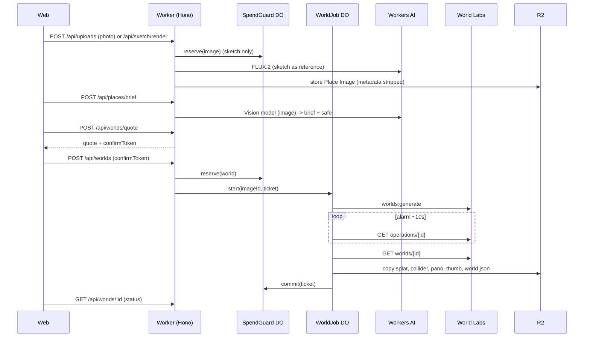

# Design Document

## Overview

The pipeline is a set of Hono routes on a Cloudflare Worker plus three Durable Objects. All rules that can be pure live in `shared/` so they can be property-tested; Durable Objects hold the only mutable state and are tested model-based. Every paid call lives in `api/src/guarded/` and needs a `SpendTicket`.

Key decisions:
- **SpendGuard is one global Durable Object.** Its single-threaded storage gives atomic reserve/commit/release without locks.
- **WorldJob is one Durable Object per world**, driven by alarms (no long-held requests). The client polls our status endpoint, which only reads the DO.
- **We copy assets to R2** instead of proxying upstream URLs, so expiry, hostnames and keys never reach the browser.
- **Default path is a single image.** Multi-view synthesis is an evidence-gated option (Requirement 11).

## Architecture



## Components and interfaces

### HTTP API (all JSON unless noted; session cookie required; origin checked)
| Route | Purpose | Req |
|---|---|---|
| `POST /api/uploads` (multipart) | validate, strip, store → `{imageId}` | 1.x |
| `POST /api/sketch/render` `{sketchPng, caption}` | → `{candidates:[{imageId}], quota}` | 2.x |
| `POST /api/sketch/select` `{imageId}` | promote candidate to Place Image | 2.5 |
| `POST /api/places/brief` `{imageId}` | → `{brief, safe}` | 3.x |
| `POST /api/worlds/quote` `{imageId}` | → `{imageUrl, quota, confirmToken}` | 4.1–4.2 |
| `POST /api/worlds` `{imageId, confirmToken, turnstile?}` | → `{worldId, status}` | 4.3–4.5, 5.x, 6.x |
| `GET /api/worlds/:id` | status + manifest when ready | 7.3, 8.2 |
| `GET /api/worlds/:id/assets/:name` | range-capable asset stream | 8.4 |
| `DELETE /api/worlds/:id` | delete my place | 10.2 |
| `GET /api/gallery` | list Gallery Worlds | 9.2 |
| `GET /api/quota` | remaining per meter | 5.7 |

### `shared/` pure modules
`upload.ts` (validate + `stripJpegMetadata`), `sketch.ts` (`inkCoverage`, `buildSketchPrompt`), `token.ts` (`signConfirm`, `verifyConfirm`), `dedup.ts` (`worldKey`), `job.ts` (`jobReducer`), `manifest.ts` (`buildManifest`), `retention.ts` (`expiredKeys`), `enhance.ts` (`planEnhance`), `errors.ts`.

### Durable Objects
- `SpendGuard`: `reserve({meter, sessionId, ipHash, now}) → {ok:true, ticket} | {ok:false, reason}`, `commit(ticket)`, `release(ticket)`, `remaining(sessionId, ipHash)`, `setKill(on)`. Meters: `world`, `image`, `llm`. Caps: session, ip-day, global-day, global-total (world only). Unreleased reservations expire after 30 min and are treated as released.
- `WorldJob`: `start(args)`, `status()`, `alarm()`; uses `jobReducer` for every transition; persists after each event.

## Data models

```ts
type Meter = 'world' | 'image' | 'llm';
type SpendTicket = { id: string; meter: Meter; sessionId: string; issuedAt: number };

type JobState = 'queued' | 'generating' | 'ingesting' | 'ready' | 'failed';
type JobEvent =
  | { t: 'started'; operationId: string }
  | { t: 'poll_pending' } | { t: 'poll_done' }
  | { t: 'rate_limited'; retryAfterMs?: number }
  | { t: 'upstream_error'; status: number }
  | { t: 'ingest_ok' } | { t: 'ingest_failed'; code: string }
  | { t: 'timeout' };

type WorldManifest = {
  id: string; title: string; createdAt: number; source: 'upload' | 'sketch' | 'gallery';
  assets: { splat: AssetRef[]; collider?: AssetRef; pano?: AssetRef; thumb?: AssetRef };
  orientation: { upFix: [number, number, number, number] /* quaternion */; scale: number };
  spawn: { position: [number, number, number]; yaw: number }; floorY: number;
  bounds: { min: [number, number, number]; max: [number, number, number] };
  brief: string; anchors?: Anchor[]; ghostPreset?: string;
};
type AssetRef = { path: string; bytes: number; lod?: '100k' | '500k' | 'full' };
```
Orientation, scale, spawn, floorY and bounds are computed at ingest with defaults and hand-tunable for Gallery Worlds (Spike 1.1 fixes the defaults).

## Job state machine
`queued → generating → ingesting → ready`; `failed` reachable from any non-terminal state. `ready` and `failed` are absorbing. Rate-limit events only extend the next poll delay. `timeout` fires at 20 min from start. Every transition into `failed` or on timeout is accompanied by `SpendGuard.release`; `ready` by `commit`.

## Error handling
Stable codes in `shared/src/errors.ts`: `bad_type`, `too_large`, `too_small`, `bad_magic`, `blank_sketch`, `quota_session`, `quota_day`, `quota_total`, `gen_disabled`, `unsafe_image`, `moderation_unavailable`, `bad_confirm`, `confirm_expired`, `turnstile_failed`, `upstream_rate_limited`, `upstream_rejected`, `upstream_no_credits`, `ingest_failed`, `timeout`. Routes map codes to user-safe copy; upstream bodies are never forwarded.

## Testing strategy
- Property tests (fast-check) for every pure module and a model-based test for SpendGuard (random command sequences vs. a simple counter model).
- Contract tests: `buildManifest` against recorded World Labs fixtures plus mutated variants (missing optional assets, missing splat).
- Route tests with fakes for Workers AI, World Labs and R2. No test makes a paid call.
- Manual spikes (1.1–1.3) produce fixtures and decisions before dependent code is written.

## Correctness Properties

### Property 1: Upload validation is exact
*For any* byte sequence, declared content type and dimensions, validation accepts if and only if the magic bytes match an allowed type, the declared type agrees, size ≤ 10 MB and dimensions are within bounds; otherwise it returns a specific reason code.
**Validates: Requirements 1.1, 1.2**

### Property 2: Metadata stripping preserves pixels and removes metadata
*For any* valid JPEG with arbitrary APP1 (EXIF/XMP), APP13 and comment segments inserted, `stripJpegMetadata` returns a JPEG containing none of those segments whose entropy-coded scan data is byte-identical to the input's.
**Validates: Requirements 1.3**

### Property 3: Prompt composition is bounded and contained
*For any* caption string, the built prompt has no control characters, is within the length cap, contains the sanitised caption only inside the data clause, and always contains the fixed negative prompt.
**Validates: Requirements 2.3**

### Property 4: Blank sketches are rejected
*For any* bitmap, `inkCoverage` equals the fraction of ink pixels, and the sketch is rejected if and only if that fraction is below 0.005.
**Validates: Requirements 2.2**

### Property 5: Confirm tokens bind their inputs
*For any* (imageId, imageHash, sessionId, issuedAt) and verification time, `verifyConfirm` succeeds if and only if the presented tuple equals the signed tuple and the time is before expiry; changing any single field or any single bit of the token makes verification fail.
**Validates: Requirements 4.2, 4.3**

### Property 6: Creation is idempotent
*For any* sequence of create requests carrying the same Confirm Token or matching an in-flight key, exactly one upstream generate call is made and every request receives the same job id.
**Validates: Requirements 4.4, 6.2**

### Property 7: SpendGuard never exceeds a cap
*For any* interleaving of reserve, commit, release and expiry commands across sessions, at every step committed plus reserved units for each cap never exceed that cap, and a denied reserve leaves all counters unchanged.
**Validates: Requirements 5.1, 5.6**

### Property 8: Reservations are accounted exactly once
*For any* ticket, reserve followed by release restores all counters to their prior values, reserve followed by commit leaves exactly one unit consumed, and repeated commit or release of the same ticket has no further effect.
**Validates: Requirements 5.2, 5.3**

### Property 9: Job state machine is safe
*For any* sequence of job events, transitions follow only the allowed edges, `ready` and `failed` are absorbing, the 20-minute timeout yields `failed`, and every run that ends `failed` also produces a release effect while every run that ends `ready` produces a commit effect.
**Validates: Requirements 7.2, 7.6, 5.2**

### Property 10: Dedup key is a function of image and options
*For any* two (imageBytes, options) pairs, `worldKey` is equal if and only if the image hashes and normalised options are equal.
**Validates: Requirements 6.1**

### Property 11: Manifest building is total and fail-closed on splat
*For any* World Labs response variant derived from the fixtures by deleting or emptying optional assets, `buildManifest` returns a schema-valid manifest; for any variant with the splat missing or empty it returns a typed `ingest_failed` error.
**Validates: Requirements 8.2, 8.3**

### Property 12: Browser-facing payloads leak no secrets or upstream URLs
*For any* manifest or status response built from fixtures containing upstream hostnames and a sentinel API key, the serialised JSON contains neither the sentinel nor any upstream asset URL.
**Validates: Requirements 8.5**

### Property 13: Retention deletes exactly the expired non-Gallery objects
*For any* set of stored objects with kinds and ages and any current time, `expiredKeys` returns exactly the upload objects older than 24 hours and user-world objects older than 7 days, and never a Gallery object.
**Validates: Requirements 10.1**

### Property 14: Enhance plans overlap and fall back
*For any* image dimensions, `planEnhance` returns a set of views with pairwise-distinct azimuths and each extension overlapping the original by at least 40%; and for any failure injected at any step the final prompt is the single-image prompt with the original photo.
**Validates: Requirements 11.1, 11.3**
