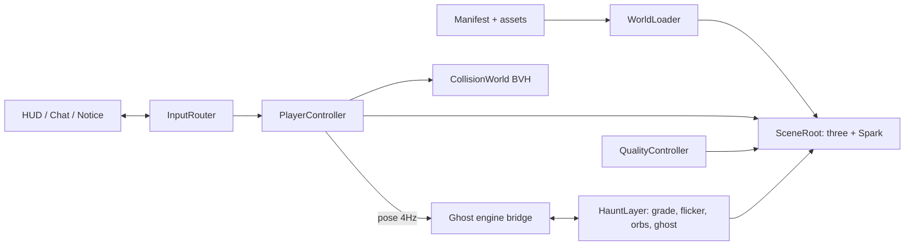

# Design Document

## Overview

The viewer is a React shell around a three.js scene that renders a Spark splat mesh. Everything that can be a pure function is one and lives in `shared/src/viewer/` so it can be property-tested without a GPU: orientation math, movement integration, flicker, orb intensity, ghost placement, quality control, device-tier selection, input mode, and memory-card layout. The scene code is thin glue that feeds these functions each frame.

Decisions:
- **Spark for splats, three-mesh-bvh for collision.** The splat is never used for collision; the Collider GLB is, invisible. No collider → disc-constrained fallback.
- **Post effects are cheap.** Grade, vignette and grain are a full-screen overlay; flicker modulates a single brightness uniform. Exact hooks into Spark (opacity/recolor) are confirmed in Spike 1; if absent, the overlay alone is used.
- **The game owns Haunt Level and anchors.** The viewer only renders and reports player pose (≤ 4 Hz).
- **Graceful degradation ladder:** full splat world → lower LOD/resolution → panorama viewer → thumbnail. The chat works at every rung.

## Architecture



## Components and interfaces

- `WorldLoader`: `load(manifest, caps) → LoadedWorld | LoadError`; picks LOD with `chooseLod`, retries with backoff, applies `orientationTransform`.
- `PlayerController`: holds position/yaw/pitch; each frame calls `stepMovement(state, input, dt, params)` then `resolveCollision` (BVH capsule) or `constrainToDisc`.
- `HauntLayer`: `setHauntLevel(n)`, `setAnchors(anchors, foundIds)`, `setGhost({visible})`; computes `flicker`, `orbIntensity`, `ghostPlacement` per frame.
- `QualityController`: consumes frame times, emits `QualityLevel` changes.
- `PanoFallback`: equirectangular sphere viewer with drag-to-look.
- `ViewerBridge` (to ghost engine): events `pose {pos, yaw}` (≤ 4 Hz), `openChat`, `closeChat`; commands `setHauntLevel`, `setFound`, `showGhost`.
- `InputRouter`: owns `InputMode`; in `chat` mode all movement keys/sticks are ignored.

```ts
type Vec3 = [number, number, number];
type MoveParams = { walk: number; sprintMul: number; eyeHeight: number; bounds: Bounds; floorY: number };
type MoveInput = { forward: number; strafe: number; sprint: boolean; yawDelta: number };
type DeviceCaps = { mobile: boolean; memoryGb?: number; cores?: number; maxTexture: number; webgl2: boolean };
type QualityLevel = 0 | 1 | 2 | 3;   // 0 = lowest
type InputMode = 'play' | 'chat';
```

## Pure functions (in `shared/src/viewer/`)
- `orientationTransform({upFix, scale}) → Matrix4`: rotation then uniform scale; determinant positive.
- `stepMovement(state, input, dt, params)`: dt clamped to ≤ 50 ms, speed ≤ walk × sprintMul, position clamped to bounds.
- `constrainToDisc(pos, spawn, radius, eyeHeight)`.
- `flicker(t, seed, reducedMotion) → multiplier ∈ [0.8, 1]`: dips scheduled at least 400 ms apart, each ≥ 80 ms eased; always 1 when reduced motion.
- `orbIntensity(distance, found, radius) → [0, 1]`: 0 if found; non-increasing in distance.
- `ghostPlacement(playerPos, yaw, anchor?, t, bounds) → Vec3`: deterministic; distance to player ≥ 1.2; clamped inside bounds.
- `nextQuality(state, fpsSample, now) → {level, state}`: implements the 3 s / 5 s / 30 s rules.
- `chooseLod(caps, available) → AssetRef`: monotone in capability; always returns an available LOD.
- `inputReduce(mode, event) → {mode, movementEnabled}`.
- `layoutMemoryCard(memories, thumb) → CardLayout`: includes exactly the found memories, each excerpt ≤ 120 chars.

## Error handling
`LoadError` codes: `webgl_unavailable`, `splat_failed`, `manifest_invalid`, `collider_failed` (non-fatal), `pano_failed`. Non-fatal errors log a code and degrade; fatal ones show the Gallery link. Out-of-bounds or NaN positions trigger `resetToSafe()`.

## Testing strategy
- Property tests on all pure functions (below), seeded and ≥ 100 runs.
- Collision property uses generated box rooms with a BVH built in Node (no GPU).
- Component smoke tests with `jsdom` for HUD focus order and live region.
- Manual perf checklist on one integrated-GPU laptop and one mid-range phone, recorded in `docs/spikes/2.1.md`.

## Correctness Properties

### Property 1: Orientation maps up to +Y and preserves handedness
*For any* manifest up-fix quaternion and positive scale, the transform sends the declared up vector to +Y (within ε), scales distances uniformly, and has a positive determinant.
**Validates: Requirements 1.4**

### Property 2: Movement stays in bounds, never exceeds speed, and is frame-rate independent
*For any* input sequence and frame times, positions are finite and inside the bounds, per-second displacement never exceeds walk × sprint multiplier, and advancing by one step of dt versus two steps of dt/2 with the same input yields positions within a small tolerance.
**Validates: Requirements 2.3, 2.6**

### Property 3: Collision resolution never leaves the player inside geometry
*For any* generated room collider, free start position and move vector, the resolved capsule is at least its radius (minus ε) from every collider surface, and its feet are on the floor within tolerance.
**Validates: Requirements 2.4**

### Property 4: Disc fallback confines and holds height
*For any* sequence of moves with no collider, the player remains within the fixed radius of the spawn and at constant eye height.
**Validates: Requirements 2.5**

### Property 5: Flicker is bounded and off under reduced motion
*For any* seed and any one-second window, the number of flicker dips is at most 3, the multiplier stays within [0.8, 1], and with reduced motion enabled it is exactly 1.
**Validates: Requirements 3.2, 6.2**

### Property 6: Orb intensity is monotone and zero when found
*For any* anchor radius and two distances d1 ≤ d2, `orbIntensity(d1) ≥ orbIntensity(d2)`, values lie in [0, 1], and a found anchor always yields 0.
**Validates: Requirements 3.3**

### Property 7: Ghost placement keeps distance and bounds
*For any* player position, yaw, optional anchor, time and bounds, `ghostPlacement` is at least 1.2 m from the player, inside the bounds, and identical for identical inputs.
**Validates: Requirements 3.4**

### Property 8: Quality control obeys its timing rules
*For any* sequence of timestamped frame-rate samples, quality changes by at most one level per step, at most one downward step occurs per 5 seconds, the level stays within [0, max], and no upward step occurs within 30 seconds of a downward step.
**Validates: Requirements 5.2**

### Property 9: Chat mode suspends movement
*For any* sequence of open-chat, close-chat and movement events, movement is applied if and only if the current mode is `play`, and closing the chat always returns to `play`.
**Validates: Requirements 4.2**

### Property 10: LOD choice is available and monotone
*For any* device capabilities and non-empty set of available LODs, `chooseLod` returns one of them, and a device with greater-or-equal capability in every dimension never gets a lower LOD.
**Validates: Requirements 1.1**

### Property 11: Memory card contains exactly the found memories
*For any* list of memories with found flags and any text, the card layout lists exactly the found ones, each excerpt is at most 120 characters, and no field outside thumbnail, titles and excerpts is present.
**Validates: Requirements 7.1**
