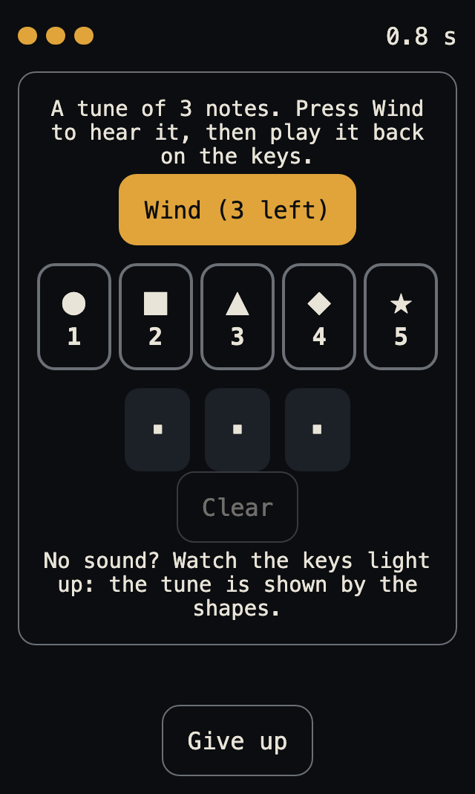
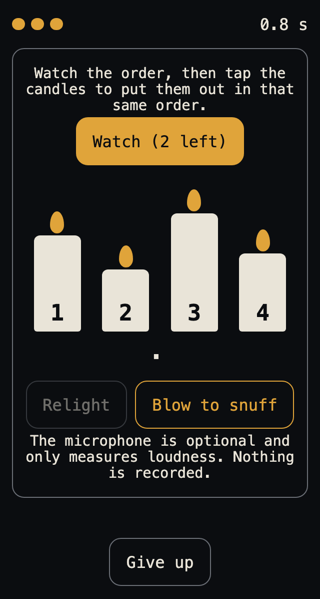
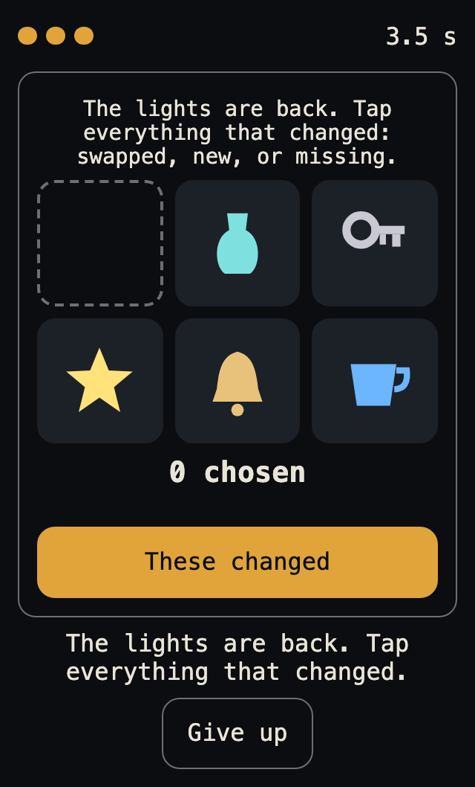
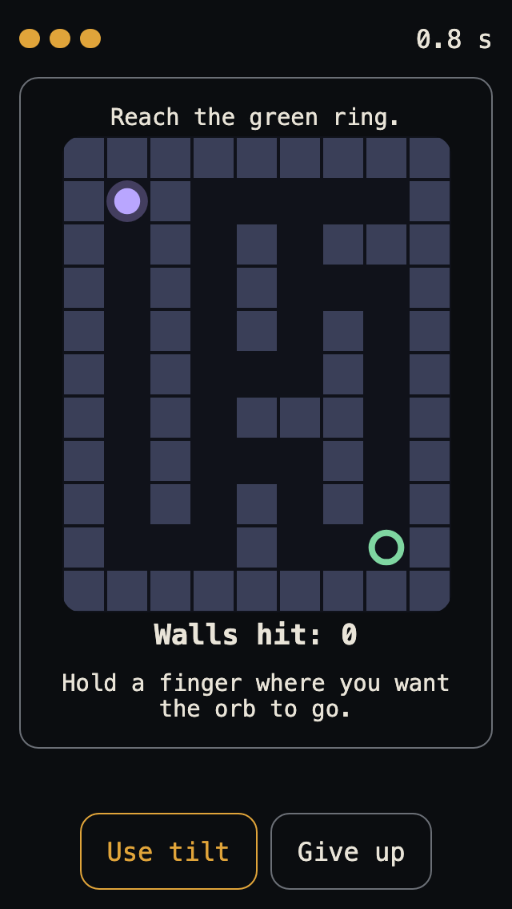
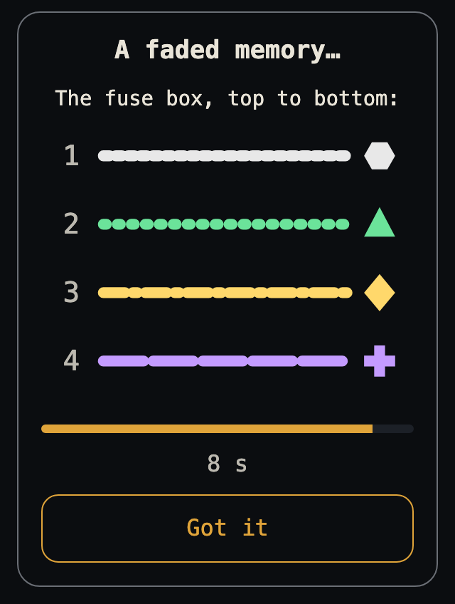
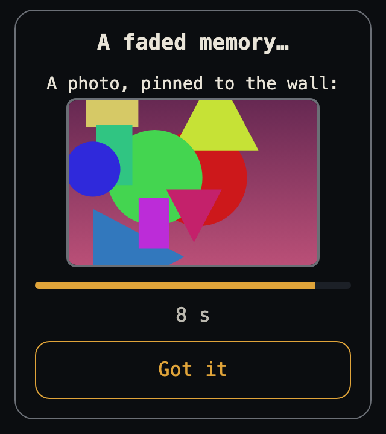
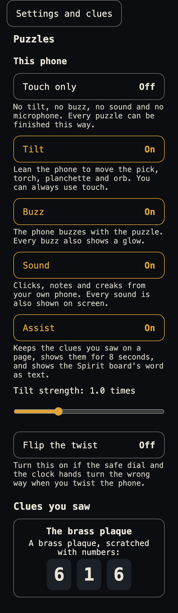

# Puzzle screens

The 11 phone screens, the clue cards and the settings page, as they look on a 320 pixel wide phone (the narrowest we
support), taken from a real headless Chromium with touch emulation at 2x pixel density. Taken at commit `fdc3fbb`.

To see them live, run the development page and open it on a phone or in a browser's phone view:

```
cd web && node_modules/.bin/vite --host 127.0.0.1 --port 5199
# then open /puzzles-demo.html?kind=safe&level=easy&seed=3   (kinds: lockpick wires clock safe musicbox candles moved photo words board maze)
```

The page is for development only and is not part of the production build.

| Screen | Picture | Notes |
|---|---|---|
| Lock pick |  | Tension, a slider or tilt, hot and cold text for the buzz |
| Cut wires |  | Drag a wire end to a terminal, or tap the wire and then the terminal |
| Clock time |  | Drag the hands, use the buttons, or twist the phone |
| Safe code |  | Turn the dial, or use the Digit buttons |
| Music box |  | Wind to hear the tune (three times at most); every key has a shape |
| Candle order |  | Watch the order, then tap the candles; Blow to snuff is optional |
| What moved |  | After the two seconds of dark: tap what changed |
| Torn photo |  | Tap to pick and turn, drag or tap a spot to place |
| Hidden words |  | Torch aimed at a letter; Pick, or tap the lit letter |
| Spirit board |  | Planchette on a letter; Pick, or tap a letter |
| Marble maze |  | Hold a finger where the orb should go, or tilt |

## Clue cards

Shown once in an earlier place (or at the Lock when it was missed).

| Wires | Clock | Safe | What moved | Torn photo |
|---|---|---|---|---|
|  |  |  |  |  |

## Settings and the clues page



The "♪ tick (muted)" line under some screens is the on-screen twin of a sound: every buzz and sound has one.
The Hidden words wall is dark on purpose: letters show only in the torch.
