# Puzzle screens

The 11 phone screens, the clue cards, the states a Player meets and the settings page, as they look on a 320 pixel wide
phone (the narrowest we support), taken from a real headless Chromium with touch emulation at 2x pixel density.
Updated after a design critique (see "What changed" at the bottom).

To see them live, run the development page and open it on a phone or in a browser's phone view:

```
cd web && node_modules/.bin/vite --host 127.0.0.1 --port 5199
# then open /puzzles-demo.html?kind=safe&level=easy&seed=3   (kinds: lockpick wires clock safe musicbox candles moved photo words board maze)
```

The page is for development only and is not part of the production build.

## The order a Player meets them in

1. A **clue card** is shown once, in an earlier place (the Sight). It is shown at the Lock only if it was missed.
2. Later, the **puzzle** opens. Five Kinds need a clue: Cut wires, Clock, Safe, What moved and Torn photo. Their prompt says what to match ("...the stopped clock you saw").
3. A clue is not shown again, because remembering it is the puzzle. With **Assist** on, the clue can be looked at again from the puzzle ("See the clue again": the clock keeps running) and stays on the Clues page.

## The clue cards

| Wires | Clock | Safe | What moved | Torn photo |
|---|---|---|---|---|
|  | 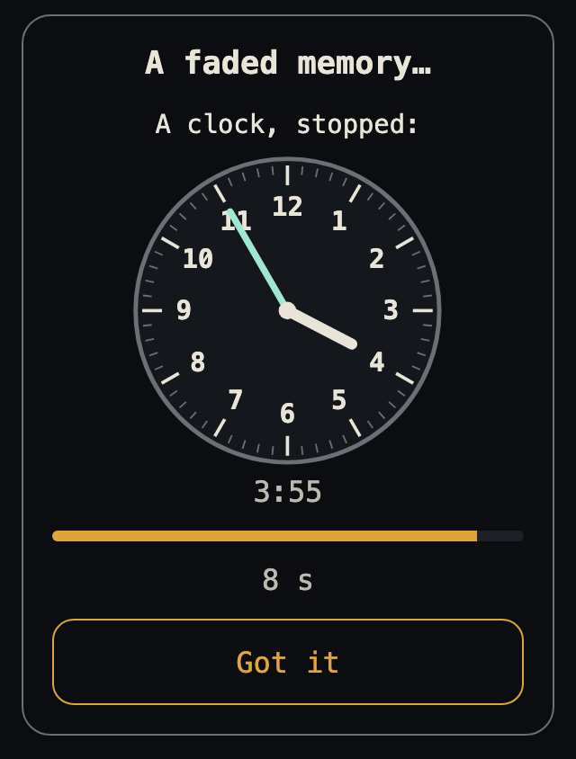 | 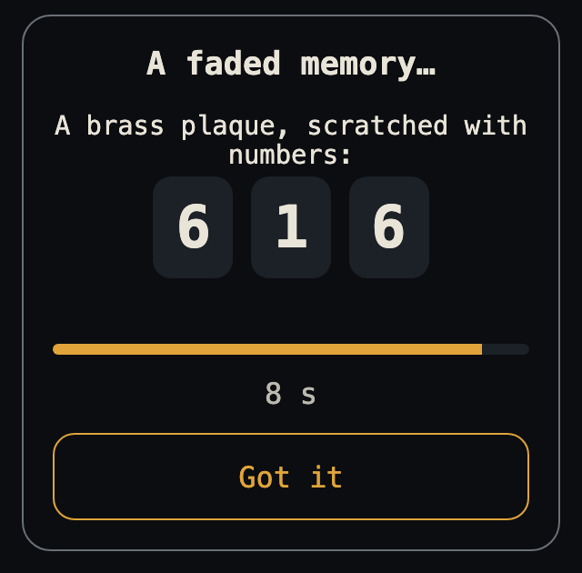 | 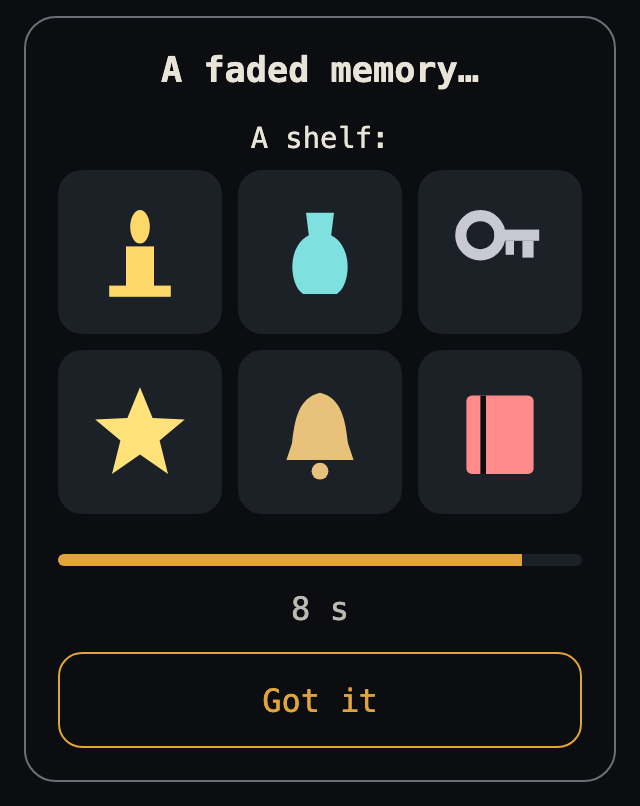 |  |

## The 11 puzzles

| Screen | Picture | Notes |
|---|---|---|
| Lock pick | 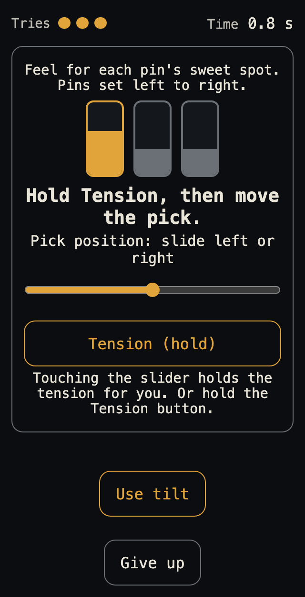 | One labelled slider, Tension, hot and cold text for the buzz |
| Cut wires | 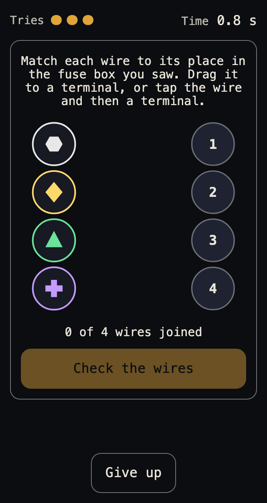 | Drag a wire end to a terminal, or tap the wire and then the terminal |
| Clock time | 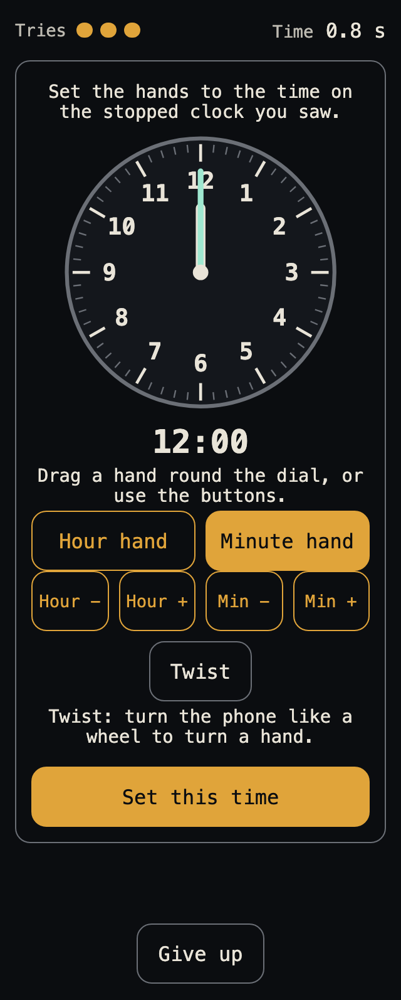 | Drag the hands, or use the buttons; Twist turns the phone like a wheel |
| Safe code | 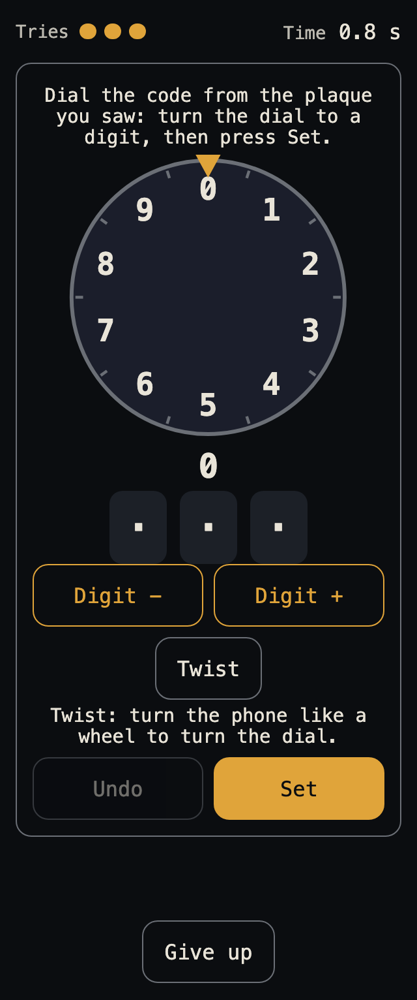 | Turn the dial, or use the Digit buttons |
| Music box |  | Wind to hear the tune (three times at most); every key has a shape |
| Candle order |  | Watch the order, then tap the candles; Blow to snuff is optional |
| What moved |  | After the two seconds of dark: tap what changed |
| Torn photo | 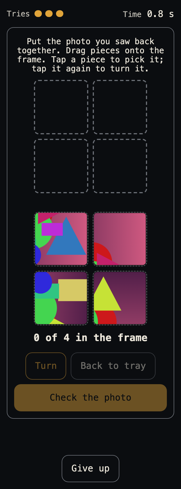 | Tap to pick and turn, drag or tap a spot to place |
| Hidden words | 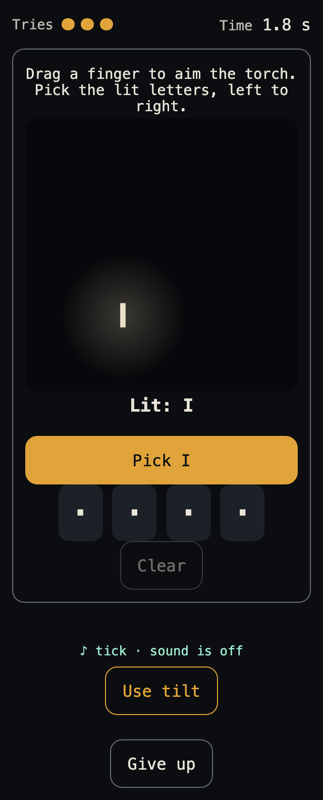 | Torch aimed at a letter; Pick, or tap the lit letter |
| Spirit board | 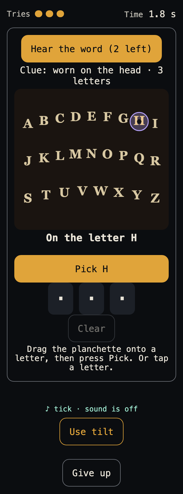 | Planchette on a letter; Pick, or tap a letter |
| Marble maze |  | Hold a finger where the orb should go, or tilt |

## States

| Joined a wire, picked another | Candles out | Picked on the shelf | Clue again (Assist) |
|---|---|---|---|
| 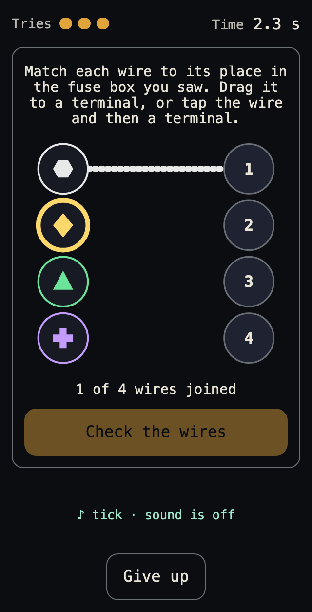 | 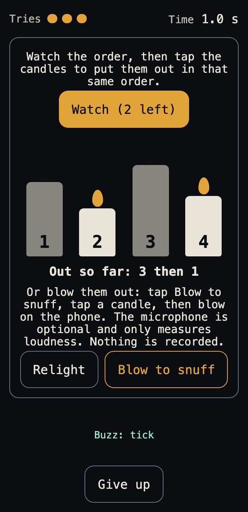 | 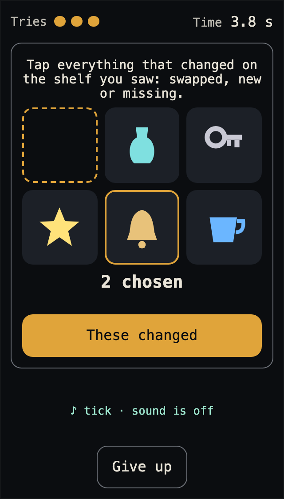 | 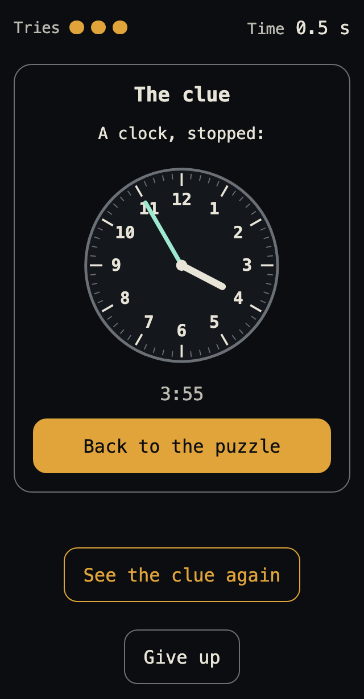 |

| A wrong answer | Giving up asks first | Opened |
|---|---|---|
| 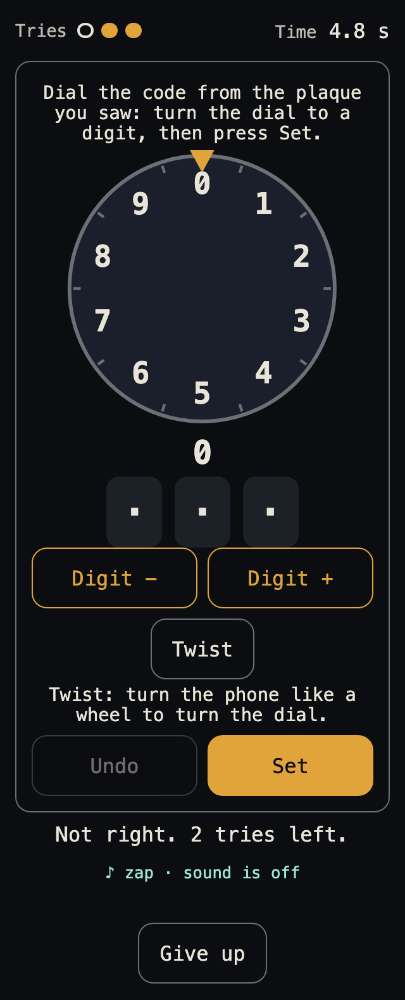 | 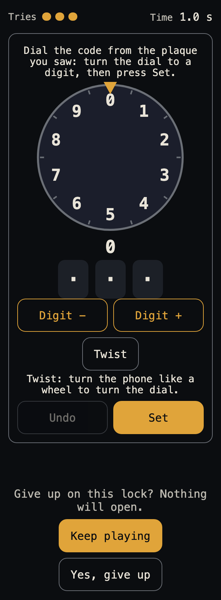 | 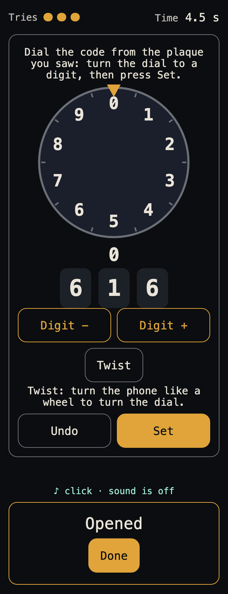 |

## The clues page and the settings

| Clues page | Settings |
|---|---|
| 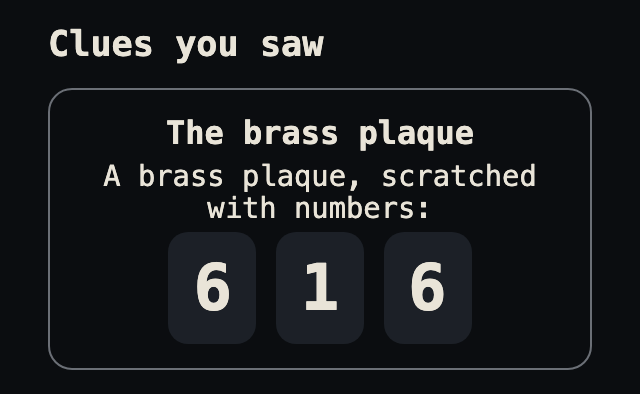 | 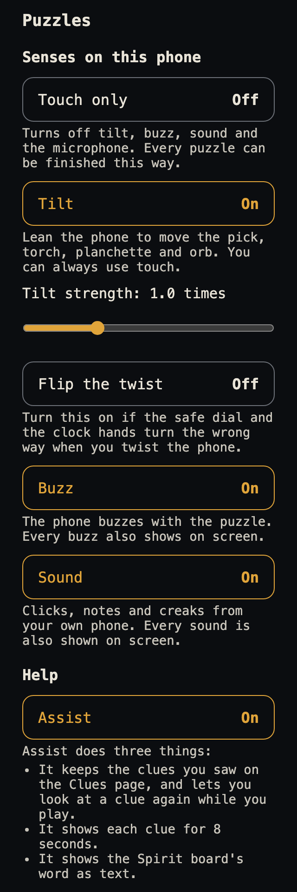 |

The "♪ tick · sound is off" line is the on-screen twin of a sound; "Buzz: tick" is the twin of a buzz. Every buzz and sound has one.
The Hidden words wall is dark on purpose: letters show only in the torch.

## What changed after the design critique

- Every Memory Kind prompt names what to match, and Assist adds "See the clue again" to the puzzle.
- Lock pick has one position control (the slider), with a visible label; the duplicate track is gone.
- Clock and Safe: the controls are in aligned groups, Twist is explained where it is used, and a "Turns the wrong way? Flip it" button sits next to it.
- The tries and the time are labelled; the sound and buzz twin lines say what they are; Give up sits apart and asks once.
- What a screen says to a screen reader is no longer drawn a second time on screen; each screen gives its instruction once.
- Candles say "Out so far: none" instead of a dot, and the microphone line sits beside its button.
- Settings are grouped (Senses on this phone, Help), and Assist lists the three things it does.
